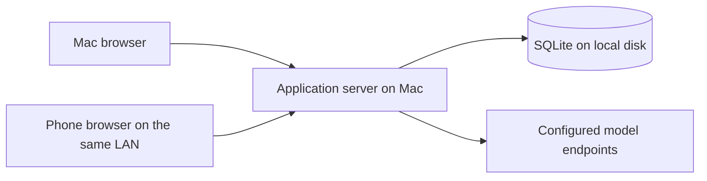

# Roleplay Engine — Implementation Guide

Date: 2026-10-16

Status: accepted technology and architecture baseline; persistent chat, roleplay libraries and durable layered compaction are implemented for local testing. The user confirmed a first roleplay response through OpenRouter on 2026-10-16. The in-app name is “ORE”; the repository remains “Roleplay Engine”. Actual phone use, real-model compaction quality and broader provider compatibility remain to be verified.

## 1. How to use this document

Read [CONCEPTS.md](CONCEPTS.md) first for product intent and accepted behavior. Follow this guide for the application's technology choices, responsibility boundaries, deployment model, and implementation sequence. Read [CONTEXT_EDITING.md](docs/CONTEXT_EDITING.md) when working on context preparation, revisions, or summary repair.

The stack approval does not accept every earlier proposal in those documents. Numerical defaults, automatic restoration rules, manual-summary authority, and agent inclusion remain open; manual preparation with saved-memory reselection is accepted below. Promotion ranking was separately accepted on 2026-10-17 as described below. This guide records the approved architecture; detailed schemas, endpoint names, package versions, and unresolved user-facing policies must be established during implementation without silently changing product requirements.

The existing [Python visualizer](docs/VISUALIZER.md) is a standalone experiment, not the application. Do not describe planned capabilities in this guide as already implemented.

## 2. Accepted stack

| Area | Choice | Purpose |
| --- | --- | --- |
| Language | TypeScript with strict checking | Shared data contracts and explicit states across the browser and server |
| Interface | React + Vite | Responsive chat, prompt editing, summary inspection, and context visualization |
| Server | Node.js on a supported LTS release + Fastify | HTTP API, static interface delivery, model transport, and generation coordination |
| Storage | SQLite on the server's local disk | Persistent conversations, configuration, summaries, selections, and generation records |
| Database access | better-sqlite3 + Drizzle | Typed queries and versioned schema migrations |
| Runtime validation | Zod | Validation of incoming commands, settings, and structured data |
| Browser communication | HTTP API + Server-Sent Events (SSE) | Commands and edits over HTTP; generated text and progress over an event stream |
| Automated verification | Vitest + Playwright | Core/persistence tests and browser workflow tests, including mobile layouts |
| Model integration | A small explicit OpenAI-compatible HTTP adapter | Inspectable request assembly, custom parameters, streaming, and cancellation |

The initial implementation uses npm, with exact dependencies in `package.json` and `package-lock.json`, and was validated with Node.js 24.19.0 LTS. Source modules live under `src/`; SQL migrations under `migrations/`. Installation, development, build, launch, and test commands are documented in [README.md](README.md). Keep future updates mutually compatible and supported.

Use one application with clear internal modules. The initial deployment does not require separate database, queue, or worker services. Keep the core independent of React, Fastify, and database drivers so context rules can be tested without running a browser or server.

## 3. Deployment and access

The Mac hosts the application server and its data. Both the Mac browser and a phone browser on the same local network access that server and the same persistent chats.

For normal use, Fastify serves the built interface and API from one origin. Vite is the development/build tool; a development or preview server is not the normal application deployment.

Provide a simple launcher that starts the application and displays its local and LAN addresses. The exact launcher format, port, installation packaging, and optional start-at-login behavior remain to be selected. LAN access requires an appropriate listening address and host network permissions. Do not assume that localhost on a phone refers to the Mac.

The Mac must remain awake and the server running for phone access and ongoing generation. Browser disconnection is different from server suspension or shutdown.

Include a single-owner login for LAN use. Saved model credentials stay on the server and are excluded from ordinary API responses, request previews, logs, and ordinary exports. Credential entry is an explicit settings operation; do not send saved secrets back merely to display a Connection. HTTPS setup must be settled before routine phone use. Certificate setup, session details, and credential storage protection remain implementation decisions; this document does not select a particular proxy or secret store.

The interface must work on desktop and phone screens, including chat input, scrolling, editing, and request inspection. Mobile emulation is useful but does not replace checking the actual phone browser, especially keyboard behavior and reconnecting after suspension.

## 4. Responsibility boundaries

| Module | Owns | Boundary |
| --- | --- | --- |
| Core engine | Turn rules, prompt resolution, context budgeting, summary selection, and coverage validation | Operates on explicit data and state; does not depend on web or database frameworks |
| Persistence | Turns and revisions, configuration, summaries and dependencies, committed selections, generation records, and operation progress | Implements durable reads, migrations, and transactional writes |
| Generation coordinator | Preparation, model calls, cancellation, revision checks, per-chat coordination, and recovery | Orchestrates work without embedding context policy in HTTP handlers |
| Provider adapter | Provider request encoding, response/stream decoding, errors, and transport cancellation | Does not own the history cutoff or choose summaries |
| Web interface | Editing, previews, progress, and recovery controls | Displays server state; does not become the authority for completed turns or selected context |

Keep reusable Connection settings, prompt arrangement, context configuration, chat state, and any future agent output separate. Shared TypeScript contracts describe safe browser/server data; server-only credentials and persistence internals must not become public response fields by accident. Zod validates actual runtime inputs in addition to compile-time checking.

The server remains authoritative when both devices are open. Coordinate mutations per chat and verify revisions before applying asynchronous results. Browser button disabling alone cannot enforce the rule that only the latest turn may be pending.

## 5. Persistence and transaction rules

Use SQLite on the Mac's local disk, with WAL mode and short write transactions. Phone access goes through the API, never through a shared database file. A synchronous database driver is acceptable for this initial workload; keep database work bounded and avoid long operations that stall the server.

Persist enough information to recover the actual committed state, including:

- Stable turn and part identities, source revisions, and completion state independent of text length.
- Saved summaries, their revisions, source membership, and dependencies.
- Selected summary identities/revisions and the verbatim cutoff, separately from the set of summaries that merely exist.
- The effective context configuration and relevant chat/selection revision used by preparation.
- Credential-free generation records containing resolved messages, effective parameters, coverage, and the outcome or interruption state.
- Operation identity and progress needed to distinguish a retry from new work.

These are persistence responsibilities, not a finalized table schema. Revision retention, branching representation, and record retention limits remain open.

Accepted greeting behavior (implemented in the library milestone): initialize a chosen character greeting as a completed opening turn with an empty user part and a copied assistant part, using ordinary stable identities and revisions. Later changes to the reusable greeting must not rewrite existing chats. The first user action creates the next turn. Render no empty user bubble and omit the blank user part from outgoing input. Apply ordinary editing, whole-turn deletion, summary dependencies, and completed-turn counting for `B` and `L`; see [Character greeting as an opening turn](CONCEPTS.md#character-greeting-as-an-opening-turn). A copied greeting is saved history and does not require a model generation to become complete.

For a compaction replacement:

1. Read the selected state and capture the relevant source, configuration, and selection revisions.
2. Call the summarizing model outside a database transaction.
3. Validate the candidate and its token savings.
4. In a short transaction, check that the captured revisions still match, save the replacement, and switch exactly its covered selection. Advance the verbatim cutoff only when replacing source turns.
5. Retain the original turns and lower-level summaries, then remeasure the request before deciding whether more compaction is necessary.

If the sources changed while the model was working, an obsolete result must not become active. Failed writes must not leave source content excluded without a saved replacement. Retries must not create duplicate coverage or advance the cutoff twice. Completed compaction steps remain available if a later step fails.

Restarting the server must load the committed selection rather than reconstructing a different tree from transcript length or token totals.

Backups must capture a consistent database snapshot, including any required associated files. Do not treat copying only the main database file during active WAL writes as a complete backup. Backup scheduling, retention, destination, and treatment of credentials remain open. Verify restore behavior before describing backups as dependable.

## 6. Generation and streaming

Generation is a server-owned operation with an identity and saved state. A browser subscribes to progress; its connection does not own the operation's lifetime.

The intended flow is:

1. Validate the command and save a pending turn only if the chat has no unresolved turn.
2. Capture the relevant revisions and resolve required prompt content sufficiently to measure the complete input budget.
3. Prepare historical context from the committed selection, saving each valid replacement before changing coverage.
4. Assemble and validate the final request, then save its credential-free generation record.
5. Call the configured model and publish generated text and progress through SSE.
6. Verify that the result still belongs to the intended operation and conversation state, then persist the completed response in the same turn.

Failures and explicit cancellation leave the turn pending under the accepted turn rules. Whether partial or empty generated output can be explicitly accepted is unresolved. Do not equate an empty string with an unfinished turn or automatically complete an interrupted response.

When the phone locks or the browser disconnects, generation continues while the server remains operational. On reconnect, the client retrieves current saved state and resumes observing any active operation. SSE reconnection alone is not a persistence or replay mechanism; the implementation must reconcile the browser with the server's operation state.

Cancellation is an explicit command, separate from losing the event connection. Prevent late results from a cancelled or superseded operation from overwriting newer state. Define partial-output checkpoint frequency during implementation rather than promising that every streamed token survives a crash.

On server restart, identify interrupted operations and expose recovery. Preserve committed summaries and the pending turn. Do not claim that an interrupted provider stream can resume, or silently issue a duplicate model request with potentially repeated cost. A retry must refer to the existing pending turn.

Agent execution before or after generation remains conditional on a future decision to include that feature. This flow does not settle proactive context preparation or permission to generate with stale memory.

## 7. Context-engine implementation contract

Follow the accepted rules in [CONCEPTS.md](CONCEPTS.md) and the stateful contract in [CONTEXT_EDITING.md](docs/CONTEXT_EDITING.md). In particular:

- Treat the target working input size as a ceiling, separately from the Connection's physical limits. Include pending input, resolved prompt content, and protocol overhead. Reserve output against combined physical windows without subtracting it twice from an input-only target.
- Preserve all history verbatim while the assembled request fits. Under pressure, summarize only complete oldest batches of exactly `B` turns, retaining at least `L` completed turns and all residual turns that cannot form a valid batch.
- Stop compaction as soon as the request fits. Consider summary promotion only when no complete first-layer batch is eligible and the request still overflows.
- Fail if required verbatim and non-summary input cannot fit. Do not silently reduce `L`, change `B`, exceed the target, or omit history.
- Carry forward the committed selection. In ordinary continuation, inactive children do not return just because space becomes available. Retain unused capacity when necessary for stability.
- Explicit Prepare chat first re-plans using approved fresh saved representations, reusing fixed turn batches and pressure-ranked eligible saved parents. Restore recent detail first and preserve chronological levels (older spans at least as compact as newer ones). Protect direct manual corrections through coverage children; allow generated parents to expand while retaining those corrected children. Prior-context dependencies still invalidate consumers on edits, but do not freeze their representation. A direct edit blocks restoring its own span to original turns. Restore an incompatible completed-tail cutoff before compression; never fall back to that invalid boundary. Report a direct correction/tail conflict with its range and required minimum. Retain saved content and atomically save selection plus before/after history with the job. A fitting result ends without model requests; unavailable groups leave an already fitting selection unchanged. Otherwise continue from committed state, reusing exact saved replacements before generating missing summaries. Automatic and single-step preparation reuse saved replacements without expanding existing history. Resolve the summarization Connection only when a provider request is needed; source revisions, exact coverage/dependencies and complete-request savings govern reuse.
- Emit coverage in conversation order, without overlapping parent/child representations or unexplained gaps. Promotion eligibility also rejects a parent deeper than an older selected span. Historical irregular selections remain inspectable and can be reconsidered by manual Prepare. The optional reselection `limitation` field explains retained corrections or unavailable saved groups; old job records remain readable without it. Manually edited timeline boxes use an amber accent and accessible wording in addition to their active/retained/stale status.
- Track source revisions so archived edits invalidate affected summaries and their dependents. Structural freshness does not guarantee narrative consistency.

Port accepted state-transition behavior from `experiments/compaction/compaction_model.py` into the TypeScript core. Compare the same synthetic scenarios across the reference model and the port, including checkpoint continuation and the 301-to-302 stability regression. The visualizer's promotion formula is accepted as the initial application policy on 2026-10-17; numerical defaults remain illustrative. Rank with actual active-summary token totals, respect fixed groups and retained floors, validate net savings before commit, and remeasure after each replacement. Keep the decision replaceable without building a general plugin system; unequal sizes do not establish semantic quality or guarantee that every candidate shrinks.

On 2026-10-17 the user requested carrying over the non-simulation settings: target input, minimum tail, fixed turn batch, requested summary size, promotion group and retained summaries per source level. The implementation measures resolved non-history input and actual summary output rather than retaining the lab's fixed token assumptions. Summarization has a separately selected reusable Connection and separate editable first-layer/promotion prompts that request independently understandable narrative summaries. Starting values match the lab; they are adjustable, not validated quality defaults. Summary size is a soft instruction target, and the Connection's `max_tokens` remains the actual output reservation. Up to three preceding selected summaries are supplied when they fit and are recorded as explicit dependencies. Sources are never silently shortened to fit.

A summary-output validator and model-call gate are implemented in `src/core/summary-validation.ts` and `src/server/summarizer.ts` and used by the context coordinator. The provider adapter exposes completion reasons and rejects explicit refusal/filter metadata. The gate rejects obvious refusals, placeholders, empty/non-text output, repetition loops, length-limited or incomplete output and cancelled results, returning safe errors without silent retries. Persistence additionally verifies captured part revisions, chat/configuration revisions, coverage and complete-request savings before the save-and-select transaction. Ordinary roleplay responses do not use summary-text heuristics; their existing acceptance of a `length` finish reason is unchanged.

Actual text lengths, model errors, persistence, revision conflicts, and summary quality require additional validation. Synthetic arithmetic does not establish semantic recall or faithful summarization.

## 8. Model connections and token measurement

Start with an explicit OpenAI-compatible HTTP adapter, honoring the selected endpoint, model, token limits, and supported custom JSON parameters. The exact initial API dialect and supported endpoint subset must be documented during implementation; OpenAI-compatible services are not assumed to behave identically. Anthropic-compatible support remains a possible later addition.

Keep request assembly inspectable. The generation preview must show the messages and effective parameters actually used after resolution and parameter handling, with credentials removed. Define custom-parameter precedence and protected fields before exposing overrides; user JSON must not silently replace assembled history.

The final user-approved counting policy on 2026-10-17 uses **one `cl100k_base` reference tokenizer for every model**. This supersedes the earlier per-model registry and byte fallback. Use the pinned `gpt-tokenizer` encoding directly in the framework-independent core, with a bounded text-count cache and a small shared framing allowance. There are no model mappings, tokenizer downloads or per-model assets. No character divisor or observed provider ratio is generalized.

Apply the same counter to complete roleplay requests, prompt allocations, promotion ranking, summary savings and the separate summarization Connection’s input-window/prior-context checks. Remeasure complete input after each saved replacement. Enforce the working target against the reference estimate, accepting modest differences from actual endpoint token counts. Keep the physical context window and reserved output as separate checks; approximate counting cannot guarantee exact remote limits. Existing committed selections remain stable.

Browser previews and Memory plans use the authoritative server calculation and ignore superseded responses. Save the method, tokenizer, implementation version, framing assumption and verification limits with new requests. Preserve older request bodies, estimates and endpoint usage; endpoint counts are separate post-request observations, without automatic verification or calibration. The normal UI uses existing ‘Estimated input’ wording and does not add tokenizer names or repeated technical notes. Detailed metadata remains inspectable in saved records and developer documentation. Connection checks and the optional test message are explicit remote actions and do not write chat turns, request history or settings. Tests use the current Connection's configured output reservation without a separate diagnostic cap; empty/incomplete response errors offer another test without implying saved pending work. See [README.md](README.md) and [TOKEN_COUNTING.md](docs/TOKEN_COUNTING.md).

## 9. Implementation sequence and acceptance checks

### First milestone: one persistent chat

Implement one Connection, one persistent chat, streamed responses, and an inspectable request preview, with only enough prompt/character/persona support to exercise that flow. Establish the shared core, persistence, and server boundaries without building all editors first.

Validate that:

- Both devices see the same saved chat and response.
- A pending turn blocks another submission, including concurrent requests from two devices.
- Intentional blank edits preserve completion and turn membership.
- A phone disconnect does not cancel generation; reconnecting retrieves its state.
- Cancellation and server interruption leave a recoverable pending turn.
- The preview agrees with the assembled provider request and excludes credentials.

Implementation status on 2026-10-16: these flows are implemented with one Connection, one persistent chat, owner login, a minimal fixed prompt order, full verbatim history, and request inspection. Vitest checks core limits and validation, persistence, concurrent commands, blank edits, cancellation, disconnected observers, explicit retry, graceful interruption, a real process crash, and single-server database ownership. Playwright exercises separate desktop and phone-sized sessions, including shared state, streaming, reconnecting, cancellation/retry, blank edits, and exact request-body inspection. Tests use a synthetic local endpoint and temporary databases. The user subsequently confirmed a first response through OpenRouter on 2026-10-16. HTTPS certificate provisioning, a real phone browser/keyboard/suspension check, and broader provider compatibility remain unverified; see [README.md](README.md).

### Second milestone: usable roleplay libraries and imports

The user explicitly moved this work ahead of context management on 2026-10-16 and requested implementation. Provide persona and character libraries with import/create/edit, a block-and-marker Prompt library/editor, name preprocessing, multiple persistent chats with independent selections, and file-based replacement of all messages in one chat. Full V2 behavior/lorebooks and branching are deferred.

Implementation behavior:

- Reuse the accepted stack and module boundaries. Core modules resolve prompts and normalize external formats; persistence owns library revisions, chat selections and transactional history replacement; generation remains server-owned.
- Character import reads V1/V2/V3 JSON and PNG-embedded text metadata (V3 basic-field compatibility was added on 2026-10-17). Edit the six basic fields: name, description, personality, scenario, greeting (`first_mes`) and example dialogue (`mes_example`). Retain unsupported imported fields and the imported V3 format for export but do not execute lorebooks, extensions or prompt overrides. Prefer ccv3 PNG metadata over legacy chara when both exist. Persona import reads SillyTavern backup JSON and basic name/description JSON. Export cards/personas as compatible JSON; exporting an avatar PNG is outside this subset.
- Prompt blocks carry stable identities, enabled state, roles, and either text or a marker. Support whole character, persona, individual character fields, Messages and Summary sources. Messages and Summary are optional (at most one enabled marker each); empty presets are valid. Summary inserts selected memory, and Messages inserts managed verbatim history when Summary is enabled, or bounded recent whole turns when it is absent/disabled. Preserve stored message roles rather than using the marker's role. The context component owns the shared managed selection; the Summary-off suffix is calculated per request without changing saved memory.
- Replace case-insensitive `{{user}}` and `{{char}}` once in text blocks and character/persona fields. Names are inserted literally; unknown macros remain literal. Preserve stored conversation text. Resolve a greeting once when creating a chat, then save it as ordinary completed history under the accepted greeting rules. Compatibility is implemented independently from the documented behavior; no SillyTavern engine source is copied.
- Keep an editable built-in default with a restore action, alongside user-created/duplicated presets. The default and independent new-prompt template contain Instructions, Character, Persona, Summary and Messages, in that order. Generic missing-marker warnings are advisory. Empty resolved input fails before a provider call; the eventual instruction wording remains open.
- The interface uses shared styled dropdowns and checkboxes. Prompt blocks collapse independently and show an insertion line during reordering. Numeric fields allow an empty editing draft and validate positive integer limits when saved. Model discovery optionally reads the OpenAI-compatible `/models` endpoint through the server, using an entered or saved credential without returning it to the browser; model identifiers remain editable.
- Trim boundary blank lines from submissions, successful responses, copied greetings and part edits while preserving internal formatting. Do not rewrite existing/imported history. Reject blank submissions and keep whitespace-only generated responses pending.
- Any idle chat may be deleted, including the original/final chat. Do not recreate deleted starter chats on restart. Keep the Chats library open after deletion and support creating a new chat when the library is empty.
- Each chat selects reusable records by identity and owns its input target, turns, revision and generation records. Saved shared edits affect future requests in selecting chats and advance their revisions. Block shared edits while a response is running; do not rewrite saved requests or greetings. Pending turns and active-generation uniqueness are enforced per chat.
- Upgrade the version-1 database transactionally, preserving existing turn/part identities, revisions, credentials and generation records, and migrating existing inline text to reusable records. Acquire database-process ownership before upgrading an existing database.
- Stream-read chat files in the browser and extract active `mes` values in order, avoiding upload/storage of foreign memory snapshots, alternate swipes or summary metadata. Preserve all active messages even if foreign `hiddenFromAI` flags reflect old compaction. Pair ordinary user/assistant messages; keep consecutive same-speaker entries as separate turns with empty opposite parts, as accepted by the user. Only a final unmatched user entry remains pending. Reject unsupported system entries and malformed input without changing the chat.
- Show replacement counts before the user invokes Replace all messages. Validate normalized turns again on the server, check the selected chat revision and running state, then replace its turns and associated generation records atomically. Keep chat selections; do not prepend another greeting. The original import file is read-only. See README for bounded file/transcript sizes.

Validation covers card preservation and PNG parsing, name substitution and prompt roles/order, protected history markers, greeting copy semantics, separate same-speaker turns, failed/stale replacement, database migration, credential exclusion, independent concurrent chat generations, and browser workflows on desktop/phone-sized screens. The supplied approximately 61 MB example was read-only normalized to 498 messages / 253 turns; no original conversation was used for destructive testing. Actual phone use and full provider/card ecosystem compatibility remain unverified.

### Third milestone: durable layered compaction

Port and validate the stateful core, then connect real summarization and transactional persistence using the established roleplay workflow and request inspector.

The user clarified the milestone's priority on 2026-10-17, accepted the design recommendations, then requested implementation. It prepares ongoing imported sessions directly from their transcript with separate summarization Connection/prompt selections, the lab's non-simulation controls and promotion ranking, budget/batch previews, saved progress with stop/resume, and a layered viewer. Preparation is not a replay of historical provider requests.

Implementation behavior:

- Version 3 migrates existing databases under process ownership, adding durable selections, versioned summaries, context jobs and request/step snapshots. Existing chats remain verbatim until a context preset is selected. Replacing history clears dependent memory and jobs in the same transaction as replacing turns.
- The core validates ordered, non-overlapping selected coverage and dependency freshness. Persist only the active selection/cutoff separately from retained lower representations. A new summary must reduce the fully assembled roleplay input; failed writes roll back both the summary and the selection.
- Explicit preparation and automatic preparation before a response share the server-owned coordinator. Only one workflow per chat can mutate context; other chats remain independent. Shared library edits are blocked during running work. Cancellation retains committed steps, restart marks unfinished work interrupted, and retries require an explicit command with idempotent identities.
- Summary and Messages markers resolve from one managed selection only when Summary is enabled; summaries are never inserted implicitly. Without Summary, Messages selects a contiguous newest suffix of whole original turns within the complete input target and physical limits, ignoring the saved cutoff. Preserve required pending input when Messages is enabled; fail if fixed content plus pending input cannot fit. Missing Messages inserts no turns. Summary-off requests and plans ignore unused stale memory, never generate summaries, and leave saved memory untouched. Server preparation/repair commands reject this mode with a clear disabled status; re-enable Summary and Prepare to resume. Roleplay generation records capture selected summary identities/revisions and archived-turn membership as well as original turn revisions; request bodies remain immutable and credential-free.
- The user chose targeted repair with review and subsequently approved a continuous **Repair summaries** session. Repair follows current child and prior-context dependencies required by selected memory, saves one unselected candidate at a time, and exposes remaining/approved counts. **Approve & Next** atomically saves corrected text and advances the job before generating the next candidate; **Approve & Finish** completes the queue. Commands carry durable idempotency identities. **Regenerate** retains a still-valid candidate until replacement succeeds; an obsolete candidate cannot become approvable through a failed retry. **Close** cancels any running request and discards unapproved candidates and local edits while preserving approved replacements. Reopening generates fresh work. Approval checks captured revisions; fresh approved children are used by later parent repairs. All selected stale memory blocks continuation.
- Minimal repair uses the separately editable repair prompt and the existing summary plus identified before/after changes to its incorporated turn parts, child summaries and original prior dependencies. Do not re-run extraction/compression instructions or select new prior context during repair. Include all changed inputs or fail before a provider call. Historical first-layer source text is recovered from immutable saved requests; new repair records retain a complete local source baseline outside the provider body for subsequent repairs. Older presets/imports receive the new default field on read/validation without rewriting saved records, revisions or requests; explicit edits use ordinary library revision checks.
- Revision freshness stays conservative. During an explicit repair session, compare actual consumed content and ordered coverage/dependency membership. Revalidate unchanged inputs transactionally as a new approved version without a model call, preserving manual flags and selected coverage. Exactly identical validated model output can also save automatically when the baseline is known and structure is unchanged; all changed text and coverage changes await review. Save distinct `inputs_unchanged` and `model_unchanged` step outcomes and separate counters. Continue every direct consumer of a changed source, including prior-context consumers; no blanket downstream freshness reset is permitted. Preserve approved progress on stop/error, reject stale/cancelled results and avoid automatic paid retries. Summary-off mode still forbids all repair work.
- Review uses an on-demand CodeMirror merge editor with matching read-only/editable prose panes, aligned unchanged text, a shared scroll area, change navigation, optional unchanged-line collapse and an expandable source/prior-context comparison from saved requests. Phone layouts use unified changes. HTML responses carry a fresh style nonce for the editor’s generated styles; scripts remain restricted to the application origin. Diff computation has a bounded detailed scan/time before falling back to coarser highlighting; candidate text retains the existing size limit. No semantic matching or automatic acceptance is implied. Unapproved summary text is deleted on dismissal or successful regeneration, while request/step outcomes and approved summary versions remain inspectable.
- Direct manual summary edits create new approved versions, retain old ones and invalidate dependents. They do not update source revision links. Entirely deleted coverage proposes a reviewed tombstone without a model call. Still-present blank batches are retained; unusable or non-shrinking model output fails rather than omitting them.
- The Memory page shows active, retained, preparing and stale spans, source inspection, budget/status and the latest 20 jobs with request snapshots. Historical views retain their original turn membership and do not mutate current selections. Clear memory deletes every summary version, review candidate and preparation record atomically, returning turns to verbatim while keeping original turns, preset selection and roleplay generation records. Changed settings preserve selections; a protected-tail conflict can be resolved by explicit Prepare chat when saved representations permit, explicit adjustment, or clearing memory. Manual Prepare records the initial saved-memory reselection and its measured before/after state in the job, followed by reused or generated summary steps and a final saved-only selection pass when steps have occurred. Persist a changed final pass as a separate history frame; this makes a subsequent identical click stable. Saved reuse has no request body, never rewrites summary records and retains the original model request for later repair. Counts distinguish reuse from successful summary generation, and completed jobs retain their final measured input/verbatim count. Prior Refresh history remains readable. Automatic partial restoration is deferred.

- Version 5 performs a transactional data upgrade: add Summary only to the exact old factory default, advance its revision and selecting chats/library revisions, and preserve edited defaults, user presets, summaries and immutable requests. New/restored prompts use the complete factory template. Request metadata records managed/recent mode and actual verbatim membership so Story, Memory and previews use the same selection.
- Version 4 adds nullable provider-reported token usage to generation records. Streaming requests ask for usage by default; Connections can disable this for incompatible endpoints. Missing or invalid counts remain unavailable. Counts describe the saved attempt and survive later text edits.
- The Story sidebar and prompt peek use the shared request assembler for current estimates and message attribution, including unsent text. Inspection can show overflow or stale memory without bypassing server generation checks. Current request inspection updates with saved settings; selected historical records keep their original budgets. Memory recomputes its plan from each current snapshot and places old failures in saved preparation history.

Use Vitest for core and persistence tests covering fixed batches, protected tails, residual turns, limit separation, coverage, selection stability, and checkpoint continuation. Add failure and interruption tests around the save-and-select transaction, safe retries, edits during generation, and stale-result rejection.

Use synthetic or copied conversations to inspect summary quality against known story facts. Report structural correctness separately from semantic quality. Resolve relevant repair and restoration policies before implementing their user-facing behavior.

### Subsequent interface work

Expand summary inspection/editing around the verified compaction flow and its initial layered visualization; extend the existing libraries only as needed for accepted product requirements. Use Playwright for meaningful end-to-end workflows and responsive layouts, with actual phone checks for platform-specific behavior.

These are implementation priorities, not a delivery schedule. The application build and its core/server/browser tests now exist and pass; commands are documented in [README.md](README.md). Existing simulator validation commands remain in [VISUALIZER.md](docs/VISUALIZER.md), and that isolated experiment is unchanged.

## 10. Decisions still to resolve

The product questions in [CONCEPTS.md](CONCEPTS.md) remain authoritative. Stack approval specifically leaves these areas open:

- Future summary schemas, revision retention, regeneration, branching, and additional imported-history formats. Consecutive same-speaker conversion is now settled for the initial JSONL importer.
- Quality tuning of numerical starting values, prompts, prior-context policies and any operational headroom. The implemented output-size control is a soft target with physical output reservation owned by the summarization Connection.
- Automatic partial restoration after deletion or settings changes; any future stale-memory override; semantic authority for conflicting manual additions and creating entirely handwritten coverage. Targeted repair review, direct corrections, manual preparation and explicit full restoration are implemented.
- Entirely blank summary batches and acceptance of partial or empty generated responses. The user decided that blank saved parts are omitted from outgoing requests while their completed turns remain stored.
- Future shared-record pinning/copy behavior. Summarization now requires a separately selected reusable Connection. The library milestone uses shared records for subsequent requests while preserving saved requests and greetings.
- Product agents in the first release, their triggers, and missing marker/output behavior.
- Additional provider dialects/custom parameters. All models use the shared reference tokenizer by user decision; exact endpoint counts and framing remain unverified. The Chat Completions subset and protected request fields are documented in [README.md](README.md).
- HTTPS certificate provisioning/trust, stronger credential storage protection, distribution packaging, and optional automatic startup. A local launcher and owner sessions are implemented; routine actual-phone use awaits HTTPS setup and verification.
- Backup cadence, retention, restore UX, and generation-record retention.

Do not treat these as reasons to delay independent implementation work. Resolve a question before implementing behavior whose outcome materially depends on it, and record accepted decisions in the relevant documentation.

## 11. Technical references

- [SillyTavern personas and backup behavior](https://docs.sillytavern.app/usage/core-concepts/personas/)
- [SillyTavern name macro syntax](https://docs.sillytavern.app/usage/core-concepts/macros/)
- [Character Card V2 field specification](https://github.com/malfoyslastname/character-card-spec-v2)
- [React: building an application with a build tool](https://react.dev/learn/build-a-react-app-from-scratch)
- [Vite: building for production](https://vite.dev/guide/build)
- [Fastify: TypeScript](https://fastify.dev/docs/latest/Reference/TypeScript/)
- [Drizzle: SQLite drivers](https://orm.drizzle.team/docs/sqlite/get-started-sqlite)
- [SQLite: write-ahead logging](https://sqlite.org/wal.html)
- [Zod: runtime validation](https://zod.dev/)
- [Vitest: features](https://vitest.dev/guide/features)
- [Playwright: device emulation](https://playwright.dev/docs/emulation)

These references explain the selected tools. Product decisions and implementation requirements are defined by this repository's documentation and the user's subsequent instructions.
