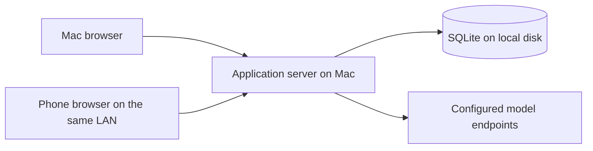

# Roleplay Engine — Implementation Guide

Date: 2026-10-16

Status: accepted technology and architecture baseline; persistent chat, roleplay libraries and durable layered compaction are implemented for local testing. The user confirmed a first roleplay response through OpenRouter on 2026-10-16. The in-app name is “ORE”; the repository remains “Roleplay Engine”. Actual phone use, real-model compaction quality and broader provider compatibility remain to be verified.

## 1. How to use this document

Read [CONCEPTS.md](CONCEPTS.md) first for product intent and accepted behavior. Follow this guide for the application's technology choices, responsibility boundaries, deployment model, and implementation sequence. Read [CONTEXT_EDITING.md](docs/CONTEXT_EDITING.md) when working on context preparation, revisions, or summary repair.

The stack approval does not accept every earlier proposal in those documents. Numerical defaults, automatic restoration rules, manual-summary authority, and agent inclusion remain open; manual preparation with saved-memory reselection is accepted below. Promotion ranking was separately accepted on 2026-10-17 as described below. This guide records the approved architecture; detailed schemas, endpoint names, package versions, and unresolved user-facing policies must be established during implementation without silently changing product requirements.

The existing [Python visualizer](docs/VISUALIZER.md) is a standalone experiment, not the application. Do not describe planned capabilities in this guide as already implemented.

## 2. Accepted stack

| Area | Choice | Purpose |
| --- | --- | --- |
| Language | TypeScript with strict checking | Shared data contracts and explicit states across the browser and server |
| Interface | React + Vite | Responsive chat, prompt editing, summary inspection, and context visualization |
| Server | Node.js on a supported LTS release + Fastify | HTTP API, static interface delivery, model transport, and generation coordination |
| Storage | SQLite on the server's local disk | Persistent conversations, configuration, summaries, selections, and generation records |
| Database access | better-sqlite3 + Drizzle | Typed queries and versioned schema migrations |
| Runtime validation | Zod | Validation of incoming commands, settings, and structured data |
| Browser communication | HTTP API + Server-Sent Events (SSE) | Commands and edits over HTTP; generated text and progress over an event stream |
| Automated verification | Vitest + Playwright | Core/persistence tests and browser workflow tests, including mobile layouts |
| Model integration | A small explicit OpenAI-compatible HTTP adapter | Inspectable request assembly, custom parameters, streaming, and cancellation |

The initial implementation uses npm, with exact dependencies in `package.json` and `package-lock.json`, and was validated with Node.js 24.19.0 LTS. Source modules live under `src/`; SQL migrations under `migrations/`. Installation, development, build, launch, and test commands are documented in [README.md](README.md). Keep future updates mutually compatible and supported.

Use one application with clear internal modules. The initial deployment does not require separate database, queue, or worker services. Keep the core independent of React, Fastify, and database drivers so context rules can be tested without running a browser or server.

## 3. Deployment and access

The Mac hosts the application server and its data. Both the Mac browser and a phone browser on the same local network access that server and the same persistent chats.

For normal use, Fastify serves the built interface and API from one origin. Vite is the development/build tool; a development or preview server is not the normal application deployment.

Provide a simple launcher that starts the application and displays its local and LAN addresses. The exact launcher format, port, installation packaging, and optional start-at-login behavior remain to be selected. LAN access requires an appropriate listening address and host network permissions. Do not assume that localhost on a phone refers to the Mac.

The Mac must remain awake and the server running for phone access and ongoing generation. Browser disconnection is different from server suspension or shutdown.

Include a single-owner login for LAN use. Saved model credentials stay on the server and are excluded from ordinary API responses, request previews, logs, and ordinary exports. Credential entry is an explicit settings operation; do not send saved secrets back merely to display a Connection. HTTPS setup must be settled before routine phone use. Certificate setup, session details, and credential storage protection remain implementation decisions; this document does not select a particular proxy or secret store.

The interface must work on desktop and phone screens, including chat input, scrolling, editing, and request inspection. Mobile emulation is useful but does not replace checking the actual phone browser, especially keyboard behavior and reconnecting after suspension.

## 4. Responsibility boundaries

| Module | Owns | Boundary |
| --- | --- | --- |
| Core engine | Turn rules, prompt resolution, context budgeting, summary selection, and coverage validation | Operates on explicit data and state; does not depend on web or database frameworks |
| Persistence | Turns and revisions, configuration, summaries and dependencies, committed selections, generation records, and operation progress | Implements durable reads, migrations, and transactional writes |
| Generation coordinator | Preparation, model calls, cancellation, revision checks, per-chat coordination, and recovery | Orchestrates work without embedding context policy in HTTP handlers |
| Provider adapter | Provider request encoding, response/stream decoding, errors, and transport cancellation | Does not own the history cutoff or choose summaries |
| Web interface | Editing, previews, progress, and recovery controls | Displays server state; does not become the authority for completed turns or selected context |

Keep reusable Connection settings, prompt arrangement, context configuration, chat state, and any future agent output separate. Shared TypeScript contracts describe safe browser/server data; server-only credentials and persistence internals must not become public response fields by accident. Zod validates actual runtime inputs in addition to compile-time checking.

The server remains authoritative when both devices are open. Coordinate mutations per chat and verify revisions before applying asynchronous results. Browser button disabling alone cannot enforce the rule that only the latest turn may be pending.

## 5. Persistence and transaction rules

Use SQLite on the Mac's local disk, with WAL mode and short write transactions. Phone access goes through the API, never through a shared database file. A synchronous database driver is acceptable for this initial workload; keep database work bounded and avoid long operations that stall the server.

Persist enough information to recover the actual committed state, including:

- Stable turn and part identities, source revisions, and completion state independent of text length.
- Saved summaries, their revisions, source membership, and dependencies.
- Selected summary identities/revisions and the verbatim cutoff, separately from the set of summaries that merely exist.
- The effective context configuration and relevant chat/selection revision used by preparation.
- Credential-free generation records containing resolved messages, effective parameters, coverage, and the outcome or interruption state.
- Operation identity and progress needed to distinguish a retry from new work.

These are persistence responsibilities, not a finalized table schema. Revision retention, branching representation, and record retention limits remain open.

Accepted greeting behavior (implemented in the library milestone): initialize a chosen character greeting as a completed opening turn with an empty user part and a copied assistant part, using ordinary stable identities and revisions. Later changes to the reusable greeting must not rewrite existing chats. The first user action creates the next turn. Render no empty user bubble and omit the blank user part from outgoing input. Apply ordinary editing, whole-turn deletion, summary dependencies, and completed-turn counting for `B` and `L`; see [Character greeting as an opening turn](CONCEPTS.md#character-greeting-as-an-opening-turn). A copied greeting is saved history and does not require a model generation to become complete.

For a compaction replacement:

1. Read the selected state and capture the relevant source, configuration, and selection revisions.
2. Call the summarizing model outside a database transaction.
3. Validate the candidate and its token savings.
4. In a short transaction, check that the captured revisions still match, save the replacement, and switch exactly its covered selection. Advance the verbatim cutoff only when replacing source turns.
5. Retain the original turns and lower-level summaries, then remeasure the request before deciding whether more compaction is necessary.

If the sources changed while the model was working, an obsolete result must not become active. Failed writes must not leave source content excluded without a saved replacement. Retries must not create duplicate coverage or advance the cutoff twice. Completed compaction steps remain available if a later step fails.

Restarting the server must load the committed selection rather than reconstructing a different tree from transcript length or token totals.

Backups must capture a consistent database snapshot, including any required associated files. Do not treat copying only the main database file during active WAL writes as a complete backup. Manual backup/inspection/import/wipe is implemented as described in [BACKUPS.md](docs/BACKUPS.md), including saved API keys and excluding login/runtime authority. Scheduling and retention remain open.

## 6. Generation and streaming

Generation is a server-owned operation with an identity and saved state. A browser subscribes to progress; its connection does not own the operation's lifetime.

The composer synchronously stores exact draft text per chat in browser localStorage on each edit, without waiting for a server request, idle timer or unload event. A staged send also stores its request identity and captured revision before transport. Failed or ambiguous responses retain the text; ambiguous failures retain the identity across reload for server-idempotent explicit retry. A definite client-command rejection permits a fresh explicit attempt against current state. Acknowledgement clears only the captured draft, never a newer edit or another chat’s composer; post-send refresh follows the currently selected chat. Storage failures retain in-memory text and show a copy-before-leaving warning. Browser storage is device/origin-local and subject to clearing, quota and private-session lifetime; no cross-device draft synchronization or automatic resend is implemented. Summary-repair candidate discard rules remain separate.

`ChatTextarea.tsx` shares live `--` → `—` substitution between the composer and both turn-part editors. Only a non-composing hyphen insertion immediately following another hyphen is converted; selection replacement and caret position are preserved. Other input events and loaded values remain literal. Converted drafts and edits use the existing storage and save paths.

The composer opts into content sizing in `ChatTextarea.tsx`: measure after value changes (including restored/cleared drafts) and width/viewport changes, measure a hidden fixed-position copy so intermediate sizing cannot clamp transcript scrolling, and clean up resize observers/listeners. Only the final height changes the visible layout, preserving latest-turn following and older-turn reading positions. Its minimum height matches the 44px Send button; the existing 30dvh cap retains internal scrolling for long drafts. Manual resizing is disabled only for the composer; turn editors keep their existing sizing.

The intended flow is:

1. Validate the command and save a pending turn only if the chat has no unresolved turn.
2. Capture the relevant revisions and resolve required prompt content sufficiently to measure the complete input budget.
3. Prepare historical context from the committed selection, saving each valid replacement before changing coverage.
4. Assemble and validate the final request, then save its credential-free generation record.
5. Call the configured model and publish generated text and progress through SSE.
6. Verify that the result still belongs to the intended operation and conversation state, then persist the completed response in the same turn.

For the first response, failures and explicit cancellation leave the turn pending under the accepted turn rules. Regeneration instead retains its completed selected response. Whether partial or empty generated output can be explicitly accepted is unresolved. Do not equate an empty string with an unfinished turn or automatically complete an interrupted response.

When the phone locks or the browser disconnects, generation continues while the server remains operational. On reconnect, the client retrieves current saved state and resumes observing any active operation. SSE reconnection alone is not a persistence or replay mechanism; the implementation must reconcile the browser with the server's operation state.

Cancellation is an explicit command, separate from losing the event connection. Prevent late results from a cancelled or superseded operation from overwriting newer state. Define partial-output checkpoint frequency during implementation rather than promising that every streamed token survives a crash.

Reasoning uses a separate optional provider callback for `delta.reasoning`, `delta.reasoning_content`, or readable `reasoning_details` text/summary entries. Prefer the first nonempty plain field over details to avoid duplicated representations; ignore encrypted data and signatures. Reasoning and reply each have a four-million-character stream limit. Reasoning alone cannot complete a response. No extra request parameters are injected to enable reasoning.

Migration 12 adds `generations.reasoning_text` with an empty default, preserving existing records and revisions. The coordinator checkpoints reply/reasoning together at most once per 250 ms on incoming chunks and saves both on completion, failure, cancellation and graceful shutdown. A hard crash may lose chunks after the last checkpoint. Live snapshots reconcile from the owning in-memory operation; terminal/restarted attempts use saved output. Cancellation rejects late reasoning just as it rejects late reply text. Ordinary snapshots contain only the final 2,000 reasoning characters per attempt; the authenticated, chat-scoped reasoning endpoint supplies full live/saved text on demand. Reasoning does not enter turn parts, request assembly, lore scanning, budgeting or summary sources.

`Reasoning.tsx` owns the passive bounded fading preview and the Show reasoning footer action with its native modal popup. App renders the inline preview only for the running turn before its first reply text; completion, cancellation, failure and interruption hide it. The footer action and any open popup remain independent of preview visibility. The popup follows incoming text until the reader scrolls away, offers Latest reasoning, restores focus on dismissal and ignores superseded fetches. Fetch errors retain previously loaded text and offer Retry. Completion keeps the popup available as saved reasoning; changing response variant/attempt or leaving Story dismisses it. The footer action follows each selected variant's generation identity; a pending idle turn exposes its latest attempt's saved reasoning through the same action. Failed/cancelled regeneration restores the saved response's reasoning. Imported turns and greetings have no generated reasoning.

`ChatMarkdown.tsx` is the shared memoized presentation for user/assistant parts, copied greetings, selected variants and live/terminal partial responses. The approved pinned `react-markdown` and `remark-gfm` dependencies parse Markdown without executing raw HTML. Links permit only HTTP(S), mailto and fragment destinations; image syntax displays alt text without loading an image. `remark-direct-speech.ts` projects inline prose across emphasis/link labels, finds speech spans, and wraps text leaves without rewriting Markdown source, code, URL destinations or authoritative chat state. It preserves soft line breaks and excludes every em dash from speech styling after detection, without changing dialogue boundaries. `quoted-speech.ts` and the independently optional `russian-dialogue.ts` own separate detectors, combined by `direct-speech.ts`. The renderer's default options can disable Russian detection without affecting quotation styling; the inherited `--direct-speech-color` variable owns the temporary color. Unchanged parts skip reparsing on unrelated snapshots. No migration, saved-state transformation or asynchronous operation is introduced. Detection rules, ambiguity limits and verification live in [CHAT_FORMATTING.md](docs/CHAT_FORMATTING.md).

On server restart, identify interrupted operations and expose recovery. Preserve committed summaries and the pending turn. Do not claim that an interrupted provider stream can resume, or silently issue a duplicate model request with potentially repeated cost. A retry must refer to the existing pending turn.

Agent execution before or after generation remains conditional on a future decision to include that feature. This flow does not settle proactive context preparation or permission to generate with stale memory.

Latest-turn regeneration uses a separate server-owned generation kind and keeps the saved turn complete. The UI overrides only the running attempt’s matching assistant area with its partial text, or “Waiting for first token…” before text arrives; it uses the same in-turn rendering for first responses. There is no separate regeneration preview panel or status row. The turn action switches from Regenerate response to Cancel while its regeneration is active; Cancel remains enabled unless a command is being submitted, while variant selection stays locked. Cancellation restores the saved response and action without a cancellation notice. Failed/interrupted attempts retain an actionable error. New first responses use the same in-turn Cancel action while running, with no separate generating status row. The shared footer always includes its selector when an action is present, including for a single saved variant. An incomplete response displays a disabled 1 / 1 placeholder without creating a saved variant; successful completion supplies the authoritative saved version. Pending idle turns expose no regenerate action: cancellation with no partial text displays “Generation cancelled.”, while existing partial text remains visible for inspection. The pending-turn panel and Retry response retain their existing recovery behavior, including after reload and across devices. Historical usage for the selected response is hidden during its replacement stream. Reconnect retrieves the running partial text; terminal failure/cancellation/interruption restores the selected saved text, while success displays the newly selected variant. Migration 11 adds generic response variants, selected variant identities and an operation-local context selection; existing completed responses become single variants without changing text, part revisions, summaries or historical requests. Imported responses and copied greetings need no generation record. Each generated variant references its own immutable attempt; edits affect only the active variant and preserve generation history. Whole-turn/chat deletion and history replacement cascade through variants.

The regeneration view replaces only the latest response with a request-local pending input. It reuses a safe selected prefix and retained eligible children, excludes summaries with the target in their coverage or dependencies, and restores a valid completed-tail boundary. Direct manual corrections containing the target fail explicitly. Normal planners, request assembly, budgeting, saved reuse and transactional summary commits then operate against that view. Context jobs write selection changes to the owning regeneration, while summary records and request history remain durable. The live context selection/cutoff is unchanged on success or failure. Current setup governs the request; it is not a replay of a saved historical body. Lore matching excludes the old response and uses fresh prior-match state. Success atomically saves/selects the new variant, starts a fresh lore epoch and commits that request's admissions once; failed attempts preserve the previous lore state.

Chat and assistant selection revisions never move backward. A variant's source revision identifies its saved text separately, and `sourceOf` supplies that content provenance consistently to request coverage, summary freshness, preparation commits and repair comparisons. Unchanged saved A can therefore become current again after A → B → A without a repair or a new summary version. Exact equal generated alternatives may share content provenance. Changed active-variant edits acquire new provenance; other edits and changed summary dependencies remain stale. Selecting an existing variant requires idle/revision/turn ownership checks and resets lore like a transcript edit.

`TurnControls.tsx` groups the selector and all available turn actions beneath each response; `ResponseVariants.tsx` owns only version selection and `TurnActionButton.tsx` shares the labeled icon buttons. Every turn keeps a selector, including single variants and disabled pending placeholders. Container queries hide button labels when the transcript column narrows; the action region scrolls horizontally at narrow phone widths while the selector stays fixed in the row. Full accessible names, tooltips, keyboard focus and 44px button heights remain available. The passive reasoning preview has no duplicate action above the reply. Existing command/revision guards, edit drafts, delete confirmation and generation/recovery paths remain authoritative. No persistence changes or new asynchronous operations are introduced.

The compact previous/current/total/next selector sends an immediate selection command for arrows and commits textbox jumps on Enter or blur. Typing alone is local; invalid input and Escape restore the confirmed number. While selection saves, controls are locked and the transcript continues to display authoritative state. The composer keeps its Send label and dimensions during all saves; temporary saving status appears only in the button tooltip. Failure retains that state and shows the existing recoverable error. A local in-flight guard prevents Enter/blur/arrow events from submitting duplicate commands. The per-response request shortcut is removed; historical request storage remains unchanged. Cancel/restart retain the selected response and require a new explicit regeneration command; late completions cannot replace it. Primary and alternate greeting initialization uses this same variant storage, as specified below.

## 7. Context-engine implementation contract

Follow the accepted rules in [CONCEPTS.md](CONCEPTS.md) and the stateful contract in [CONTEXT_EDITING.md](docs/CONTEXT_EDITING.md). In particular:

- Treat the target working input size as a ceiling, separately from the Connection's physical limits. Include pending input, resolved prompt content, and protocol overhead. Reserve output against combined physical windows without subtracting it twice from an input-only target.
- Preserve all history verbatim while the assembled request fits. Under pressure, summarize only complete oldest batches of exactly `B` turns, retaining at least `L` completed turns and all residual turns that cannot form a valid batch.
- Stop compaction as soon as the request fits. Consider summary promotion only when no complete first-layer batch is eligible and the request still overflows.
- Fail if required verbatim and non-summary input cannot fit. Do not silently reduce `L`, change `B`, exceed the target, or omit history.
- Carry forward the committed selection. In ordinary continuation, inactive children do not return just because space becomes available. Retain unused capacity when necessary for stability.
- Explicit Prepare chat first re-plans using approved fresh saved representations, reusing fixed turn batches and pressure-ranked eligible saved parents. Restore recent detail first and preserve chronological levels (older spans at least as compact as newer ones). Protect direct manual corrections through coverage children; allow generated parents to expand while retaining those corrected children. Prior-context dependencies still invalidate consumers on edits, but do not freeze their representation. A direct edit blocks restoring its own span to original turns. Restore an incompatible completed-tail cutoff before compression; never fall back to that invalid boundary. Report a direct correction/tail conflict with its range and required minimum. Retain saved content and atomically save selection plus before/after history with the job. A fitting result ends without model requests; unavailable groups leave an already fitting selection unchanged. Otherwise continue from committed state, reusing exact saved replacements before generating missing summaries. Automatic and single-step preparation reuse saved replacements without expanding existing history. Resolve the summarization Connection only when a provider request is needed; source revisions, exact coverage/dependencies and complete-request savings govern reuse.
- Correction protection is defined in `src/core/context-corrections.ts`: the latest approved manual identity with surviving coverage is authoritative regardless of selection. Exact child references and explicitly reviewed `corrections` references carry that authority; `prior` references control freshness only. All current corrections overlapping a proposed summary must be represented. Request assembly, planning, saved reuse, manual reselection and save-and-select validation share this rule. Stale retained corrections and selected dependencies enter repair; reconciliation chooses an existing selected container where possible, otherwise a compatible saved container, and supplies all overlapping corrections for review. A retained repaired container remains unselected until manual Prepare. Added editorial dependencies are a structural change, so identical model output cannot auto-approve them. Future edits invalidate their consumers through normal dependency freshness.
- Optional `corrections` provenance is stored in existing versioned summary JSON; absent fields mean no reviewed alternate inputs. No schema rewrite or retroactive manual-flag cleanup is needed. Historical versions, requests and turns are untouched. Normalized identical direct saves return the existing reference after revision/idle/latest-version checks without writing state or advancing revisions. Repair candidates keep their captured chat/configuration and operation checks; approval, selection and job progress remain transactional.
- Emit coverage in conversation order, without overlapping parent/child representations or unexplained gaps. Promotion eligibility also rejects a parent deeper than an older selected span. Historical irregular selections remain inspectable and can be reconsidered by manual Prepare. The optional reselection `limitation` field explains retained corrections or unavailable saved groups; old job records remain readable without it. Manually edited timeline boxes use an amber accent and accessible wording in addition to their active/retained/stale status.
- Track source revisions so archived edits invalidate affected summaries and their dependents. Structural freshness does not guarantee narrative consistency.

Port accepted state-transition behavior from `experiments/compaction/compaction_model.py` into the TypeScript core. Compare the same synthetic scenarios across the reference model and the port, including checkpoint continuation and the 301-to-302 stability regression. The visualizer's promotion formula is accepted as the initial application policy on 2026-10-17; numerical defaults remain illustrative. Rank with actual active-summary token totals, respect fixed groups and retained floors, validate net savings before commit, and remeasure after each replacement. Keep the decision replaceable without building a general plugin system; unequal sizes do not establish semantic quality or guarantee that every candidate shrinks.

On 2026-10-17 the user requested carrying over the non-simulation settings: target input, minimum tail, fixed turn batch, requested summary size, promotion group and retained summaries per source level. The implementation measures resolved non-history input and actual summary output rather than retaining the lab's fixed token assumptions. Summarization has a separately selected reusable Connection and separate editable first-layer/promotion prompts that request independently understandable narrative summaries. Starting values match the lab; they are adjustable, not validated quality defaults. Summary size is a soft instruction target, and the Connection's `max_tokens` remains the actual output reservation. Up to three preceding selected summaries are supplied when they fit and are recorded as explicit dependencies. Sources are never silently shortened to fit.

A summary-output validator and model-call gate are implemented in `src/core/summary-validation.ts` and `src/server/summarizer.ts` and used by the context coordinator. The provider adapter exposes completion reasons and rejects explicit refusal/filter metadata. The gate rejects obvious refusals, placeholders, empty/non-text output, repetition loops, length-limited or incomplete output and cancelled results, returning safe errors without silent retries. Persistence additionally verifies captured part revisions, chat/configuration revisions, coverage and complete-request savings before the save-and-select transaction. Ordinary roleplay responses do not use summary-text heuristics; their existing acceptance of a `length` finish reason is unchanged.

Actual text lengths, model errors, persistence, revision conflicts, and summary quality require additional validation. Synthetic arithmetic does not establish semantic recall or faithful summarization.

## 8. Model connections and token measurement

Start with an explicit OpenAI-compatible HTTP adapter, honoring the selected endpoint, model, token limits, and supported custom JSON parameters. The exact initial API dialect and supported endpoint subset must be documented during implementation; OpenAI-compatible services are not assumed to behave identically. Anthropic-compatible support remains a possible later addition.

Keep request assembly inspectable. The generation preview must show the messages and effective parameters actually used after resolution and parameter handling, with credentials removed. Define custom-parameter precedence and protected fields before exposing overrides; user JSON must not silently replace assembled history.

The final user-approved counting policy on 2026-10-17 uses **one `cl100k_base` reference tokenizer for every model**. This supersedes the earlier per-model registry and byte fallback. Use the pinned `gpt-tokenizer` encoding directly in the framework-independent core, with a bounded text-count cache and a small shared framing allowance. There are no model mappings, tokenizer downloads or per-model assets. No character divisor or observed provider ratio is generalized.

Apply the same counter to complete roleplay requests, prompt allocations, promotion ranking, summary savings and the separate summarization Connection’s input-window/prior-context checks. Remeasure complete input after each saved replacement. Enforce the working target against the reference estimate, accepting modest differences from actual endpoint token counts. Keep the physical context window and reserved output as separate checks; approximate counting cannot guarantee exact remote limits. Existing committed selections remain stable.

Browser previews and Memory plans use the authoritative server calculation and ignore superseded responses. Save the method, tokenizer, implementation version, framing assumption and verification limits with new requests. Preserve older request bodies, estimates and endpoint usage; endpoint counts are separate post-request observations, without automatic verification or calibration. The normal UI uses existing ‘Estimated input’ wording and does not add tokenizer names or repeated technical notes. Detailed metadata remains inspectable in saved records and developer documentation. Connection checks and the optional test message are explicit remote actions and do not write chat turns, request history or settings. Tests use the current Connection's configured output reservation without a separate diagnostic cap; empty/incomplete response errors offer another test without implying saved pending work. See [README.md](README.md) and [TOKEN_COUNTING.md](docs/TOKEN_COUNTING.md).

## 9. Implementation sequence and acceptance checks

### First milestone: one persistent chat

Implement one Connection, one persistent chat, streamed responses, and an inspectable request preview, with only enough prompt/character/persona support to exercise that flow. Establish the shared core, persistence, and server boundaries without building all editors first.

Validate that:

- Both devices see the same saved chat and response.
- A pending turn blocks another submission, including concurrent requests from two devices.
- Intentional blank edits preserve completion and turn membership.
- A phone disconnect does not cancel generation; reconnecting retrieves its state.
- Cancellation and server interruption leave a recoverable pending turn.
- The preview agrees with the assembled provider request and excludes credentials.

Implementation status on 2026-10-16: these flows are implemented with one Connection, one persistent chat, owner login, a minimal fixed prompt order, full verbatim history, and request inspection. Vitest checks core limits and validation, persistence, concurrent commands, blank edits, cancellation, disconnected observers, explicit retry, graceful interruption, a real process crash, and single-server database ownership. Playwright exercises separate desktop and phone-sized sessions, including shared state, streaming, reconnecting, cancellation/retry, blank edits, and exact request-body inspection. Tests use a synthetic local endpoint and temporary databases. The user subsequently confirmed a first response through OpenRouter on 2026-10-16. HTTPS certificate provisioning, a real phone browser/keyboard/suspension check, and broader provider compatibility remain unverified; see [README.md](README.md).

### Second milestone: usable roleplay libraries and imports

The user explicitly moved this work ahead of context management on 2026-10-16 and requested implementation. Provide persona and character libraries with import/create/edit, a block-and-marker Prompt library/editor, name preprocessing, multiple persistent chats with independent selections, and file-based replacement of all messages in one chat. Full V2 behavior/lorebooks and branching are deferred.

Implementation behavior:

- Reuse the accepted stack and module boundaries. Core modules resolve prompts and normalize external formats; persistence owns library revisions, chat selections and transactional history replacement; generation remains server-owned.
- Character import reads V1/V2/V3 JSON and PNG-embedded text metadata (V3 basic-field compatibility was added on 2026-10-17). Edit name, description, personality, scenario, greeting (`first_mes`), ordered alternate greetings (`alternate_greetings`) and example dialogue (`mes_example`). Retain unsupported imported fields and the imported V3 format for export; lorebooks follow the subsequent lorebook contract, while other extensions stay inactive except the separately accepted card-instruction profile below. Prefer ccv3 PNG metadata over legacy chara when both exist. Persona import reads SillyTavern backup JSON and basic name/description JSON. Export cards/personas as compatible JSON; exporting an avatar PNG is outside this subset.
- Prompt blocks carry stable identities, enabled state, roles, and either text or a marker. Support whole character, persona, individual character fields, Messages and Summary sources. Messages and Summary are optional (at most one enabled marker each); empty presets are valid. Summary inserts selected memory, and Messages inserts managed verbatim history when Summary is enabled, or bounded recent whole turns when it is absent/disabled. Preserve stored message roles rather than using the marker's role. The context component owns the shared managed selection; the Summary-off suffix is calculated per request without changing saved memory.
- Replace case-insensitive `{{user}}` and `{{char}}` once in text blocks and character/persona fields. Names are inserted literally; unknown macros remain literal. Preserve stored conversation text. Resolve primary and alternate greetings once when creating a chat, then save the nonblank results as response variants of one ordinary completed opening turn. Select the first nonblank result in primary/alternate order; all blank means no opening turn. Preserve duplicates and internal formatting. These variants need no generation records. Allocate distinct content revisions for distinct text and initialize the assistant revision at the highest reserved content baseline so later edits cannot collide. Only the selected variant enters model history and summary coverage. Compatibility is implemented independently from the documented behavior; no SillyTavern engine source is copied.
- Keep an editable built-in default with a restore action, alongside user-created/duplicated presets. The initial default and independent new-prompt template contained Instructions, Character, Persona, Summary and Messages, in that order; the card-instruction milestone below defines the current factory template. Generic missing-marker warnings are advisory. Empty resolved input fails before a provider call; the eventual instruction wording remains open. Character selects Name, Description, Personality, Scenario and Example dialogue through checkboxes, emitting nonempty checked fields as individual messages in that fixed order with the marker role. The same field expansion helper serves individual markers and lore anchor discovery. Greeting is excluded. Missing field configuration means all fields; an explicit empty selection means none. Layout metadata groups Character children for Prompt peek without adding provider content.
- The interface uses shared styled dropdowns and checkboxes. Prompt blocks collapse independently and show an insertion line during reordering. Numeric fields allow an empty editing draft and validate positive integer limits when saved. Model discovery optionally reads the OpenAI-compatible `/models` endpoint through the server, using an entered or saved credential without returning it to the browser; model identifiers remain editable.
- `alternate_greetings` is optional in shared character contracts for compatibility with saved records and exact-command receipts. `readCharacterAlternateGreetings` validates the normalized array when present, otherwise reads preserved legacy/V2/V3 source metadata. Explicit `[]` wins over that source. Omitted older-client updates preserve saved alternatives. No database migration or saved-history rewrite is needed. New imports and writes validate up to 1,000 strings of 100,000 characters each. Malformed old metadata remains intact on unrelated saves/exports; the editor displays an error and offers explicit clearing before replacement. New-chat creation rejects malformed alternatives rather than silently discarding them. Comparisons use effective alternatives so exposing unchanged preserved data does not advance character/chat source revisions. CharacterEditor includes alternatives in dirty checks, frozen saves and stale reconciliation; failed saves retain drafts. Chat creation and all opening variants commit or roll back together.
- Trim boundary blank lines from submissions, successful responses, copied greetings and part edits while preserving internal formatting. Do not rewrite existing/imported history. Reject blank submissions and keep whitespace-only generated responses pending.
- Any idle chat may be deleted, including the original/final chat. Do not recreate deleted starter chats on restart. Keep the Chats library open after deletion and support creating a new chat when the library is empty.
- New chat collects only Character and Persona, then posts the complete default selections through the existing transactional create command. Save “[Character display label] - Roleplay” (including Title / comment and shortening the label if needed for the 100-character title limit), or “A new story” without a character. Preserve the initial 32,000-token target, first available Connection or None, default prompt, no context preset and selected character's default lorebook. Creation copies the resolved greeting and opens Setup only after confirmed success; failed creation retains the selectors for explicit retry. Opening an existing chat still opens Story. Initial values need no subsequent setup save.
- Setup title or lorebook changes invalidate the library revision in the same transaction, keeping cached lorebook usage names and links current.
- Each chat selects reusable records by identity and owns its input target, turns, revision and generation records. Saved shared edits affect future requests in selecting chats and advance their revisions. Block shared edits while a response is running; do not rewrite saved requests or greetings. Pending turns and active-generation uniqueness are enforced per chat.
- Upgrade the version-1 database transactionally, preserving existing turn/part identities, revisions, credentials and generation records, and migrating existing inline text to reusable records. Acquire database-process ownership before upgrading an existing database.
- Stream-read chat files in the browser and extract active `mes` values in order, avoiding upload/storage of foreign memory snapshots, alternate swipes or summary metadata. Preserve all active messages even if foreign `hiddenFromAI` flags reflect old compaction. Pair ordinary user/assistant messages; keep consecutive same-speaker entries as separate turns with empty opposite parts, as accepted by the user. Only a final unmatched user entry remains pending. Reject unsupported system entries and malformed input without changing the chat.
- Show replacement counts before the user invokes Replace all messages. Validate normalized turns again on the server, check the selected chat revision and running state, then replace its turns and associated generation records atomically. Keep chat selections; do not prepend another greeting. The original import file is read-only. See README for bounded file/transcript sizes.

Validation covers card preservation and PNG parsing, name substitution and prompt roles/order, protected history markers, greeting copy semantics, separate same-speaker turns, failed/stale replacement, database migration, credential exclusion, independent concurrent chat generations, and browser workflows on desktop/phone-sized screens. The supplied approximately 61 MB example was read-only normalized to 498 messages / 253 turns; no original conversation was used for destructive testing. Actual phone use and full provider/card ecosystem compatibility remain unverified.

### Third milestone: durable layered compaction

Port and validate the stateful core, then connect real summarization and transactional persistence using the established roleplay workflow and request inspector.

The user clarified the milestone's priority on 2026-10-17, accepted the design recommendations, then requested implementation. It prepares ongoing imported sessions directly from their transcript with separate summarization Connection/prompt selections, the lab's non-simulation controls and promotion ranking, budget/batch previews, saved progress with stop/resume, and a layered viewer. Preparation is not a replay of historical provider requests.

Implementation behavior:

- Version 3 migrates existing databases under process ownership, adding durable selections, versioned summaries, context jobs and request/step snapshots. Existing chats remain verbatim until a context preset is selected. Replacing history clears dependent memory and jobs in the same transaction as replacing turns.
- The core validates ordered, non-overlapping selected coverage and dependency freshness. Persist only the active selection/cutoff separately from retained lower representations. A new summary must reduce the fully assembled roleplay input; failed writes roll back both the summary and the selection.
- Explicit preparation and automatic preparation before a response share the server-owned coordinator. Only one workflow per chat can mutate context; other chats remain independent. Shared library edits are blocked during running work. Cancellation retains committed steps, restart marks unfinished work interrupted, and retries require an explicit command with idempotent identities.
- Summary and Messages markers resolve from one managed selection only when Summary is enabled; summaries are never inserted implicitly. Without Summary, Messages selects a contiguous newest suffix of whole original turns within the complete input target and physical limits, ignoring the saved cutoff. Preserve required pending input when Messages is enabled; fail if fixed content plus pending input cannot fit. Missing Messages inserts no turns. Summary-off requests and plans ignore unused stale memory, never generate summaries, and leave saved memory untouched. Server preparation/repair commands reject this mode with a clear disabled status; re-enable Summary and Prepare to resume. Roleplay generation records capture selected summary identities/revisions and archived-turn membership as well as original turn revisions; request bodies remain immutable and credential-free.
- The user chose targeted repair with review and subsequently approved a continuous **Repair summaries** session. Repair follows current child, prior-context and editorial dependencies required by selected memory and current retained corrections, saves one unselected candidate at a time, and exposes remaining/approved counts. **Approve & Next** atomically saves corrected text and advances the job before generating the next candidate; **Approve & Finish** completes the queue. Commands carry durable idempotency identities. **Regenerate** retains a still-valid candidate until replacement succeeds; an obsolete candidate cannot become approvable through a failed retry. **Close** cancels any running request and discards unapproved candidates and local edits while preserving approved replacements. Reopening generates fresh work. Approval checks captured revisions; fresh approved children are used by later parent repairs. All selected stale memory blocks continuation.
- Minimal repair uses the separately editable repair prompt and the existing summary plus identified before/after changes to its incorporated turn parts, child summaries and original prior dependencies. Do not re-run extraction/compression instructions or select new prior context during repair. Include all changed inputs or fail before a provider call. Historical first-layer source text is recovered from immutable saved requests; new repair records retain a complete local source baseline outside the provider body for subsequent repairs. Older presets/imports receive the new default field on read/validation without rewriting saved records, revisions or requests; explicit edits use ordinary library revision checks.
- Revision freshness stays conservative. During an explicit repair session, compare actual consumed content and ordered coverage/dependency membership. Revalidate unchanged inputs transactionally as a new approved version without a model call, preserving manual flags and selected coverage. Exactly identical validated model output can also save automatically when the baseline is known and structure is unchanged; all changed text and coverage changes await review. Save distinct `inputs_unchanged` and `model_unchanged` step outcomes and separate counters. Continue every direct consumer of a changed source, including prior-context consumers; no blanket downstream freshness reset is permitted. Preserve approved progress on stop/error, reject stale/cancelled results and avoid automatic paid retries. Summary-off mode still forbids all repair work.
- Review uses an on-demand CodeMirror merge editor with matching read-only/editable prose panes, aligned unchanged text, a shared scroll area, change navigation, optional unchanged-line collapse and an expandable source/prior-context comparison from saved requests. Phone layouts use unified changes. HTML responses carry a fresh style nonce for the editor’s generated styles; scripts remain restricted to the application origin. Diff computation has a bounded detailed scan/time before falling back to coarser highlighting; candidate text retains the existing size limit. No semantic matching or automatic acceptance is implied. Unapproved summary text is deleted on dismissal or successful regeneration, while request/step outcomes and approved summary versions remain inspectable.
- Changed direct manual summary edits create new approved versions, retain old ones and invalidate dependents. Identical normalized saves are no-ops. They do not update source revision links. Entirely deleted coverage proposes a reviewed tombstone without a model call. Still-present blank batches are retained; unusable or non-shrinking model output fails rather than omitting them.
- The Memory page shows active, retained, preparing and stale spans, source inspection, budget/status and the latest 20 jobs with request snapshots. Overlapping identities occupy separate timeline lanes; identity and version selectors expose alternatives and historical approved text. Selection, freshness and manual authority are independent, and inspection explains direct/indirect representation or awaiting reconciliation. Historical versions cannot be edited as current. Historical views retain their original turn membership and do not mutate current selections. Clear memory deletes every summary version, review candidate and preparation record atomically, returning turns to verbatim while keeping original turns, preset selection and roleplay generation records. Changed settings preserve selections; a protected-tail conflict can be resolved by explicit Prepare chat when saved representations permit, explicit adjustment, or clearing memory. Manual Prepare records the initial saved-memory reselection and its measured before/after state in the job, followed by reused or generated summary steps and a final saved-only selection pass when steps have occurred. Persist a changed final pass as a separate history frame; this makes a subsequent identical click stable. Saved reuse has no request body, never rewrites summary records and retains the original model request for later repair. Counts distinguish reuse from successful summary generation, and completed jobs retain their final measured input/verbatim count. Prior Refresh history remains readable. Automatic partial restoration is deferred.

- First-layer extraction and higher-layer promotion use independent conservative continuity prompts in `src/shared/context.ts`. Requests carry ordered `sources`; bounded earlier memory is interpretive reference, never additional coverage. Output remains plain summary text, without title/JSON parsing. Extraction creates a standalone batch memory; promotion rewrites the whole group, with the configured token target and a secondary 40–60% word-count goal. Unusable or non-shrinking results retain existing failure behavior; no empty-delta skip or automatic retry is added. Repair is unchanged.
- Version 6 transactionally upgrades each saved context prompt field only when it exactly matches its previous factory text, including presets with customized numerical settings or the other prompt field. Custom text and repair instructions remain intact. Changed presets, selecting chats and the library advance revisions; saved summaries, selections, job configurations and historical requests remain unchanged. Restart applies the upgrade once under database-process ownership; failures roll back the entire upgrade.
- Version 5 performs a transactional data upgrade: add Summary only to the exact old factory default, advance its revision and selecting chats/library revisions, and preserve edited defaults, user presets, summaries and immutable requests. New/restored prompts use the complete factory template. Request metadata records managed/recent mode and actual verbatim membership so Story, Memory and previews use the same selection.
- Version 4 adds nullable provider-reported token usage to generation records. Streaming requests ask for usage by default; Connections can disable this for incompatible endpoints. Missing or invalid counts remain unavailable. Counts describe the saved attempt and survive later text edits.
- The Story sidebar and prompt peek use the shared request assembler for current estimates and message attribution, including unsent text. Inspection can show overflow or stale memory without bypassing server generation checks. Current request inspection updates with saved settings; selected historical records keep their original budgets. Memory recomputes its plan from each current snapshot and places old failures in saved preparation history.

Use Vitest for core and persistence tests covering fixed batches, protected tails, residual turns, limit separation, coverage, selection stability, and checkpoint continuation. Add failure and interruption tests around the save-and-select transaction, safe retries, edits during generation, and stale-result rejection.

Use synthetic or copied conversations to inspect summary quality against known story facts. Report structural correctness separately from semantic quality. Resolve relevant repair and restoration policies before implementing their user-facing behavior.

### Lorebook integration

The user requested implementation on 2026-10-18 and approved the brief's proposed defaults/state/pressure rules and the upstream ambiguity interpretations in [the contract review](docs/LOREBOOK_CONTRACT_REVIEW.md). This is a lorebook compatibility profile, not full V3 card or SillyTavern engine compliance.

- `src/shared/lorebook.ts` defines normalized books/entries, placements, diagnostics, immutable request resolution and activation state. Library JSON remains the authoritative editable book. Character defaults and chat selections are separate nullable relations. Omitted create selection resolves the character default; omitted updates preserve the existing selection; older missing selections mean None.
- `src/core/lorebook-formats.ts` adapts standard array books, the V3 standalone envelope and World Info maps/legacy arrays. Original external metadata/IDs stay separate from fresh local identities. Export overlays edited fields, preserving optional absence until edited. Export receives the resolved character link explicitly; an explicit None removes raw embedded content from future exports. Atomic imports/extraction and durable command identities live in `Store`.
- `src/core/lorebook.ts` and `lorebook-directives.ts` own deterministic activation/admission/recursion and directive precedence. An injected regex matcher runs untrusted patterns through the bounded server worker pool. No pattern evaluation occurs on the server event loop. Complete message framing is included in the lore cap; actual complete request measurement remains authoritative for fit and savings.
- `resolveRequestLore` captures original scan inputs before planning. It performs the one allowed preliminary pressure recomputation, then passes the frozen result through `assembleRequest`, context planning, saved reuse/reselection and persistence savings checks. Server-owned generation and preparation persist that resolution in `lore_operations`; reloading committed memory during a job does not rescan lore. Request assembly refuses a selected book without explicit resolution. Summary-model request builders remain lore-free.
- The selected book authorizes automatic placement; lore controls are retired. Before/after Character anchors at the first/last enabled nonempty character source. Field positions use the first included nonempty corresponding field, including checked Character fields. History positions require Messages and expand inside it without creating saved turns or changing coverage; missing Messages cannot implicitly fall back to character placement. Entry/decorator roles override the system default. Missing destinations are explained and resolved before cap admission/recursion. Character always emits separate field messages, so framing is independent of lore activation.
- Schema version 7 transactionally adds command, operation, chat-epoch and per-book state storage. It upgrades only an exact untouched previous factory prompt. Existing cards/chats remain unlinked/inactive until explicit selection/extraction. Old requests remain valid with metadata unavailable. Existing identity/revision/text/credentials/summary/request records stay intact apart from the approved factory upgrade revisions.
- Version 8 transactionally removes retired lore controls from every saved preset and adds explicit all-field selections to previously unconfigured Character markers. Retain remaining block IDs/order/roles/text and explicit field choices, bump changed preset/selecting-chat/library revisions, and bump chats with selected books for changed placement semantics. Prior exact-default migrations use a frozen historical template. Failed upgrades roll back and restart can retry; successful restart is idempotent. Prompt-file imports use the same validated conversion. Future lore uses system defaults and automatic anchors even when old controls were disabled/customized. Historical requests, lore state, selections, summary versions and jobs are preserved.
- Shared edits retain the global idle/revision checks and bump affected chats, including books selected independently of characters. Semantic changes increment server-maintained entry activation revisions and clear their state immediately, so reverting a semantic edit cannot resurrect old matches. Successful response completion and activation delta commit atomically; failure, cancellation, restart and duplicate commands cannot advance state. Chat transcript/name/identity changes reset the chat epoch; book switches and memory-only operations preserve appropriate state.
- Routine chat refreshes omit full books, activation state and detailed historical lore reports. Selecting a saved request fetches its immutable body/provenance on demand; inspection paginates outcomes. Current draft previews remain hypothetical and reject stale completions. Credential mapping, authentication/origin policy and provider transport remain unchanged.

The exact standards/decorator/extension coverage and operational bounds live in [LOREBOOKS.md](docs/LOREBOOKS.md). Verification uses synthetic books/transcripts, real temporary SQLite and controlled local-provider behavior, plus desktop/phone-sized browser workflows. Real-model usefulness, semantic relevance and actual phone behavior remain unverified.

### Card-specific instructions and prompt warnings

Accepted on 2026-10-19. Shared character contracts add optional `system_prompt`, `post_history_instructions` and normalized `depth_prompt`. `src/shared/card-instructions.ts` validates effective fields, preferring explicit edits over preserved legacy/V2/V3 metadata. `src/core/card-instructions.ts` resolves marker-local fallback and one-pass original/name substitution. `assembleRequest` handles the two new optional markers, reserves their complete costs and the permitted depth note before recent-history selection, and uses `history-injections.ts` for both lore and the note. Lore precedes the note at a shared depth; only original nonblank outgoing history establishes depth. Summary requests remain independent.

Existing saved presets/imports keep their behavior; missing Messages `allowDepthPrompt` means false. New/Restore original templates replace Instructions with a Card system prompt marker carrying the former text as fallback, allow depth injection under Messages, and append Card post-history instructions with an empty fallback. Frozen historical templates keep earlier migration semantics; no new schema migration or saved-record backfill is needed. Optional edited values survive omitted older-client updates; effective-field comparisons prevent unchanged materialization from advancing character/chat source revisions. Existing transactional saves, exact-command receipts, operation restrictions and historical-request immutability apply.

`core/prompt-diagnostics.ts` reuses effective readers and the authoritative lore entry layout/directive fallback helper. Public snapshots expose saved structural warnings; an authenticated revision-checked diagnostic endpoint evaluates draft source selections without writes. Chat Settings guards/aborts superseded requests, shows loading/error/retry states and links to editors, with explicit discard handling for changed settings. Story exposes the saved warning count. Prompt peek identifies card/fallback sources and depth notes without modifying provider messages. Detailed compatibility, failure handling and verification live in [CARD_INSTRUCTIONS.md](docs/CARD_INSTRUCTIONS.md).

### Character title / comment

Character **Title / comment** is optional `LibraryCharacter.titleComment` metadata in the existing library JSON, separate from prompt-bearing `Character`. The shared schema trims it, limits it to 200 characters and requires a single line; empty means no suffix. Older records need no migration or rewrite, and omitted metadata in older clients/internal card writes preserves the saved value. Explicit empty clears it. `Store` strips this metadata when resolving character sources, and the card exporter excludes it independently. Metadata-only saves advance the library cache revision without advancing character/chat source revisions or resetting lore; combined edits retain the ordinary atomic text/tag/picture/save-receipt behavior. Duplication copies the metadata independently. Character labels, search, selectors, Story headings and lorebook usage notices use it; automatic new-chat titles copy that display label once. Editor close discards unsaved metadata; failed/stale/uncertain saves use the existing reconciliation and exact-command retry paths. Creator notes and nickname remain independent preserved card metadata.

Persona **Title / comment** follows the same local-label validation in `LibraryPersona`, separate from prompt-bearing `Persona`. Existing records remain valid without migration. Omitted metadata preserves the saved title; explicit empty clears it. Metadata-only saves update the library cache without changing persona/chat source revisions or lore activation. Imports and SillyTavern-compatible exports contain only persona name and description. Duplication copies the local title; the persona library, search, chat selectors and Story user headings display it. Macros and outgoing prompt text continue using the plain persona name.

### Character tag organization

The user requested the [tag brief](docs/TAGS_IMPLEMENTATION_BRIEF.md) on 2026-10-18 and accepted all section 3 defaults. `src/shared/tags.ts` owns browser-safe normalization/contracts/limits; `src/core/tags.ts` analyzes authoritative preserved metadata; `src/persistence/tag-store.ts` owns catalog/assignment writes. Tags are separate snapshot fields, never fields of Character or PromptSources. Migration 9 adds normalized tags, canonical-key uniqueness, unique character/tag relations, foreign keys, kind guards and lookup indexes. It does not backfill assignments or rewrite existing character data; it invalidates the library cache once.

Catalog/assignment commands use the established library revision and global idle guard. No-op writes preserve revisions. Tag-only editor saves compare normalized character data and use organization writes without updating character/chat revisions or lore epochs. Combined saves, duplication, deletion, imports and explicit application after Review embedded tags are transactional. Character duplication shares catalog IDs and the existing default book link. Character deletion cascades assignments while retaining unused tags.

Import analysis is read-only outside write transactions and exposes the validated description with character/book diagnostics and bounded normalized candidates. The interface defaults to All while omitted API policy retains None compatibility. Review tags groups a styled native radio selector with a fixed-layout paginated tag/status table and full-name tooltips. The review shows the description beside its picture with bounded height and a bottom fade. Character imports always retain artwork; invalid art blocks the UI commit. Import/Cancel replace the previous action labels, and stale reviews require Cancel and a new file selection. Exact-command uncertain retries remain available with their distinct recovery label. Final commit rechecks the reviewed library revision and saves character/book/link/new tags/assignments plus the durable command result together. Fingerprints include source and effective policy, excluding the concurrency revision; legacy fingerprints are accepted only for effective None and original recorded results remain immutable/replayable after deletion. Uncertain UI acknowledgements retain the exact command for explicit retry in the open review. Catalog changes require renewed review, and parser/capacity failures cannot partially import.

CharacterEditor, CharacterImport and Tags components own the cohesive editing/review/organization workflows. TagChooser reserves the measured results-area height before each search edit until the search is cleared, covering rows, pagination and empty notices without restoring or changing scroll offsets. Broadening a search from a short catalog page can expand that minimum; subsequent narrowing retains the expanded space. Both assignment and filter choosers share this rule and omit per-row usage counts; TagManager retains usage counts. Review embedded tags opens the read-only preview; Apply reviewed tags remains the explicit commit. The character toolbar groups creation/import with an on-demand filter dropdown; active filter pills render separately. TagManager uses a native modal dialog with bounded catalog scrolling, focus restoration and dismissal blocked during a save. Import review state stays mounted while the editor temporarily hides the toolbar, preserving explicit retry identities. Manager operations preserve the character draft and advance its captured revision only for checked self-originated changes with unchanged dependencies. Authoritative refresh prunes deleted filter identities. Memoized membership/catalog indexes avoid per-chip queries or repeated catalog maps. Full behavior, limits and verification scope live in [TAGS.md](docs/TAGS.md).

### Character pictures

The user approved the [picture brief](docs/PICTURES_IMPLEMENTATION_BRIEF.md), sharp and all proposed defaults on 2026-10-18. `src/shared/pictures.ts` owns versioned oriented-source geometry, limits and public commands. `src/server/pictures.ts` coordinates bounded native child processes; `picture-worker.ts` validates, orients and renders original pixels with pinned sharp 0.35.5. Preview cancellation and timeout terminate native work; decoding runs outside SQLite transactions. sRGB PNG thumbnails/previews preserve alpha; retained originals remain exact bytes.

Migration 10 adds immutable image assets and separate per-character crop/thumbnail relations. `PictureStore` owns bulk safe descriptors, private resources, transactional association/copy/ref cleanup. Combined saves/imports recheck library/picture/idle preconditions and atomically commit text/tags/book/art/receipt. Picture-only saves preserve prompt/chat revisions, lore epochs/state and historical requests; no-ops preserve image/cache identities. Snapshots contain only dimensions, crop and versioned URLs. Authenticated private revalidation occurs after ownership/existence checks; original downloads use no-store and safe attachment disposition. No CSP broadening is needed.

Import receipt lookup follows bounded metadata extraction/hash and precedes strict image decoding. New fingerprints include picture digest/mode, excluding derived encoding; historical pre-picture and pre-tags None receipts remain replayable without fabricating art. Editor saves retain frozen exact commands through uncertain acknowledgements. Stale editors show current saved text/tags/picture and can retain a changed local image/crop while explicitly adopting current text/tags. Tag self-originated revision reconciliation checks the picture dependency too. Picture-only drafts participate in existing book-navigation/extraction guards.

`Pictures.tsx`, CharacterEditor/Import and character-only library CSS own the crop dialog, draft lifecycle, compact rows with descriptions directly below names, placeholders and lazy loading. List rows omit tags; assignments remain available through the editor and filters. Save remains the only editor commit, with distinct Use crop/Cancel semantics. Export JSON remains separate from retained artwork; the editor no longer exposes an original-download disclosure. Limits, first-frame APNG/WebP rules, measured synthetic performance, migration/rollback/replay tests and visual evidence are described in [PICTURES.md](docs/PICTURES.md). Actual phone behavior remains a separate verification task.

### Subsequent interface work

`ChatWorkspace.tsx` owns the shared two-column shell and sidebar action area for Story, Setup, Memory and Request inspector. App supplies the current chat’s authoritative metadata and request estimates. The header exposes Story, Libraries and application-level Data management; chat tool navigation lives in the Story sidebar. Setup owns its form and external sidebar submit button, preserves failed drafts, rejects duplicate/stale submission and returns only after a confirmed save while still mounted. Returning without saving unmounts its draft. Memory and Request inspector return to Story without changing the selected chat or composer. Content scrolls independently on desktop; narrow layouts stack the controls above content with expandable chat details.

App retains the Context dropdown’s open/closed state across workspace navigation, including save/return actions. Remounting a tool’s sidebar must not collapse that dropdown; this is in-memory presentation state, with no saved-chat mutation.

Destructive confirmations share `src/web/Confirmation.tsx`, rendered as a styled modal dialog above the current workspace or another dialog. Cancel receives initial focus; Tab stays within the choices, Escape cancels, and dismissal restores focus to the surviving trigger. Opening a warning performs no mutation. Confirmation submits the originally captured command/revision through the existing error and refresh paths; server revision/operation guards remain authoritative. Unmounting the requesting editor or changing the requesting workspace scope dismisses its warning. This covers turns, chats, library records, lore entries, tags and Clear memory, plus prompt restoration and discarding character edits.

Libraries shares Story's desktop workspace width and sidebar proportions. Its categories form a vertical navigation stack beside the selected library's list/editor, with independent content scrolling. At phone widths, categories wrap above the content in one scrolling page. Existing library editing, import and recovery behavior remains in the owning components.

`EditorActions.tsx` portals each library editor’s Save, Close and any exact-save retry controls into the library sidebar, in a vertical stack. Submit buttons explicitly reference the owning form’s stable ID, preserving native validation and editor-owned submission/revision/recovery state. The stack remains above content at narrow widths. `EditorTextarea.tsx` measures loaded text outside layout on mount and width changes, between the original default height and four times that height. Empty fields retain their default; typing does not override manual resizing. Expanded prompt blocks and newly selected lore entries size on mounting. Character Name and Title / comment use the normal responsive two-column grid; alternate-greeting removal aligns right. Character import success uses the ordinary row Edit action. The editor omits redundant helper copy and the original-picture download disclosure; retained originals and authenticated crop loading remain unchanged.

All library lists use the same compact search control below their actions, with a decorative magnifying glass and an accessible name matching the “Search …” placeholder. Filtering is local, case-insensitive and NFC-normalized: names/titles, available descriptions, Connection models and lorebook entry names/comments/content/keys. Character search intersects with tag filters. Queries survive opening/closing an editor and clear when switching categories. LorebookImport owns the Import lorebook toolbar button beside New lorebook, retaining reviewed commits and exact-command retries.

Expand summary inspection/editing around the verified compaction flow and its initial layered visualization; extend the existing libraries only as needed for accepted product requirements. Use Playwright for meaningful end-to-end workflows and responsive layouts, with actual phone checks for platform-specific behavior.

These are implementation priorities, not a delivery schedule. The application build and its core/server/browser tests now exist and pass; commands are documented in [README.md](README.md). Existing simulator validation commands remain in [VISUALIZER.md](docs/VISUALIZER.md), and that isolated experiment is unchanged.

## 10. Decisions still to resolve

The product questions in [CONCEPTS.md](CONCEPTS.md) remain authoritative. Stack approval specifically leaves these areas open:

- Future summary schemas, revision retention, regeneration, branching, and additional imported-history formats. Consecutive same-speaker conversion is now settled for the initial JSONL importer.
- Quality tuning of numerical starting values, prompts, prior-context policies and any operational headroom. The implemented output-size control is a soft target with physical output reservation owned by the summarization Connection.
- Automatic partial restoration after deletion or settings changes; any future stale-memory override; semantic authority for conflicting manual additions and creating entirely handwritten coverage. Targeted repair review, direct corrections, manual preparation and explicit full restoration are implemented.
- Entirely blank summary batches and acceptance of partial or empty generated responses. The user decided that blank saved parts are omitted from outgoing requests while their completed turns remain stored.
- Future shared-record pinning/copy behavior. Summarization now requires a separately selected reusable Connection. The library milestone uses shared records for subsequent requests while preserving saved requests and greetings.
- Product agents in the first release, their triggers, and missing marker/output behavior.
- Additional provider dialects/custom parameters. All models use the shared reference tokenizer by user decision; exact endpoint counts and framing remain unverified. The Chat Completions subset and protected request fields are documented in [README.md](README.md).
- HTTPS certificate provisioning/trust, stronger credential storage protection, distribution packaging, and optional automatic startup. A local launcher and owner sessions are implemented; routine actual-phone use awaits HTTPS setup and verification.
- Backup cadence, retention, restore UX, and generation-record retention.

Do not treat these as reasons to delay independent implementation work. Resolve a question before implementing behavior whose outcome materially depends on it, and record accepted decisions in the relevant documentation.

## 11. Technical references

- [SillyTavern personas and backup behavior](https://docs.sillytavern.app/usage/core-concepts/personas/)
- [SillyTavern name macro syntax](https://docs.sillytavern.app/usage/core-concepts/macros/)
- [Character Card V2 field specification](https://github.com/malfoyslastname/character-card-spec-v2)
- [React: building an application with a build tool](https://react.dev/learn/build-a-react-app-from-scratch)
- [Vite: building for production](https://vite.dev/guide/build)
- [Fastify: TypeScript](https://fastify.dev/docs/latest/Reference/TypeScript/)
- [Drizzle: SQLite drivers](https://orm.drizzle.team/docs/sqlite/get-started-sqlite)
- [SQLite: write-ahead logging](https://sqlite.org/wal.html)
- [Zod: runtime validation](https://zod.dev/)
- [Vitest: features](https://vitest.dev/guide/features)
- [Playwright: device emulation](https://playwright.dev/docs/emulation)

These references explain the selected tools. Product decisions and implementation requirements are defined by this repository's documentation and the user's subsequent instructions.

### Application data management

`src/server/backups.ts` owns private, expiring, session-bound staging, online snapshot export and bounded authenticated inspection. `src/persistence/backup-validation.ts` checks uploaded records and graphs against shipped schemas; `backup-store.ts` owns import units, merged-state preflight, immutable asset mapping, whole-chat aggregate replacement, wipe, dataset epochs and durable receipts. Shared contracts remain browser-safe in `src/shared/backups.ts`; `DataManagement.tsx` owns the independent page and existing destructive confirmations.

Migration 13 adds `dataset_state` and `data_commands`. The global request gate includes asynchronous mutation requests and both coordinators' active/preflight work. A commit requires idle/exclusive ownership, rechecks the reviewed full-state digest, and commits all content changes, a fresh epoch and its receipt atomically. Ordinary mutating requests carry a captured epoch, preventing revision ABA without rewriting source provenance. Imported execution receipts are never installed; unfinished work becomes interrupted and unapproved repairs are discarded. The owner login remains local. Other tabs retain recoverable editor text with a reload notice; stored composer drafts require explicit reconciliation after an epoch change.

The portable format is a single SQLite snapshot with metadata, including artwork and Connection keys. Input schema SQL is compared to shipped schema definitions and never executed against the live database. Schema 12 is reconstructed privately into schema 13; future/unknown versions fail. Exact limits, collision/shared-record effects, wipe scope and uncertain acknowledgement recovery are specified in [BACKUPS.md](docs/BACKUPS.md). No new dependency or release packaging change is introduced.
