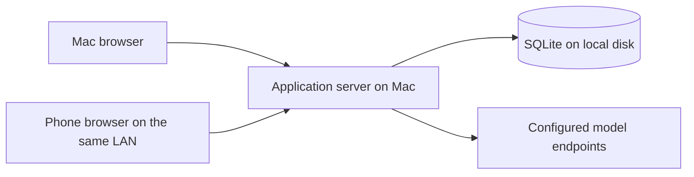

# Roleplay Engine — Implementation Guide

Date: 2026-10-16

Status: accepted technology and architecture baseline; the first milestone is implemented, and the user confirmed a first response through OpenRouter on 2026-10-16. The user approved the stack proposal and its recommendations on this date. “Roleplay Engine” remains a working name. Actual phone use and broader provider compatibility remain to be verified.

## 1. How to use this document

Read [CONCEPTS.md](CONCEPTS.md) first for product intent and accepted behavior. Follow this guide for the application's technology choices, responsibility boundaries, deployment model, and implementation sequence. Read [CONTEXT_EDITING.md](docs/CONTEXT_EDITING.md) when working on context preparation, revisions, or summary repair.

The stack approval does not accept every earlier proposal in those documents. In particular, promotion ranking, numerical defaults, restoration rules, manual-summary authority, and agent inclusion remain open. This guide records the approved architecture; detailed schemas, endpoint names, package versions, and unresolved user-facing policies must be established during implementation without silently changing product requirements.

The existing [Python visualizer](docs/VISUALIZER.md) is a standalone experiment, not the application. Do not describe planned capabilities in this guide as already implemented.

## 2. Accepted stack

| Area | Choice | Purpose |
| --- | --- | --- |
| Language | TypeScript with strict checking | Shared data contracts and explicit states across the browser and server |
| Interface | React + Vite | Responsive chat, prompt editing, summary inspection, and context visualization |
| Server | Node.js on a supported LTS release + Fastify | HTTP API, static interface delivery, model transport, and generation coordination |
| Storage | SQLite on the server's local disk | Persistent conversations, configuration, summaries, selections, and generation records |
| Database access | better-sqlite3 + Drizzle | Typed queries and versioned schema migrations |
| Runtime validation | Zod | Validation of incoming commands, settings, and structured data |
| Browser communication | HTTP API + Server-Sent Events (SSE) | Commands and edits over HTTP; generated text and progress over an event stream |
| Automated verification | Vitest + Playwright | Core/persistence tests and browser workflow tests, including mobile layouts |
| Model integration | A small explicit OpenAI-compatible HTTP adapter | Inspectable request assembly, custom parameters, streaming, and cancellation |

The initial implementation uses npm, with exact dependencies in `package.json` and `package-lock.json`, and was validated with Node.js 24.19.0 LTS. Source modules live under `src/`; SQL migrations under `migrations/`. Installation, development, build, launch, and test commands are documented in [README.md](README.md). Keep future updates mutually compatible and supported.

Use one application with clear internal modules. The initial deployment does not require separate database, queue, or worker services. Keep the core independent of React, Fastify, and database drivers so context rules can be tested without running a browser or server.

## 3. Deployment and access

The Mac hosts the application server and its data. Both the Mac browser and a phone browser on the same local network access that server and the same persistent chats.

For normal use, Fastify serves the built interface and API from one origin. Vite is the development/build tool; a development or preview server is not the normal application deployment.

Provide a simple launcher that starts the application and displays its local and LAN addresses. The exact launcher format, port, installation packaging, and optional start-at-login behavior remain to be selected. LAN access requires an appropriate listening address and host network permissions. Do not assume that localhost on a phone refers to the Mac.

The Mac must remain awake and the server running for phone access and ongoing generation. Browser disconnection is different from server suspension or shutdown.

Include a single-owner login for LAN use. Saved model credentials stay on the server and are excluded from ordinary API responses, request previews, logs, and ordinary exports. Credential entry is an explicit settings operation; do not send saved secrets back merely to display a Connection. HTTPS setup must be settled before routine phone use. Certificate setup, session details, and credential storage protection remain implementation decisions; this document does not select a particular proxy or secret store.

The interface must work on desktop and phone screens, including chat input, scrolling, editing, and request inspection. Mobile emulation is useful but does not replace checking the actual phone browser, especially keyboard behavior and reconnecting after suspension.

## 4. Responsibility boundaries

| Module | Owns | Boundary |
| --- | --- | --- |
| Core engine | Turn rules, prompt resolution, context budgeting, summary selection, and coverage validation | Operates on explicit data and state; does not depend on web or database frameworks |
| Persistence | Turns and revisions, configuration, summaries and dependencies, committed selections, generation records, and operation progress | Implements durable reads, migrations, and transactional writes |
| Generation coordinator | Preparation, model calls, cancellation, revision checks, per-chat coordination, and recovery | Orchestrates work without embedding context policy in HTTP handlers |
| Provider adapter | Provider request encoding, response/stream decoding, errors, and transport cancellation | Does not own the history cutoff or choose summaries |
| Web interface | Editing, previews, progress, and recovery controls | Displays server state; does not become the authority for completed turns or selected context |

Keep reusable Connection settings, prompt arrangement, context configuration, chat state, and any future agent output separate. Shared TypeScript contracts describe safe browser/server data; server-only credentials and persistence internals must not become public response fields by accident. Zod validates actual runtime inputs in addition to compile-time checking.

The server remains authoritative when both devices are open. Coordinate mutations per chat and verify revisions before applying asynchronous results. Browser button disabling alone cannot enforce the rule that only the latest turn may be pending.

## 5. Persistence and transaction rules

Use SQLite on the Mac's local disk, with WAL mode and short write transactions. Phone access goes through the API, never through a shared database file. A synchronous database driver is acceptable for this initial workload; keep database work bounded and avoid long operations that stall the server.

Persist enough information to recover the actual committed state, including:

- Stable turn and part identities, source revisions, and completion state independent of text length.
- Saved summaries, their revisions, source membership, and dependencies.
- Selected summary identities/revisions and the verbatim cutoff, separately from the set of summaries that merely exist.
- The effective context configuration and relevant chat/selection revision used by preparation.
- Credential-free generation records containing resolved messages, effective parameters, coverage, and the outcome or interruption state.
- Operation identity and progress needed to distinguish a retry from new work.

These are persistence responsibilities, not a finalized table schema. Revision retention, branching representation, and record retention limits remain open.

For a compaction replacement:

1. Read the selected state and capture the relevant source, configuration, and selection revisions.
2. Call the summarizing model outside a database transaction.
3. Validate the candidate and its token savings.
4. In a short transaction, check that the captured revisions still match, save the replacement, and switch exactly its covered selection. Advance the verbatim cutoff only when replacing source turns.
5. Retain the original turns and lower-level summaries, then remeasure the request before deciding whether more compaction is necessary.

If the sources changed while the model was working, an obsolete result must not become active. Failed writes must not leave source content excluded without a saved replacement. Retries must not create duplicate coverage or advance the cutoff twice. Completed compaction steps remain available if a later step fails.

Restarting the server must load the committed selection rather than reconstructing a different tree from transcript length or token totals.

Backups must capture a consistent database snapshot, including any required associated files. Do not treat copying only the main database file during active WAL writes as a complete backup. Backup scheduling, retention, destination, and treatment of credentials remain open. Verify restore behavior before describing backups as dependable.

## 6. Generation and streaming

Generation is a server-owned operation with an identity and saved state. A browser subscribes to progress; its connection does not own the operation's lifetime.

The intended flow is:

1. Validate the command and save a pending turn only if the chat has no unresolved turn.
2. Capture the relevant revisions and resolve required prompt content sufficiently to measure the complete input budget.
3. Prepare historical context from the committed selection, saving each valid replacement before changing coverage.
4. Assemble and validate the final request, then save its credential-free generation record.
5. Call the configured model and publish generated text and progress through SSE.
6. Verify that the result still belongs to the intended operation and conversation state, then persist the completed response in the same turn.

Failures and explicit cancellation leave the turn pending under the accepted turn rules. Whether partial or empty generated output can be explicitly accepted is unresolved. Do not equate an empty string with an unfinished turn or automatically complete an interrupted response.

When the phone locks or the browser disconnects, generation continues while the server remains operational. On reconnect, the client retrieves current saved state and resumes observing any active operation. SSE reconnection alone is not a persistence or replay mechanism; the implementation must reconcile the browser with the server's operation state.

Cancellation is an explicit command, separate from losing the event connection. Prevent late results from a cancelled or superseded operation from overwriting newer state. Define partial-output checkpoint frequency during implementation rather than promising that every streamed token survives a crash.

On server restart, identify interrupted operations and expose recovery. Preserve committed summaries and the pending turn. Do not claim that an interrupted provider stream can resume, or silently issue a duplicate model request with potentially repeated cost. A retry must refer to the existing pending turn.

Agent execution before or after generation remains conditional on a future decision to include that feature. This flow does not settle proactive context preparation or permission to generate with stale memory.

## 7. Context-engine implementation contract

Follow the accepted rules in [CONCEPTS.md](CONCEPTS.md) and the stateful contract in [CONTEXT_EDITING.md](docs/CONTEXT_EDITING.md). In particular:

- Treat the target working input size as a ceiling, separately from the Connection's physical limits. Include pending input, resolved prompt content, and protocol overhead. Reserve output against combined physical windows without subtracting it twice from an input-only target.
- Preserve all history verbatim while the assembled request fits. Under pressure, summarize only complete oldest batches of exactly `B` turns, retaining at least `L` completed turns and all residual turns that cannot form a valid batch.
- Stop compaction as soon as the request fits. Consider summary promotion only when no complete first-layer batch is eligible and the request still overflows.
- Fail if required verbatim and non-summary input cannot fit. Do not silently reduce `L`, change `B`, exceed the target, or omit history.
- Carry forward the committed selection. In ordinary continuation, inactive children do not return just because space becomes available. Retain unused capacity when necessary for stability.
- Emit coverage in conversation order, without overlapping parent/child representations or unexplained gaps.
- Track source revisions so archived edits invalidate affected summaries and their dependents. Structural freshness does not guarantee narrative consistency.

Port accepted state-transition behavior from `experiments/compaction/compaction_model.py` into the TypeScript core. Compare the same synthetic scenarios across the reference model and the port, including checkpoint continuation and the 301-to-302 stability regression. The visualizer's numerical defaults and promotion formula remain experimental; keep the promotion decision replaceable without building a general plugin system.

Actual text lengths, model errors, persistence, revision conflicts, and summary quality require additional validation. Synthetic arithmetic does not establish semantic recall or faithful summarization.

## 8. Model connections and token measurement

Start with an explicit OpenAI-compatible HTTP adapter, honoring the selected endpoint, model, token limits, and supported custom JSON parameters. The exact initial API dialect and supported endpoint subset must be documented during implementation; OpenAI-compatible services are not assumed to behave identically. Anthropic-compatible support remains a possible later addition.

Keep request assembly inspectable. The generation preview must show the messages and effective parameters actually used after resolution and parameter handling, with credentials removed. Define custom-parameter precedence and protected fields before exposing overrides; user JSON must not silently replace assembled history.

Token measurement has its own interface. Record the counting method and distinguish estimates from counts verified for the selected model/request format. A tokenizer for one model is not automatically valid for every compatible endpoint. Include protocol overhead and remeasure actual summary outputs rather than assuming requested summary length.

The strict target remains a product rule, but an approximate counter cannot guarantee an exact remote-provider count. The handling of unsupported tokenizers and uncertainty must be settled explicitly before claiming strict enforcement for an endpoint. Provider-reported usage can inform validation after a request; it cannot retroactively validate a preflight estimate.

First-milestone user decision on 2026-10-16: allow generation using a clearly labeled conservative estimate and enforce budgets against it. The initial method counts UTF-8 bytes of serialized messages plus framing allowances. It is explicitly unverified for the selected provider; exact remote token-limit guarantees are not claimed. The initial text-only Chat Completions dialect and supported custom-parameter allowlist are documented in [README.md](README.md).

## 9. Implementation sequence and acceptance checks

### First milestone: one persistent chat

Implement one Connection, one persistent chat, streamed responses, and an inspectable request preview, with only enough prompt/character/persona support to exercise that flow. Establish the shared core, persistence, and server boundaries without building all editors first.

Validate that:

- Both devices see the same saved chat and response.
- A pending turn blocks another submission, including concurrent requests from two devices.
- Intentional blank edits preserve completion and turn membership.
- A phone disconnect does not cancel generation; reconnecting retrieves its state.
- Cancellation and server interruption leave a recoverable pending turn.
- The preview agrees with the assembled provider request and excludes credentials.

Implementation status on 2026-10-16: these flows are implemented with one Connection, one persistent chat, owner login, a minimal fixed prompt order, full verbatim history, and request inspection. Vitest checks core limits and validation, persistence, concurrent commands, blank edits, cancellation, disconnected observers, explicit retry, graceful interruption, a real process crash, and single-server database ownership. Playwright exercises separate desktop and phone-sized sessions, including shared state, streaming, reconnecting, cancellation/retry, blank edits, and exact request-body inspection. Tests use a synthetic local endpoint and temporary databases. The user subsequently confirmed a first response through OpenRouter on 2026-10-16. HTTPS certificate provisioning, a real phone browser/keyboard/suspension check, and broader provider compatibility remain unverified; see [README.md](README.md).

### Second milestone: durable layered compaction

Port and validate the stateful core, then connect real summarization and transactional persistence before expanding the editors.

Use Vitest for core and persistence tests covering fixed batches, protected tails, residual turns, limit separation, coverage, selection stability, and checkpoint continuation. Add failure and interruption tests around the save-and-select transaction, safe retries, edits during generation, and stale-result rejection.

Use synthetic or copied conversations to inspect summary quality against known story facts. Report structural correctness separately from semantic quality. Resolve relevant repair and restoration policies before implementing their user-facing behavior.

### Subsequent interface work

Expand the Connection manager, block-and-marker Prompt editor, summary inspection/editing, context visualization, and character/persona management around the verified flow. Use Playwright for meaningful end-to-end workflows and responsive layouts, with actual phone checks for platform-specific behavior.

These are implementation priorities, not a delivery schedule. The application build and its core/server/browser tests now exist and pass; commands are documented in [README.md](README.md). Existing simulator validation commands remain in [VISUALIZER.md](docs/VISUALIZER.md), and that isolated experiment is unchanged.

## 10. Decisions still to resolve

The product questions in [CONCEPTS.md](CONCEPTS.md) remain authoritative. Stack approval specifically leaves these areas open:

- Detailed schemas, revision retention, regeneration, branching, and imported-history conversion.
- Promotion ranking, higher-layer grouping, numerical defaults, summary output targets, and any operational headroom.
- Restoration after deletion or settings changes; stale-memory continuation; manual-summary authority and repair review.
- Entirely blank summary batches and acceptance of partial or empty generated responses. The user decided that blank saved parts are omitted from outgoing requests while their completed turns remain stored.
- The Connection used for summarization and the effect of editing shared presets or other reusable records.
- Product agents in the first release, their triggers, and missing marker/output behavior.
- Verified tokenizer coverage and additional provider dialects/custom parameters. The first-milestone estimate policy is user-approved; its initial Chat Completions subset and protected request fields are documented in [README.md](README.md).
- HTTPS certificate provisioning/trust, stronger credential storage protection, distribution packaging, and optional automatic startup. A local launcher and owner sessions are implemented; routine actual-phone use awaits HTTPS setup and verification.
- Backup cadence, retention, restore UX, and generation-record retention.

Do not treat these as reasons to delay independent implementation work. Resolve a question before implementing behavior whose outcome materially depends on it, and record accepted decisions in the relevant documentation.

## 11. Technical references

- [React: building an application with a build tool](https://react.dev/learn/build-a-react-app-from-scratch)
- [Vite: building for production](https://vite.dev/guide/build)
- [Fastify: TypeScript](https://fastify.dev/docs/latest/Reference/TypeScript/)
- [Drizzle: SQLite drivers](https://orm.drizzle.team/docs/sqlite/get-started-sqlite)
- [SQLite: write-ahead logging](https://sqlite.org/wal.html)
- [Zod: runtime validation](https://zod.dev/)
- [Vitest: features](https://vitest.dev/guide/features)
- [Playwright: device emulation](https://playwright.dev/docs/emulation)

These references explain the selected tools. Product decisions and implementation requirements are defined by this repository's documentation and the user's subsequent instructions.
