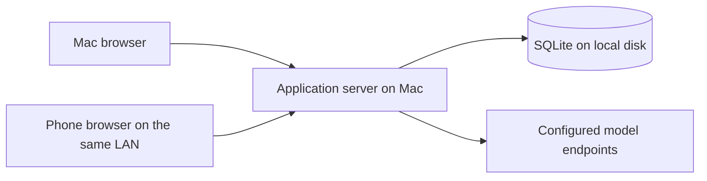

# Roleplay Engine — Implementation Guide

Date: 2026-10-16

Status: accepted technology and architecture baseline; persistent chat, roleplay libraries and durable layered compaction are implemented for local testing. The user confirmed a first roleplay response through OpenRouter on 2026-10-16. The in-app name is “ORE”; the repository remains “Roleplay Engine”. Actual phone use, real-model compaction quality and broader provider compatibility remain to be verified.

## 1. How to use this document

Read [CONCEPTS.md](CONCEPTS.md) first for product intent and accepted behavior. Follow this guide for the application's technology choices, responsibility boundaries, deployment model, and implementation sequence. Read [CONTEXT_EDITING.md](docs/CONTEXT_EDITING.md) when working on context preparation, revisions, or summary repair.

The stack approval does not accept every earlier proposal in those documents. Numerical defaults, automatic restoration rules, manual-summary authority, and agent inclusion remain open; manual preparation with saved-memory reselection is accepted below. Promotion ranking was separately accepted on 2026-10-17 as described below. This guide records the approved architecture; detailed schemas, endpoint names, package versions, and unresolved user-facing policies must be established during implementation without silently changing product requirements.

The existing [Python visualizer](docs/VISUALIZER.md) is a standalone experiment, not the application. Do not describe planned capabilities in this guide as already implemented.

## 2. Accepted stack

| Area | Choice | Purpose |
| --- | --- | --- |
| Language | TypeScript with strict checking | Shared data contracts and explicit states across the browser and server |
| Interface | React + Vite | Responsive chat, prompt editing, summary inspection, and context visualization |
| Server | Node.js on a supported LTS release + Fastify | HTTP API, static interface delivery, model transport, and generation coordination |
| Storage | SQLite on the server's local disk | Persistent conversations, configuration, summaries, selections, and generation records |
| Database access | better-sqlite3 + Drizzle | Typed queries and versioned schema migrations |
| Runtime validation | Zod | Validation of incoming commands, settings, and structured data |
| Browser communication | HTTP API + Server-Sent Events (SSE) | Commands and edits over HTTP; generated text and progress over an event stream |
| Automated verification | Vitest + Playwright | Core/persistence tests and browser workflow tests, including mobile layouts |
| Model integration | A small explicit OpenAI-compatible HTTP adapter | Inspectable request assembly, custom parameters, streaming, and cancellation |

The initial implementation uses npm, with exact dependencies in `package.json` and `package-lock.json`, and was validated with Node.js 24.19.0 LTS. Source modules live under `src/`; SQL migrations under `migrations/`. Installation, development, build, launch, and test commands are documented in [README.md](README.md). Keep future updates mutually compatible and supported.

Use one application with clear internal modules. The initial deployment does not require separate database, queue, or worker services. Keep the core independent of React, Fastify, and database drivers so context rules can be tested without running a browser or server.

## 3. Deployment and access

The Mac hosts the application server and its data. Both the Mac browser and a phone browser on the same local network access that server and the same persistent chats.

For normal use, Fastify serves the built interface and API from one origin. Vite is the development/build tool; a development or preview server is not the normal application deployment.

Provide a simple launcher that starts the application and displays its local and LAN addresses. The shared portable layout, Bash build/start procedure, version metadata and staged activation are implemented as described in [RELEASES.md](docs/RELEASES.md); Windows uses start-app.bat and Windows PowerShell 5.1 with supporting files and ordinary bundled Node. Optional start-at-login behavior remains unselected. LAN access requires an appropriate listening address and host network permissions. Do not assume that localhost on a phone refers to the Mac.

The Mac must remain awake and the server running for phone access and ongoing generation. Browser disconnection is different from server suspension or shutdown.

Include a single-owner login for LAN use. Saved model credentials stay on the server and are excluded from ordinary API responses, request previews, logs, and ordinary exports. Credential entry is an explicit settings operation; do not send saved secrets back merely to display a Connection. On 2026-10-21 the user selected HTTP restricted to LAN with all controls in Application Settings, deferring HTTPS. HTTP sessions retain HttpOnly/SameSite=Strict and origin checks, while transport contents are unencrypted. Existing explicitly configured TLS startup retains Secure cookies; no new HTTPS provisioning is introduced.

`src/server/lan.ts` owns the independent HTTP listener, machine-local versioned JSON settings and serialized revision-checked changes; `lan-policy.ts` owns eligible private IPv4 interfaces, current-subnet peers and exact hostname/IP plus port validation. `lan-listener.ts` owns the native HTTP/socket transport, and `lan-hostname.ts` reads the Mac’s Bonjour LocalHostName (or the OS hostname on other hosts). The listener delegates accepted requests to the existing Fastify router, sharing authentication, commands, SSE and server-owned operations. Manual saves prepare a replacement listener before committing a private, flushed temporary settings file by atomic rename; bind/write failure closes only the uncommitted listener. Automatic saves commit the enabled recovery policy even if currently offline or busy, then attempt to bind port 3000. A serialized operation queue orders saves, recovery and shutdown, and rejects stale settings revisions. Disabling access closes LAN sockets, not operations. Recheck interface identity/address/netmask per request and every three seconds. Automatic mode keeps a working interface, prefers its adapter after IP changes, and otherwise chooses an eligible interface in stable ID order. It monitors/retries while offline, after listener failure and while port 3000 is occupied, without changing the configuration revision or writing each runtime rebind. Manual mode restores only its exact saved binding. Local access remains available during failures. Fastify readiness awaits LAN startup, and shutdown retires its listeners and timers.

Authenticated `GET/PUT /api/application/lan` exposes browser-safe contracts in `src/shared/lan.ts`; writes additionally require an actual loopback client outside the LAN listener. Version-2 settings live beside the active database as `<database>.lan.json`, outside backup/import/wipe content, so no SQLite migration is needed and portable content cannot enable a listener on another machine. Version 1 upgrades atomically to the new automatic default/port 3000, preserving enabled state and revision; explicit version-2 manual settings retain their mode and port. `LanSettings.tsx` owns the Application Settings form, automatic/manual field visibility, read-only hostname URL, unavailable-network recovery and conflict handling. Success/off labels and footer instructions were removed by user request. Browser status reads are invalidated across saves; polling stops when Settings closes. `src/web/uuid.ts` uses native randomUUID where available and cryptographic getRandomValues on insecure LAN HTTP origins. See [LAN_ACCESS.md](docs/LAN_ACCESS.md) for boundaries, failure handling and verification.

The interface must work on desktop and phone screens, including chat input, scrolling, editing, and request inspection. Mobile emulation is useful but does not replace checking the actual phone browser, especially keyboard behavior and reconnecting after suspension.

Application Settings uses `web/settings-autosave.ts` and `useSettingsAutosave.tsx` to serialize immediate field updates through the existing revision-checked, atomic APIs. Edits made during an in-flight save queue behind it; completed responses cannot replace newer choices. On a revision conflict, read current state and retry once with only the submitted fields merged. Non-revision or repeated conflicts and transport/write failures retain the latest edits for explicit Retry; retry first reconciles authoritative state, avoiding a duplicate write after a lost acknowledgement. App owns the queues so in-flight saves, queued edits and failed choices survive leaving and reopening Settings. The shared `SettingsSaveStatus` renders no routine saving message; a cancellable one-second timer shows an error-style alert only while saving remains pending. Completion clears the alert, failures show immediately with Retry, and unmount clears the timer without cancelling the save. LAN polls every five seconds while mounted, suppressing older reads across saves and retaining failed edits. LAN runtime recovery offers Retry even when its settings already match, including replacing malformed configuration with the displayed defaults; changed runtime notices carry optional localized descriptors with English fallbacks. Numeric ports save only when valid. The application color picker saves valid hex/HSL/palette choices immediately and offers Close; library color pickers retain Apply/Cancel. No new persistence format or database migration is required.

## 4. Responsibility boundaries

| Module | Owns | Boundary |
| --- | --- | --- |
| Core engine | Turn rules, prompt resolution, context budgeting, summary selection, and coverage validation | Operates on explicit data and state; does not depend on web or database frameworks |
| Persistence | Turns and revisions, configuration, summaries and dependencies, committed selections, generation records, and operation progress | Implements durable reads, migrations, and transactional writes |
| Generation coordinator | Preparation, model calls, cancellation, revision checks, per-chat coordination, and recovery | Orchestrates work without embedding context policy in HTTP handlers |
| Provider adapter | Provider request encoding, response/stream decoding, errors, and transport cancellation | Does not own the history cutoff or choose summaries |
| Web interface | Editing, previews, progress, and recovery controls | Displays server state; does not become the authority for completed turns or selected context |

Keep reusable Connection settings, prompt arrangement, context configuration, chat state, and any future agent output separate. Shared TypeScript contracts describe safe browser/server data; server-only credentials and persistence internals must not become public response fields by accident. Zod validates actual runtime inputs in addition to compile-time checking.

The server remains authoritative when both devices are open. Coordinate mutations per chat and verify revisions before applying asynchronous results. Browser button disabling alone cannot enforce the rule that only the latest turn may be pending.

## 5. Persistence and transaction rules

Use SQLite on the Mac's local disk, with WAL mode and short write transactions. Phone access goes through the API, never through a shared database file. A synchronous database driver is acceptable for this initial workload; keep database work bounded and avoid long operations that stall the server.

Persist enough information to recover the actual committed state, including:

- Stable turn and part identities, source revisions, and completion state independent of text length.
- Saved summaries, their revisions, source membership, and dependencies.
- Selected summary identities/revisions and the verbatim cutoff, separately from the set of summaries that merely exist.
- The effective context configuration and relevant chat/selection revision used by preparation.
- Credential-free generation records containing resolved messages, effective parameters, coverage, and the outcome or interruption state.
- Operation identity and progress needed to distinguish a retry from new work.

These are persistence responsibilities, not a finalized table schema. Revision retention, branching representation, and record retention limits remain open.

Accepted greeting behavior (implemented in the library milestone): initialize a chosen character greeting as a completed opening turn with an empty user part and a copied assistant part, using ordinary stable identities and revisions. Later changes to the reusable greeting must not rewrite existing chats. The first user action creates the next turn. Render no empty user bubble and omit the blank user part from outgoing input. Apply ordinary editing, whole-turn deletion, summary dependencies, and completed-turn counting for `B` and `L`; see [Character greeting as an opening turn](CONCEPTS.md#character-greeting-as-an-opening-turn). A copied greeting is saved history and does not require a model generation to become complete.

For a compaction replacement:

1. Read the selected state and capture the relevant source, configuration, and selection revisions.
2. Call the summarizing model outside a database transaction.
3. Validate the candidate and its token savings.
4. In a short transaction, check that the captured revisions still match, save the replacement, and switch exactly its covered selection. Advance the verbatim cutoff only when replacing source turns.
5. Retain the original turns and lower-level summaries, then remeasure the request before deciding whether more compaction is necessary.

If the sources changed while the model was working, an obsolete result must not become active. Failed writes must not leave source content excluded without a saved replacement. Retries must not create duplicate coverage or advance the cutoff twice. Completed compaction steps remain available if a later step fails.

Restarting the server must load the committed selection rather than reconstructing a different tree from transcript length or token totals.

Backups must capture a consistent database snapshot, including any required associated files. Do not treat copying only the main database file during active WAL writes as a complete backup. Manual backup/inspection/import/wipe is implemented as described in [BACKUPS.md](docs/BACKUPS.md), including saved API keys and excluding login/runtime authority. ApplicationSettings coordinates download/staging requests; BackupFileDialog owns transient password fields, modal focus and local error presentation. A failed opening retains the selected File for explicit retry; dismissal clears dialog state, and pending requests prevent dismissal/duplicate submission. Successful opening still requires inspection and the existing import confirmation. Scheduling and retention remain open.

## 6. Generation and streaming

Generation is a server-owned operation with an identity and saved state. A browser subscribes to progress; its connection does not own the operation's lifetime.

The composer remains editable during server-owned generation/preparation and while the latest turn is pending; Send and its submit handler still reject submission during active work or an unresolved turn. The composer synchronously stores exact draft text per chat in browser localStorage on each edit, without waiting for a server request, idle timer or unload event. A staged send also stores its request identity and captured revision before transport. Failed or ambiguous responses retain the text; ambiguous failures retain the identity across reload for server-idempotent explicit retry. A definite client-command rejection permits a fresh explicit attempt against current state. Acknowledgement clears only the captured draft, never a newer edit or another chat’s composer; post-send refresh follows the currently selected chat. Storage failures retain in-memory text and show a copy-before-leaving warning. Browser storage is device/origin-local and subject to clearing, quota and private-session lifetime; no cross-device draft synchronization or automatic resend is implemented. Summary-repair candidate discard rules remain separate.

`ChatTextarea.tsx` shares live `--` → `—` substitution between the composer and both turn-part editors. Only a non-composing hyphen insertion immediately following another hyphen is converted; selection replacement and caret position are preserved. Other input events and loaded values remain literal. Converted drafts and edits use the existing storage and save paths.

The composer opts into content sizing in `ChatTextarea.tsx`: measure after value changes (including restored/cleared drafts) and width/viewport changes, measure a hidden fixed-position copy so intermediate sizing cannot clamp transcript scrolling, and clean up resize observers/listeners. Only the final height changes the visible layout, preserving latest-turn following and older-turn reading positions. Its minimum height matches the 44px Send button; the existing 30dvh cap retains internal scrolling for long drafts. Manual resizing is disabled only for the composer; turn editors keep their existing sizing. The composer keeps Send to the right of the textbox with bottom alignment at every width. Send uses a 44px icon button with an explicit Send accessible name; the composer has no additional status row. Draft-storage failures use the recovery area above it. On iOS, `App.tsx` adds a composer-specific style class using iPhone/iPad/iPod user-agent detection or the MacIntel plus multiple-touch-points iPadOS desktop-mode signature. The textbox uses a 22px corner radius with extra horizontal text padding, retaining that radius as multiline drafts grow; Send is circular. At widths up to 800px, the iOS composer uses at least 26px left/right padding and 28px bottom padding, increasing each inset when the corresponding safe-area inset is larger. These gaps approximate the supplied Telegram reference while retaining control sizes and multiline bottom alignment. `useComposerKeyboard.ts` infers keyboard visibility from composer focus and at least 120px of visual viewport height loss at normal zoom, using the largest observed viewport/layout height at the current width as the baseline. It listens to viewport/window resize and focus changes, resets the baseline when width changes, and removes listeners when disabled/unmounted. Focus alone, small browser-chrome changes and pinch zoom do not enable keyboard spacing. While inferred visible, all iOS widths use at least 16px side insets (respecting side safe areas) and 8px bottom padding, without the closed-keyboard bottom safe-area floor. Viewport recovery restores spacing even if the textbox stays focused. Without VisualViewport support, normal spacing is retained. The iOS composer has a transparent background and no divider; the textbox uses the existing lighter surface color. Safari’s form assistant bar remains browser-owned and unchanged. Tests simulate viewport signals; the user subsequently verified keyboard motion on an iPhone 12 Pro Max (reported iOS 26.6.2). Broader device coverage remains unverified. Other platforms retain their existing corner radii and spacing.

`useTouchScrollGuard.ts` adds touch containment only to authenticated iOS Story. A non-passive touchmove listener cancels single-finger gestures when no inner scroll area can consume movement in that direction, respecting contained boundaries and RTL horizontal scrolling. It preserves multi-touch/zoom, native selection and long-press selection, focused text-input horizontal movement, range controls and application-owned drag surfaces. Leaving Story removes its listeners. It does not change viewport sizing, header visibility, keyboard timing or scroll positions; the existing composer spacing hook remains unchanged. Browser tests check cancellation decisions and a real Chromium touch scroll. The user tested the touch-only approach on the phone and reported no observed issues; this does not establish coverage of every native gesture or other devices.

The intended flow is:

1. Validate the command and save a pending turn only if the chat has no unresolved turn.
2. Capture the relevant revisions and resolve required prompt content sufficiently to measure the complete input budget.
3. Measure the full input. Prepare historical context from the committed selection only when target overflow reaches the configured overshoot threshold (or any target overflow when overshoot is disabled), saving each valid replacement before changing coverage. Physical overflow alone fails during request validation.
4. Assemble and validate the final request, then save its credential-free generation record.
5. Call the configured model and publish generated text and progress through SSE.
6. Verify that the result still belongs to the intended operation and conversation state, then persist the completed response in the same turn.
7. Re-estimate the complete input including that saved response. Above target, start an independent ordinary preparation job. It uses captured memory retry settings, preserves the committed selection until replacements save, and cannot change the successful response outcome. No other automatic preparation triggers exist.

For the first response, failures and explicit cancellation leave the turn pending under the accepted turn rules. Regeneration instead retains its completed selected response. Whether partial or empty generated output can be explicitly accepted is unresolved. Do not equate an empty string with an unfinished turn or automatically complete an interrupted response.

When the phone locks or the browser disconnects, generation continues while the server remains operational. On reconnect, the client retrieves current saved state and resumes observing any active operation. SSE reconnection alone is not a persistence or replay mechanism; the implementation must reconcile the browser with the server's operation state.

Cancellation is an explicit command, separate from losing the event connection. Prevent late results from a cancelled or superseded operation from overwriting newer state. Define partial-output checkpoint frequency during implementation rather than promising that every streamed token survives a crash.

Reasoning uses a separate optional provider callback for `delta.reasoning`, `delta.reasoning_content`, or readable `reasoning_details` text/summary entries. Prefer the first nonempty plain field over details to avoid duplicated representations; ignore encrypted data and signatures. Reasoning and reply each have a four-million-character stream limit. Reasoning alone cannot complete a response. No extra request parameters are injected to enable reasoning.

Migration 12 adds `generations.reasoning_text` with an empty default, preserving existing records and revisions. The coordinator checkpoints reply/reasoning together at most once per 250 ms on incoming chunks and saves both on completion, failure, cancellation and graceful shutdown. A hard crash may lose chunks after the last checkpoint. Live snapshots reconcile from the owning in-memory operation; terminal/restarted attempts use saved output. Cancellation rejects late reasoning just as it rejects late reply text. Ordinary snapshots contain only the final 2,000 reasoning characters per attempt; the authenticated, chat-scoped reasoning endpoint supplies full live/saved text on demand. Reasoning does not enter turn parts, request assembly, lore scanning, budgeting or summary sources.

`Reasoning.tsx` owns the passive bounded fading preview and the Show reasoning footer action with its native modal popup. App renders the inline preview only for the running turn before its first reply text; completion, cancellation, failure and interruption hide it. The footer action and any open popup remain independent of preview visibility. The popup reserves a stable viewport-bounded height, including while loading short reasoning. Its scrollable body follows incoming text until the reader scrolls away, offers Latest reasoning, restores focus on dismissal and ignores superseded fetches. Fetch errors retain previously loaded text and offer Retry. Completion keeps the popup available as saved reasoning; changing response variant/attempt or leaving Story dismisses it. The footer action follows each selected variant's generation identity; a pending idle turn exposes its latest attempt's saved reasoning through the same action. Failed/cancelled regeneration restores the saved response's reasoning. Imported turns and greetings have no generated reasoning.

`ChatMarkdown.tsx` is the shared memoized presentation for user/assistant parts, copied greetings, selected variants and live/terminal partial responses. The approved pinned `react-markdown` and `remark-gfm` dependencies parse Markdown without executing raw HTML. Links permit only HTTP(S), mailto and fragment destinations. Markdown images accept absolute HTTP(S) URLs, load lazily without a referrer, fit the column and fall back to localized alt text on failure; raw HTML and other image schemes remain inert. The image CSP permits HTTP(S) resources while scripts and connections retain their existing restrictions. `useTranscriptScroll` observes mounted turn sizes so delayed image loads follow the latest turn or retain the earlier reading anchor, and disconnects observers when the window/chat changes. `remark-direct-speech.ts` projects inline prose across emphasis/link labels, finds speech spans, and wraps text leaves without rewriting Markdown source, code, URL destinations or authoritative chat state. It preserves soft line breaks and styles complete detected speech spans, including em dashes within those spans. `quoted-speech.ts` and the independently optional `russian-dialogue.ts` own separate detectors, combined by `direct-speech.ts`. The renderer's default options can disable Russian detection without affecting quotation styling; the per-renderer `--direct-speech-color` variable uses the selected character/persona’s local `speechColor`, falling back to the matching application speech-color default (initially `#a8c9f0`). Unchanged parts skip reparsing on unrelated snapshots. The pure `core/model-text.ts` reuses the existing Markdown parser to remove image nodes and image-only reference definitions from future roleplay, preview, budgeting and summary extraction/promotion/repair input without reserializing surrounding prose. Code examples remain literal. Parsing results use a bounded cache. Image-only turn parts are omitted without changing turn coverage. First-layer summary requests retain the original source baseline locally for repair provenance, separately from their filtered provider body. Existing transcripts, source revisions and historical requests remain unchanged; no migration is needed. Detection rules, image boundaries and verification live in [CHAT_FORMATTING.md](docs/CHAT_FORMATTING.md).

On server restart, identify interrupted operations and expose recovery. Preserve committed summaries and the pending turn. Do not claim that an interrupted provider stream can resume, or silently issue a duplicate model request with potentially repeated cost. A retry must refer to the existing pending turn.

Agent execution before or after generation remains conditional on a future decision to include that feature. The accepted post-response preparation above is the only proactive context trigger; it does not permit stale memory.

Latest-turn regeneration uses a separate server-owned generation kind and keeps the saved turn complete. The UI overrides only the running attempt’s matching assistant area with its partial text, or “Waiting for first token…” before text arrives; it uses the same in-turn rendering for first responses. There is no separate regeneration preview panel or status row. The turn action switches from Regenerate response to Cancel while its regeneration is active; Cancel remains enabled unless a command is being submitted, while variant selection stays locked. Cancellation restores the saved response and action without a cancellation notice. Failed/interrupted attempts retain an actionable error. New first responses use the same in-turn Cancel action while running, with no separate generating status row. The shared footer always includes its selector when an action is present, including for a single saved variant. An incomplete response displays a disabled 1 / 1 placeholder without creating a saved variant; successful completion supplies the authoritative saved version. Pending idle turns expose no regenerate action: cancellation with no partial text displays “Generation cancelled.”, while existing partial text remains visible for inspection. The pending-turn panel and Retry response retain their existing recovery behavior, including after reload and across devices. Historical usage for the selected response is hidden during its replacement stream. Reconnect retrieves the running partial text; terminal failure/cancellation/interruption restores the selected saved text, while success displays the newly selected variant. Migration 11 adds generic response variants, selected variant identities and an operation-local context selection; existing completed responses become single variants without changing text, part revisions, summaries or historical requests. Imported responses and copied greetings need no generation record. Each generated variant references its own immutable attempt; edits affect only the active variant and preserve generation history. Whole-turn/chat deletion and history replacement cascade through variants.

The regeneration view replaces only the latest response with a request-local pending input. It reuses a safe selected prefix and retained eligible children, excludes summaries with the target in their coverage or dependencies, and restores a valid completed-tail boundary. Direct manual corrections containing the target fail explicitly. Normal planners, request assembly, budgeting, saved reuse and transactional summary commits then operate against that view. Context jobs write selection changes to the owning regeneration, while summary records and request history remain durable. The live context selection/cutoff is unchanged on success or failure. Current setup governs the request; it is not a replay of a saved historical body. Lore matching excludes the old response and uses fresh prior-match state. Success atomically saves/selects the new variant, starts a fresh lore epoch and commits that request's admissions once; failed attempts preserve the previous lore state.

Chat and assistant selection revisions never move backward. A variant's source revision identifies its saved text separately, and `sourceOf` supplies that content provenance consistently to request coverage, summary freshness, preparation commits and repair comparisons. Unchanged saved A can therefore become current again after A → B → A without a repair or a new summary version. Exact equal generated alternatives may share content provenance. Changed active-variant edits acquire new provenance; other edits and changed summary dependencies remain stale. Selecting an existing variant requires idle/revision/turn ownership checks and resets lore like a transcript edit.

`TurnControls.tsx` groups the selector and all available turn actions beneath each response; `ResponseVariants.tsx` owns only version selection and `TurnActionButton.tsx` shares the labeled icon buttons. Every turn keeps a selector, including single variants and disabled pending placeholders. Container queries hide button labels when the transcript column narrows; the action region scrolls horizontally at narrow phone widths while the selector stays fixed in the row. Full accessible names, tooltips, keyboard focus and 44px button heights remain available. The passive reasoning preview has no duplicate action above the reply. Existing command/revision guards, edit drafts, delete confirmation and generation/recovery paths remain authoritative. No persistence changes or new asynchronous operations are introduced.

The compact previous/current/total/next selector sends an immediate selection command for arrows between saved variants. At the final saved variant of the latest completed turn, Next calls the same regeneration action and guards as the footer button. A running regeneration displays the next slot without saving a variant; success confirms it and cancellation/failure/interruption restores the saved selection and count. It commits textbox jumps on Enter or blur. Typing alone is local; invalid input and Escape restore the confirmed number. While selection saves, controls are locked and the transcript continues to display authoritative state. The composer keeps its Send label and dimensions during all saves; temporary saving status appears only in the button tooltip. Failure retains that state and shows the existing recoverable error. A local in-flight guard prevents Enter/blur/arrow events from submitting duplicate commands. The per-response request shortcut is removed; historical request storage remains unchanged. Cancel/restart retain the selected response and require a new explicit regeneration command; late completions cannot replace it. Primary and alternate greeting initialization uses this same variant storage, as specified below.

## 7. Context-engine implementation contract

Follow the accepted rules in [CONCEPTS.md](CONCEPTS.md) and the stateful contract in [CONTEXT_EDITING.md](docs/CONTEXT_EDITING.md). In particular:

- Treat the target working input size as the preparation ceiling, with the explicit sending allowance in `core/input-target.ts`, separately from the Connection's physical limits. Include pending input, resolved prompt content, and protocol overhead. Reserve output against combined physical windows without subtracting it twice from an input-only target.
- Preserve all history verbatim while the assembled request fits. Under pressure, summarize only complete oldest batches of exactly `B` turns, retaining at least `L` completed turns and all residual turns that cannot form a valid batch.
- Stop compaction as soon as the request fits. Consider summary promotion only when no complete first-layer batch is eligible and the request still overflows.
- Fail if required verbatim and non-summary input cannot fit. Do not silently reduce `L`, change `B`, exceed the configured sending allowance, or omit history.
- Carry forward the committed selection. In ordinary continuation, inactive children do not return just because space becomes available. Retain unused capacity when necessary for stability.
- Explicit Prepare chat first re-plans using approved fresh saved representations, reusing fixed turn batches and pressure-ranked eligible saved parents. Restore recent detail first and preserve chronological levels (older spans at least as compact as newer ones). Protect direct manual corrections through coverage children; allow generated parents to expand while retaining those corrected children. Prior-context dependencies still invalidate consumers on edits, but do not freeze their representation. A direct edit blocks restoring its own span to original turns. Restore an incompatible completed-tail cutoff before compression; never fall back to that invalid boundary. Report a direct correction/tail conflict with its range and required minimum. Retain saved content and atomically save selection plus before/after history with the job. A fitting result ends without model requests; unavailable groups leave an already fitting selection unchanged. Otherwise continue from committed state, reusing exact saved replacements before generating missing summaries. Automatic and single-step preparation reuse saved replacements without expanding existing history. Resolve the summarization Connection only when a provider request is needed; source revisions, exact coverage/dependencies and complete-request savings govern reuse.
- Correction protection is defined in `src/core/context-corrections.ts`: the latest approved manual identity with surviving coverage is authoritative regardless of selection. Exact child references and explicitly reviewed `corrections` references carry that authority; `prior` references control freshness only. All current corrections overlapping a proposed summary must be represented. Request assembly, planning, saved reuse, manual reselection and save-and-select validation share this rule. Stale retained corrections and selected dependencies enter repair; reconciliation chooses an existing selected container where possible, otherwise a compatible saved container, and supplies all overlapping corrections for review. A retained repaired container remains unselected until manual Prepare. Added editorial dependencies are a structural change, so identical model output cannot auto-approve them. Future edits invalidate their consumers through normal dependency freshness.
- Optional `corrections` provenance is stored in existing versioned summary JSON; absent fields mean no reviewed alternate inputs. No schema rewrite or retroactive manual-flag cleanup is needed. Historical versions, requests and turns are untouched. Normalized identical direct saves return the existing reference after revision/idle/latest-version checks without writing state or advancing revisions. Repair candidates keep their captured chat/configuration and operation checks; approval, selection and job progress remain transactional.
- Emit coverage in conversation order, without overlapping parent/child representations or unexplained gaps. Promotion eligibility also rejects a parent deeper than an older selected span. Historical irregular selections remain inspectable and can be reconsidered by manual Prepare. The optional reselection `limitation` field explains retained corrections or unavailable saved groups; old job records remain readable without it. Manually edited timeline boxes use an amber accent and accessible wording in addition to their active/retained/stale status.
- Track source revisions so archived edits invalidate affected summaries and their dependents. Structural freshness does not guarantee narrative consistency.

Port accepted state-transition behavior from `experiments/compaction/compaction_model.py` into the TypeScript core. Compare the same synthetic scenarios across the reference model and the port, including checkpoint continuation and the 301-to-302 stability regression. The visualizer's promotion formula is accepted as the initial application policy on 2026-10-17; numerical defaults remain illustrative. Rank with actual active-summary token totals, respect fixed groups and retained floors, validate net savings before commit, and remeasure after each replacement. Keep the decision replaceable without building a general plugin system; unequal sizes do not establish semantic quality or guarantee that every candidate shrinks.

On 2026-10-17 the user requested carrying over the non-simulation settings: target input, minimum tail, fixed turn batch, requested summary size, promotion group and retained summaries per source level. The implementation measures resolved non-history input and actual summary output rather than retaining the lab's fixed token assumptions. Summarization has a separately selected reusable Connection and separate editable first-layer/promotion prompts that request independently understandable narrative summaries. Starting values match the lab; they are adjustable, not validated quality defaults. Summary size is a soft instruction target, and the Connection's `max_tokens` remains the actual output reservation. Up to three preceding selected summaries are supplied when they fit and are recorded as explicit dependencies. Sources are never silently shortened to fit.

As of 2026-10-22, a context preset's nullable `connectionId` means **Same as current chat connection**, the default selector option. Preparation (manual, single-step and automatic) and repair resolve that chat's Connection, including its credentials and physical limits, only when a model request is needed. Explicit preset selections take precedence. Existing null selections adopt this behavior without a migration; saved summaries and historical requests remain unchanged. Existing operation ownership and chat/configuration revision checks protect delayed commits.

A summary-output validator and model-call gate are implemented in `src/core/summary-validation.ts` and `src/server/summarizer.ts` and used by the context coordinator. The provider adapter exposes completion reasons and rejects explicit refusal/filter metadata. The gate rejects obvious refusals, placeholders, empty/non-text output, repetition loops, length-limited or incomplete output and cancelled results, returning safe errors. Explicit preparation may opt into the retry policy below. Persistence additionally verifies captured part revisions, chat/configuration revisions, coverage and complete-request savings before the save-and-select transaction. Ordinary roleplay responses do not use summary-text heuristics; their existing acceptance of a `length` finish reason is unchanged.

Saved refusal recovery uses the same versioned saved-text detector through `src/core/summary-refusals.ts`. `ContextStore.snapshot` lazily persists optional `refusalCheck` quality metadata in summary JSON without changing text/source, selection or chat revisions. Missing/different filter versions are checked; current results are reused. The metadata and optional `regeneration: 'refusal'` reason are compatible extensions of the existing JSON format, require no SQL schema change, and are validated/preserved by backup handling. Story returns only finding counts/blocking state. Resolution commands recheck chat/filter/current-summary revisions and idle/review ownership transactionally. Regeneration reasons participate in ordinary dependency staleness and add explicitly requested inactive roots to the repair queue. Reconstructed roots always need review; unchanged-input and unchanged-output shortcuts cannot approve them. Repair assembly withholds refused previous inputs and records neutral `beforeOmitted` provenance; it rejects unresolved current summary inputs. Suffix deletion shares the existing all-version dependency cascade and atomic selection/history bookkeeping. See [saved refusal recovery](docs/SUMMARY_REFUSALS.md) for source and lifecycle rules.

Accepted on 2026-10-20: Memory offers **Auto retry failed or refused requests** beneath preparation actions, checked by default with **Maximum retries** set to 10. The count is retries after the initial attempt, per individual summary request; 0 means no retry limit until Stop preparation. The option applies to Prepare chat, Save next summary and automatic preparation; reviewed repair remains excluded (scope expanded on 2026-10-24). Failed transport, refused, empty, placeholder, incomplete and repetitive outputs may retry; planning, stale-state, persistence and non-shrinking-summary failures stop for user action. Each attempt keeps its own credential-free request/outcome. Retries wait one cancellable second, preserve committed progress, and cannot advance coverage until a valid replacement commits. Disconnecting the browser does not stop work; Stop or server interruption does. Restart never resumes requests automatically. Preferences persist through the application chat-behavior settings; each running job captures its selected policy.

The optional `retry` field is captured in existing job JSON and command identity; absent fields preserve older no-retry commands without rewriting history or a database schema change. Failed attempts become failed steps transactionally while the job remains running. Each retry creates a new step after rechecking operation ownership and revisions. Only model-call/output failures (502) retry; commit validation stays outside the retry loop. The refusal gate also rejects openings such as “I can't continue with this task.” without applying the pattern to quoted narrative dialogue.

Actual text lengths, model errors, persistence, revision conflicts, and summary quality require additional validation. Synthetic arithmetic does not establish semantic recall or faithful summarization.

Repair stream phases are transient coordinator state read through authenticated `GET /api/context/jobs/:id/progress`; the browser polls this small response only while work runs and aborts reads/timers on status, revision or dialog changes. Readable reasoning before output marks Reasoning, first output marks Generating, and no unreadable provider state is inferred. Completion/cancellation clears the phase. Failed repair steps may retain optional `rejectedText` for read-only inspection of heuristic refusals, separately from summary candidates and selection. Backup validation accepts this bounded optional field; older records remain valid without a schema migration. Explicit provider-filter/transport failures do not expose raw error bodies. The fixed review shell scrolls its body; summary inspection keeps the version selector mounted and scrolls the text region independently.

## 8. Model connections and token measurement

Connection duplication reads settings and credentials inside one revision-checked, idle library transaction and saves an independent Connection/key together. Its authenticated endpoint returns only the new identity; ordinary public records expose credential presence only. Failed credential writes roll back the entire copy. No schema migration is required.

Connection export/import uses `src/server/connection-files.ts`, the shared bounds/command schemas in `src/shared/connection-files.ts`, and `ConnectionFileDialog.tsx`. Authenticated same-origin POST `/api/library/connections/:id/export` accepts an exact optional password and `includeApiKey` (default false), returning a completed encrypted `.oreconnection` file. Kind 2 authenticates its purpose separately from backup kind 1. The version-1 inner JSON contains only a format identifier, version, validated Connection settings and an explicitly included optional key. POST `/api/library/connections/import` accepts bounded base64 bytes, the transient password and captured library revision. It authenticates/decrypts before validating the entire inner profile; uploaded identities and unsupported fields are rejected. The existing idle/revision-checked library transaction then creates an independent profile and key atomically. Failed opening or saving changes nothing. A retry keeps its original revision so an uncertain acknowledgement cannot silently create a second copy. Import returns only the new identity, and ordinary APIs still expose only credential presence. Plaintext buffers and derived keys are cleared; small profiles use bounded in-memory encryption without temporary plaintext files. No migration or dependency is required.

Browser Connection and backup exports request `Accept: application/json` to prepare a session-bound native HTTP download through `src/server/downloads.ts` and `src/web/downloads.ts`; direct binary POST export remains compatible. This replaces browser Blob URLs and their timed revocation after Safari Dock-app exports were observed remaining in `.download` packages despite having complete encrypted content. GET `/api/downloads/:token` sends the completed encrypted artifact with explicit length/filename, consumes a successful GET, and permits interrupted retries until expiry. Pending downloads are bounded to four for five minutes; expired files wait for active readers to close before cleanup. HEAD and other sessions cannot consume a download. Shutdown cleans staged ciphertext and invalidates links; no password or plaintext key is retained in download state. See [PROTECTED_FILES.md](docs/PROTECTED_FILES.md) for transport and verification limits.

Native verification on macOS/Safari 26.5 subsequently confirmed that the HTTP change does not fix delayed local finalization. An independent HTTP server reproduces the same delay with plain text, inline/attachment headers, connection closure and another save destination. Safari logs transfer completion immediately and an associated quarantine error before the delayed package move. This is distinct from the completed HTTP response and Playwright WebKit download event; the underlying OS/browser cause remains unresolved. See [DOWNLOAD_DIAGNOSTICS.md](docs/DOWNLOAD_DIAGNOSTICS.md). No application behavior or security policy is changed based on the unconfirmed network hypothesis.

Start with an explicit OpenAI-compatible HTTP adapter, honoring the selected endpoint, model, token limits, and supported custom JSON parameters. The exact initial API dialect and supported endpoint subset must be documented during implementation; OpenAI-compatible services are not assumed to behave identically. Anthropic-compatible support remains a possible later addition.

Keep request assembly inspectable. The generation preview must show the messages and effective parameters actually used after resolution and parameter handling, with credentials removed. Define custom-parameter precedence and protected fields before exposing overrides; user JSON must not silently replace assembled history.

The final user-approved counting policy on 2026-10-17 uses **one `cl100k_base` reference tokenizer for every model**. This supersedes the earlier per-model registry and byte fallback. Use the pinned `gpt-tokenizer` encoding directly in the framework-independent core, with a bounded text-count cache and a small shared framing allowance. There are no model mappings, tokenizer downloads or per-model assets. No character divisor or observed provider ratio is generalized.

Apply the same counter to complete roleplay requests, prompt allocations, promotion ranking, summary savings and the separate summarization Connection’s input-window/prior-context checks. Remeasure complete input after each saved replacement. Enforce the working target against the reference estimate, accepting modest differences from actual endpoint token counts. Keep the physical context window and reserved output as separate checks; approximate counting cannot guarantee exact remote limits. Existing committed selections remain stable.

Browser previews and Memory plans use the authoritative server calculation and ignore superseded responses. Save the method, tokenizer, implementation version, framing assumption and verification limits with new requests. Preserve older request bodies, estimates and endpoint usage; endpoint counts are separate post-request observations, without automatic verification or calibration. The normal UI uses existing ‘Estimated input’ wording and does not add tokenizer names or repeated technical notes. Detailed metadata remains inspectable in saved records and developer documentation. Connection checks and the optional test message are explicit remote actions and do not write chat turns, request history or settings. Tests use the current Connection's configured output reservation without a separate diagnostic cap; empty/incomplete response errors offer another test without implying saved pending work. See [README.md](README.md) and [TOKEN_COUNTING.md](docs/TOKEN_COUNTING.md).

## 9. Implementation sequence and acceptance checks

### First milestone: one persistent chat

Implement one Connection, one persistent chat, streamed responses, and an inspectable request preview, with only enough prompt/character/persona support to exercise that flow. Establish the shared core, persistence, and server boundaries without building all editors first.

Validate that:

- Both devices see the same saved chat and response.
- A pending turn blocks another submission, including concurrent requests from two devices.
- Intentional blank edits preserve completion and turn membership.
- A phone disconnect does not cancel generation; reconnecting retrieves its state.
- Cancellation and server interruption leave a recoverable pending turn.
- The preview agrees with the assembled provider request and excludes credentials.

Implementation status on 2026-10-16: these flows are implemented with one Connection, one persistent chat, owner login, a minimal fixed prompt order, full verbatim history, and request inspection. Vitest checks core limits and validation, persistence, concurrent commands, blank edits, cancellation, disconnected observers, explicit retry, graceful interruption, a real process crash, and single-server database ownership. Playwright exercises separate desktop and phone-sized sessions, including shared state, streaming, reconnecting, cancellation/retry, blank edits, and exact request-body inspection. Tests use a synthetic local endpoint and temporary databases. The user subsequently confirmed a first response through OpenRouter on 2026-10-16. HTTPS certificate provisioning, a real phone browser/keyboard/suspension check, and broader provider compatibility remain unverified; see [README.md](README.md).

### Second milestone: usable roleplay libraries and imports

The user explicitly moved this work ahead of context management on 2026-10-16 and requested implementation. Provide persona and character libraries with import/create/edit, a block-and-marker Prompt library/editor, name preprocessing, multiple persistent chats with independent selections, and file-based replacement of all messages in one chat. Full V2 behavior/lorebooks and branching are deferred.

Implementation behavior:

- Reuse the accepted stack and module boundaries. Core modules resolve prompts and normalize external formats; persistence owns library revisions, chat selections and transactional history replacement; generation remains server-owned.
- Character import reads V1/V2/V3 JSON and PNG-embedded text metadata (V3 basic-field compatibility was added on 2026-10-17). Edit name, description, personality, scenario, greeting (`first_mes`), ordered alternate greetings (`alternate_greetings`) and example dialogue (`mes_example`). Retain unsupported imported fields and the imported V3 format for export; lorebooks follow the subsequent lorebook contract, while other extensions stay inactive except the separately accepted card-instruction profile below. Prefer ccv3 PNG metadata over legacy chara when both exist. Persona import reads SillyTavern backup JSON and basic name/description JSON. Export cards/personas as compatible JSON; exporting an avatar PNG is outside this subset.
- Prompt blocks carry stable identities, enabled state, roles, and either text or a marker. Support whole character, persona, individual character fields, Messages and Summary sources. Messages and Summary are optional (at most one enabled marker each); empty presets are valid. Summary inserts selected memory, and Messages inserts managed verbatim history when Summary is enabled, or bounded recent whole turns when it is absent/disabled. Preserve stored message roles rather than using the marker's role. The context component owns the shared managed selection; the Summary-off suffix is calculated per request without changing saved memory.
- Replace case-insensitive `{{user}}` and `{{char}}` once in text blocks and character/persona fields. Names are inserted literally; unknown macros remain literal. Preserve stored conversation text. Resolve primary and alternate greetings once when creating a chat, then save the nonblank results as response variants of one ordinary completed opening turn. Select the first nonblank result in primary/alternate order; all blank means no opening turn. Preserve duplicates and internal formatting. These variants need no generation records. Allocate distinct content revisions for distinct text and initialize the assistant revision at the highest reserved content baseline so later edits cannot collide. Only the selected variant enters model history and summary coverage. Compatibility is implemented independently from the documented behavior; no SillyTavern engine source is copied.
- Context preset identity `default-context` is built-in, protected against deletion in Store, and named Default context preset for new/reset records. Library displays the former factory name Layered narrative memory as Default context preset without rewriting stored data; custom names remain literal. POST `/api/library/default-context/reset` validates the library revision and uses the ordinary transactional library save, including idle guards and selecting-chat revision bumps. Reset replaces every configuration field with current factory values and preserves saved memory, selections and historical requests. Failure retains committed state; stale/repeated commands are rejected. Reset and Delete share the prompt action width rule.
- Keep an editable built-in default with a restore action, alongside user-created/duplicated presets. The initial default and independent new-prompt template contained Instructions, Character, Persona, Summary and Messages, in that order; the card-instruction milestone below defines the current factory template. Generic missing-marker warnings are advisory. Empty resolved input fails before a provider call; the eventual instruction wording remains open. Character selects Name, Description, Personality, Scenario and Example dialogue through checkboxes, emitting nonempty checked fields as individual messages in that fixed order with the marker role. The same field expansion helper serves individual markers and lore anchor discovery. Greeting is excluded. Missing field configuration means all fields; an explicit empty selection means none. Retained layout metadata may identify Character children without adding provider content; Prompt peek renders the messages as one flat ordered list.
- The interface uses shared styled dropdowns and checkboxes. Prompt blocks collapse independently and show an insertion line during reordering. Numeric fields allow an empty editing draft and validate positive integer limits when saved. Model discovery optionally reads the OpenAI-compatible `/models` endpoint through the server, using an entered or saved credential without returning it to the browser; model identifiers remain editable.
- `alternate_greetings` is optional in shared character contracts for compatibility with saved records and exact-command receipts. `readCharacterAlternateGreetings` validates the normalized array when present, otherwise reads preserved legacy/V2/V3 source metadata. Explicit `[]` wins over that source. Omitted older-client updates preserve saved alternatives. No database migration or saved-history rewrite is needed. New imports and writes validate up to 1,000 strings of 100,000 characters each. Malformed old metadata remains intact on unrelated saves/exports; the editor displays an error and offers explicit clearing before replacement. New-chat creation rejects malformed alternatives rather than silently discarding them. Comparisons use effective alternatives so exposing unchanged preserved data does not advance character/chat source revisions. CharacterEditor includes alternatives in dirty checks, frozen saves and stale reconciliation; failed saves retain drafts. Chat creation and all opening variants commit or roll back together.
- Trim boundary blank lines from submissions, successful responses, copied greetings and part edits while preserving internal formatting. Do not rewrite existing/imported history. Reject blank submissions and keep whitespace-only generated responses pending.
- Any idle chat may be deleted, including the original/final chat. Do not recreate deleted starter chats on restart. Keep the Chats library open after deletion and support creating a new chat when the library is empty.
- Chats library cards use a native title button stretched across the card, with hover/focus feedback and a separate Delete button above its hit area. Flexible wrapping keeps Delete beside the details when space permits. Full and incremental chat summaries expose the current `characterId`; the list resolves its thumbnail from the existing picture index. `CharacterAvatar` in `Pictures.tsx` reuses the square picture's lazy loading/failure handling in a 40px round frame. This presentation uses existing authenticated thumbnail endpoints and needs no migration.
- New chat collects only Character and Persona, then posts those choices, its title, 32,000-token target and selected character's default lorebook. The server resolves omitted Prompt, Connection and Context preset selections from current application defaults before the existing transactional create command. Explicit API selections, including nullable None selections, remain authoritative. Save “[Character display label] - Roleplay” (including Title / comment and shortening the label if needed for the 100-character title limit), or “A new story” without a character. Creation copies the resolved greeting and opens Setup only after confirmed success; failed creation retains the selectors for explicit retry. Opening an existing chat still opens Story. Initial values need no subsequent setup save.
- Setup title or lorebook changes invalidate the library revision in the same transaction, keeping cached lorebook usage names and links current.
- Each chat selects reusable records by identity and owns its input target, turns, revision and generation records. Saved shared edits affect future requests in selecting chats and advance their revisions. Block shared edits while a response is running; do not rewrite saved requests or greetings. Pending turns and active-generation uniqueness are enforced per chat.
- Upgrade the version-1 database transactionally, preserving existing turn/part identities, revisions, credentials and generation records, and migrating existing inline text to reusable records. Acquire database-process ownership before upgrading an existing database.
- Stream-read chat files in the browser and extract active `mes` values in order, avoiding upload/storage of foreign memory snapshots, alternate swipes or summary metadata. Preserve all active messages even if foreign `hiddenFromAI` flags reflect old compaction. Pair ordinary user/assistant messages; keep consecutive same-speaker entries as separate turns with empty opposite parts, as accepted by the user. Only a final unmatched user entry remains pending. Reject unsupported system entries and malformed input without changing the chat.
- Show replacement counts before the user invokes Replace all messages. Validate normalized turns again on the server, check the selected chat revision and running state, then replace its turns and associated generation records atomically. Keep chat selections; do not prepend another greeting. The original import file is read-only. See README for bounded file/transcript sizes.

Validation covers card preservation and PNG parsing, name substitution and prompt roles/order, protected history markers, greeting copy semantics, separate same-speaker turns, failed/stale replacement, database migration, credential exclusion, independent concurrent chat generations, and browser workflows on desktop/phone-sized screens. The supplied approximately 61 MB example was read-only normalized to 498 messages / 253 turns; no original conversation was used for destructive testing. Actual phone use and full provider/card ecosystem compatibility remain unverified.

### New-chat defaults

New-chat defaults live in the private versioned `<database>.chat-defaults.json` sidecar, following application appearance settings rather than changing chat/prompt records or the SQLite schema. `server/chat-defaults.ts` owns authenticated GET/PUT `/api/application/chat-defaults`, strict validation, settings and library revision checks, and atomic temporary-file replacement. Checks and replacement are synchronous under the single database-owning process, so reference validation cannot race a library mutation. A failed write preserves the prior defaults; malformed saved settings fail explicitly. `shared/chat-defaults.ts` resolves only existing records of the requested category, with the original new-chat fallbacks for cleared or deleted defaults. Default choices are application preferences outside portable SQLite backups/import/wipe; removed identities cannot override creation fallbacks. App refreshes the separate settings revision even when the library revision is unchanged, ignores superseded responses and renders filled bookmarks only after confirmed saves. Clearing or replacing a bookmark does not change library/source/chat revisions or running work. The server reads current defaults at creation, independently of the initiating tab's cached state.

### Library sorting

Migration 14 adds nullable `created_at` / `updated_at` to library, Connection and chat rows, plus indexed per-turn `message_at`. Creation dates are supplied by persistence on new inserts; existing dates remain NULL. A grouped update recovers known message activity from successful generation records without changing historical requests or source revisions. `legacy-library-schema.ts` freezes pre-14 Drizzle definitions for earlier migrations. Each migration transaction rolls back independently and ordinary pre-upgrade snapshots remain available.

Library snapshots expose dates separately from editable data and prompt sources; chat summaries include dates even in unchanged-library refreshes. Successful library edits (including local character labels, colors, tags and changed pictures) update dates inside the checked transaction; no-op character/persona saves and exact-command replays retain dates. Chat settings edits have their own updated date. Turn insertion and successful response/regeneration completion stamp message activity. Retries, checkpoints, failures, transcript edits and response-version selection leave activity dates unchanged. Deleting turns naturally removes their activity; history replacement records local import time. Reads use the per-chat date index rather than scanning transcript text.

`web/library-sorting.ts` owns presentation ordering, natural case-insensitive name comparisons, added-date fallbacks, unknown dates last in both directions and stable name/identity ties. Sort copied, filtered lists without mutating snapshots. Per-category browser preferences are validated and fall back to defaults when missing, invalid or unavailable. Sort failure cannot mutate server state or editor drafts. Backup schema validation accepts exact schemas 12, 13 and 14; current exports preserve dates, while older uploads rebuild missing dates as NULL in the trusted current schema. Portable launchers require the newest migration.

### Third milestone: durable layered compaction

Port and validate the stateful core, then connect real summarization and transactional persistence using the established roleplay workflow and request inspector.

The user clarified the milestone's priority on 2026-10-17, accepted the design recommendations, then requested implementation. It prepares ongoing imported sessions directly from their transcript with separate summarization Connection/prompt selections, the lab's non-simulation controls and promotion ranking, budget/batch previews, saved progress with stop/resume, and a layered viewer. Preparation is not a replay of historical provider requests.

Implementation behavior:

- Version 3 migrates existing databases under process ownership, adding durable selections, versioned summaries, context jobs and request/step snapshots. Existing chats remain verbatim until a context preset is selected. Replacing history clears dependent memory and jobs in the same transaction as replacing turns.
- The core validates ordered, non-overlapping selected coverage and dependency freshness. Persist only the active selection/cutoff separately from retained lower representations. A new summary must reduce the fully assembled roleplay input; failed writes roll back both the summary and the selection.
- Explicit preparation and automatic preparation before or after a response share the server-owned coordinator. Only one workflow per chat can mutate context; other chats remain independent. Shared library edits are blocked during running work. Cancellation retains committed steps, restart marks unfinished work interrupted, and retries require an explicit command with idempotent identities.
- Summary and Messages markers resolve from one managed selection only when Summary is enabled; summaries are never inserted implicitly. Without Summary, Messages selects a contiguous newest suffix of whole original turns within the complete input target and physical limits, ignoring the saved cutoff. Preserve required pending input when Messages is enabled; fail if fixed content plus pending input cannot fit. Missing Messages inserts no turns. Summary-off requests and plans ignore unused stale memory, never generate summaries, and leave saved memory untouched. Server preparation/repair commands reject this mode with a clear disabled status; re-enable Summary and Prepare to resume. Roleplay generation records capture selected summary identities/revisions and archived-turn membership as well as original turn revisions; request bodies remain immutable and credential-free.
- The user chose targeted repair with review and subsequently approved a continuous **Repair summaries** session. Repair follows current child, prior-context and editorial dependencies required by selected memory and current retained corrections, saves one unselected candidate at a time, and exposes remaining/approved counts. **Approve & Next** atomically saves corrected text and advances the job before generating the next candidate; **Approve & Finish** completes the queue. Commands carry durable idempotency identities. **Regenerate** retains a still-valid candidate until replacement succeeds; an obsolete candidate cannot become approvable through a failed retry. **Close** cancels any running request and discards unapproved candidates and local edits while preserving approved replacements. Reopening generates fresh work. Approval checks captured revisions; fresh approved children are used by later parent repairs. All selected stale memory blocks continuation.
- Minimal repair uses the separately editable repair prompt and the existing summary plus identified before/after changes to its incorporated turn parts, child summaries and original prior dependencies. Do not re-run extraction/compression instructions or select new prior context during repair. Include all changed inputs or fail before a provider call. Historical first-layer source text is recovered from immutable saved requests; new repair records retain a complete local source baseline outside the provider body for subsequent repairs. Older presets/imports receive the new default field on read/validation without rewriting saved records, revisions or requests; explicit edits use ordinary library revision checks.
- Revision freshness stays conservative. During an explicit repair session, compare actual consumed content and ordered coverage/dependency membership. Revalidate unchanged inputs transactionally as a new approved version without a model call, preserving manual flags and selected coverage. Exactly identical validated model output can also save automatically when the baseline is known and structure is unchanged; all changed text and coverage changes await review. Save distinct `inputs_unchanged` and `model_unchanged` step outcomes and separate counters. Continue every direct consumer of a changed source, including prior-context consumers; no blanket downstream freshness reset is permitted. Preserve approved progress on stop/error, reject stale/cancelled results and avoid automatic paid retries. Summary-off mode still forbids all repair work.
- Review uses an on-demand CodeMirror merge editor with matching read-only/editable prose panes, aligned unchanged text, a shared scroll area, change navigation, optional unchanged-line collapse and an expandable source/prior-context comparison from saved requests. Phone layouts use unified changes. HTML responses carry a fresh style nonce for the editor’s generated styles; scripts remain restricted to the application origin. Diff computation has a bounded detailed scan/time before falling back to coarser highlighting; candidate text retains the existing size limit. No semantic matching or automatic acceptance is implied. Unapproved summary text is deleted on dismissal or successful regeneration, while request/step outcomes and approved summary versions remain inspectable.
- Changed direct manual summary edits create new approved versions, retain old ones and invalidate dependents. Identical normalized saves are no-ops. They do not update source revision links. Entirely deleted coverage proposes a reviewed tombstone without a model call. Still-present blank batches are retained; unusable or non-shrinking model output fails rather than omitting them.
- The Memory page shows active, retained, preparing and stale spans, source inspection, budget/status and the latest 20 jobs with request snapshots. Overlapping identities occupy separate timeline lanes; identity and version selectors expose alternatives and historical approved text. Selection, freshness and manual authority are independent, and inspection explains direct/indirect representation or awaiting reconciliation. Historical versions cannot be edited as current. Historical views retain their original turn membership and do not mutate current selections. Clear memory deletes every summary version, review candidate and preparation record atomically, returning turns to verbatim while keeping original turns, preset selection and roleplay generation records. Changed settings preserve selections; a protected-tail conflict can be resolved by explicit Prepare chat when saved representations permit, explicit adjustment, or clearing memory. Manual Prepare records the initial saved-memory reselection and its measured before/after state in the job, followed by reused or generated summary steps and a final saved-only selection pass when steps have occurred. Persist a changed final pass as a separate history frame; this makes a subsequent identical click stable. Saved reuse has no request body, never rewrites summary records and retains the original model request for later repair. Counts distinguish reuse from successful summary generation, and completed jobs retain their final measured input/verbatim count. Prior Refresh history remains readable. Automatic partial restoration is deferred.

- First-layer extraction and higher-layer promotion use independent conservative continuity prompts in `src/shared/context.ts`. Requests carry ordered `sources`; bounded earlier memory is interpretive reference, never additional coverage. Output remains plain summary text, without title/JSON parsing. Extraction creates a standalone batch memory; promotion rewrites the whole group, with the configured token target and a secondary 40–60% word-count goal. Unusable or non-shrinking results retain existing failure behavior; no empty-delta skip is added. The explicit-preparation retry policy in section 7 supersedes the earlier no-retry behavior; repair is unchanged.
- Summary deletion uses a shared core dependency planner for the Summary layers preview and transactional persistence command. Traverse reverse dependencies across every saved version, including child, prior-context, correction and version provenance links; delete all versions of each affected identity. Keep the selected prefix preceding the first deleted active summary and its archived coverage, returning the suffix to verbatim without model calls. Retain unrelated summary records. Check chat/current-summary revisions and reject running generation/preparation or pending repair review before mutation. Delete records, mark historical step results as deleted, save selection/cutoff and advance revisions atomically. Preserve request bodies, step result references, job snapshots and original turns; backup validation accepts missing historical results only with the explicit deletion marker. Historical views can retain references whose summary text was deleted.
- Version 6 transactionally upgrades each saved context prompt field only when it exactly matches its previous factory text, including presets with customized numerical settings or the other prompt field. Custom text and repair instructions remain intact. Changed presets, selecting chats and the library advance revisions; saved summaries, selections, job configurations and historical requests remain unchanged. Restart applies the upgrade once under database-process ownership; failures roll back the entire upgrade.
- Version 5 performs a transactional data upgrade: add Summary only to the exact old factory default, advance its revision and selecting chats/library revisions, and preserve edited defaults, user presets, summaries and immutable requests. New/restored prompts use the complete factory template. Request metadata records managed/recent mode and actual verbatim membership so Story, Memory and previews use the same selection.
- Version 4 adds nullable provider-reported token usage to generation records. Streaming requests ask for usage by default; Connections can disable this for incompatible endpoints. Missing or invalid counts remain unavailable. Counts describe the saved attempt and survive later text edits.
- The Story sidebar and prompt peek use the shared request assembler for current estimates and message attribution, including unsent text. Inspection can show overflow or stale memory without bypassing server generation checks. Current request inspection updates with saved settings; selected historical records keep their original budgets. Memory recomputes its plan from each current snapshot and places old failures in saved preparation history.

Use Vitest for core and persistence tests covering fixed batches, protected tails, residual turns, limit separation, coverage, selection stability, and checkpoint continuation. Add failure and interruption tests around the save-and-select transaction, safe retries, edits during generation, and stale-result rejection.

Use synthetic or copied conversations to inspect summary quality against known story facts. Report structural correctness separately from semantic quality. Resolve relevant repair and restoration policies before implementing their user-facing behavior.

### Lorebook integration

The user requested implementation on 2026-10-18 and approved the brief's proposed defaults/state/pressure rules and the upstream ambiguity interpretations in [the contract review](docs/LOREBOOK_CONTRACT_REVIEW.md). This is a lorebook compatibility profile, not full V3 card or SillyTavern engine compliance.

- `src/shared/lorebook.ts` defines normalized books/entries, placements, diagnostics, immutable request resolution and activation state. Library JSON remains the authoritative editable book. Character defaults and chat selections are separate nullable relations. Omitted create selection resolves the character default; omitted updates preserve the existing selection; older missing selections mean None.
- `src/core/lorebook-formats.ts` adapts standard array books, the V3 standalone envelope and World Info maps/legacy arrays. Original external metadata/IDs stay separate from fresh local identities. Export overlays edited fields, preserving optional absence until edited. Export receives the resolved character link explicitly; an explicit None removes raw embedded content from future exports. Atomic imports/extraction and durable command identities live in `Store`.
- `src/core/lorebook.ts` and `lorebook-directives.ts` own deterministic activation/admission/recursion and directive precedence. An injected regex matcher runs untrusted patterns through the bounded server worker pool. No pattern evaluation occurs on the server event loop. Complete message framing is included in the lore cap; actual complete request measurement remains authoritative for fit and savings.
- `resolveRequestLore` captures original scan inputs before planning. It performs the one allowed preliminary pressure recomputation, then passes the frozen result through `assembleRequest`, context planning, saved reuse/reselection and persistence savings checks. Server-owned generation and preparation persist that resolution in `lore_operations`; reloading committed memory during a job does not rescan lore. Request assembly refuses a selected book without explicit resolution. Summary-model request builders remain lore-free.
- The selected book authorizes automatic placement; lore controls are retired. Before/after Character anchors at the first/last enabled nonempty character source. Field positions use the first included nonempty corresponding field, including checked Character fields. History positions require Messages and expand inside it without creating saved turns or changing coverage; missing Messages cannot implicitly fall back to character placement. Entry/decorator roles override the system default. Missing destinations are explained and resolved before cap admission/recursion. Character always emits separate field messages, so framing is independent of lore activation.
- Schema version 7 transactionally adds command, operation, chat-epoch and per-book state storage. It upgrades only an exact untouched previous factory prompt. Existing cards/chats remain unlinked/inactive until explicit selection/extraction. Old requests remain valid with metadata unavailable. Existing identity/revision/text/credentials/summary/request records stay intact apart from the approved factory upgrade revisions.
- Version 8 transactionally removes retired lore controls from every saved preset and adds explicit all-field selections to previously unconfigured Character markers. Retain remaining block IDs/order/roles/text and explicit field choices, bump changed preset/selecting-chat/library revisions, and bump chats with selected books for changed placement semantics. Prior exact-default migrations use a frozen historical template. Failed upgrades roll back and restart can retry; successful restart is idempotent. Prompt-file imports use the same validated conversion. Future lore uses system defaults and automatic anchors even when old controls were disabled/customized. Historical requests, lore state, selections, summary versions and jobs are preserved.
- Shared edits retain the global idle/revision checks and bump affected chats, including books selected independently of characters. Semantic changes increment server-maintained entry activation revisions and clear their state immediately, so reverting a semantic edit cannot resurrect old matches. Successful response completion and activation delta commit atomically; failure, cancellation, restart and duplicate commands cannot advance state. Chat transcript/name/identity changes reset the chat epoch; book switches and memory-only operations preserve appropriate state.
- Routine chat refreshes omit full books, activation state and detailed historical lore reports. Selecting a saved request fetches its immutable body/provenance on demand; inspection paginates outcomes. Current draft previews remain hypothetical and reject stale completions. Credential mapping, authentication/origin policy and provider transport remain unchanged.

The exact standards/decorator/extension coverage and operational bounds live in [LOREBOOKS.md](docs/LOREBOOKS.md). Verification uses synthetic books/transcripts, real temporary SQLite and controlled local-provider behavior, plus desktop/phone-sized browser workflows. Real-model usefulness, semantic relevance and actual phone behavior remain unverified.

### Card-specific instructions and prompt warnings

Accepted on 2026-10-19. Shared character contracts add optional `system_prompt`, `post_history_instructions` and normalized `depth_prompt`. `src/shared/card-instructions.ts` validates effective fields, preferring explicit edits over preserved legacy/V2/V3 metadata. `src/core/card-instructions.ts` resolves marker-local fallback and one-pass original/name substitution. `assembleRequest` handles the two new optional markers, reserves their complete costs and the permitted depth note before recent-history selection, and uses `history-injections.ts` for both lore and the note. Lore precedes the note at a shared depth; only original nonblank outgoing history establishes depth. Summary requests remain independent.

Chat-level Author’s notes are a separate accepted feature (2026-10-25). `shared/author-note.ts` defines the bounded text/depth/role and revision status contracts. Optional `ChatSettings.authorNote` uses existing settings JSON: absent values mean empty/system/depth 2, with no database schema change or record backfill. `Store.saveAuthorNote` validates, checks the chat revision and per-chat idle state, atomically updates only that chat's note and advances its revision; identical values are no-ops. Older settings writes that omit the field preserve it, and selection/history replacement commands retain it. Authenticated GET/PUT `/api/chats/:chatId/author-note` expose only the note and chat revision. Core assembly places it after lore/card injections, labels it as prompt content in inspection, includes it before recent-history budgeting, and omits/warns when Messages is unavailable. Existing planning paths share this assembly; summary-model builders remain independent.

`web/useAuthorNote.ts` keeps serialized SettingsAutosave queues through popup dismissal and navigation. Only the selected editor and unresolved saves stay cached. Explicit pending field changes, including reversions after uncertain writes, are synchronously stored under dataset-epoch/chat-specific browser keys; reopening restores only edited fields over current server state. Note reads/writes have a 15-second abort deadline. Delays after one second and confirmed errors show localized recovery in the popup or Story while closed; Retry reads authoritative state before another write, recognizing a lost acknowledgement without duplicating the change. Send, response retry and regeneration remain unavailable while note changes are unresolved and release after acknowledged/no-op reconciliation. Acknowledgements update the selected chat revision and invalidate older reads before refreshing previews. Active response/preparation work disables note editing; server guards remain authoritative. See [Author’s note](docs/AUTHOR_NOTE.md).

Existing saved presets/imports keep their behavior; missing Messages `allowDepthPrompt` means false. New/Restore original templates replace Instructions with a Card system prompt marker carrying the former text as fallback, allow depth injection under Messages, and append Card post-history instructions with an empty fallback. Frozen historical templates keep earlier migration semantics; no new schema migration or saved-record backfill is needed. Optional edited values survive omitted older-client updates; effective-field comparisons prevent unchanged materialization from advancing character/chat source revisions. Existing transactional saves, exact-command receipts, operation restrictions and historical-request immutability apply.

`core/prompt-diagnostics.ts` reuses effective readers and the authoritative lore entry layout/directive fallback helper. Public snapshots expose saved structural warnings; an authenticated revision-checked diagnostic endpoint evaluates draft source selections without writes. Chat Settings guards/aborts superseded requests, shows loading/error/retry states and links to editors, with explicit discard handling for changed settings. Story exposes the saved warning count. Prompt peek identifies card/fallback sources and depth notes without modifying provider messages. Detailed compatibility, failure handling and verification live in [CARD_INSTRUCTIONS.md](docs/CARD_INSTRUCTIONS.md).

### Character title / comment

Character **Title / comment** is optional `LibraryCharacter.titleComment` metadata in the existing library JSON, separate from prompt-bearing `Character`. The shared schema trims it, limits it to 200 characters and requires a single line; empty means no suffix. Older records need no migration or rewrite, and omitted metadata in older clients/internal card writes preserves the saved value. Explicit empty clears it. `Store` strips this metadata when resolving character sources, and the card exporter excludes it independently. Metadata-only saves advance the library cache revision without advancing character/chat source revisions or resetting lore; combined edits retain the ordinary atomic text/tag/picture/save-receipt behavior. Duplication copies the metadata independently. Character labels, search, selectors and lorebook usage notices use it; Story turn headings use only the character name; automatic new-chat titles copy that display label once. Editor close discards unsaved metadata; failed/stale/uncertain saves use the existing reconciliation and exact-command retry paths. Creator notes and nickname remain independent preserved card metadata.

Persona **Title / comment** follows the same local-label validation in `LibraryPersona`, separate from prompt-bearing `Persona`. Existing records remain valid without migration. Omitted metadata preserves the saved title; explicit empty clears it. Metadata-only saves update the library cache without changing persona/chat source revisions or lore activation. Imports and SillyTavern-compatible exports contain only persona name and description. Duplication copies the local title; the persona library, search and chat selectors display it. Story user turn headings use only the persona name. Macros and outgoing prompt text continue using the plain persona name.

Character and Persona `speechColor` is optional local metadata validated as opaque six-digit hex and normalized to lowercase; commands accept null to clear it. Both library editors show Not set by default, Set color to enable a color override, and Clear color to return to Not set. Existing JSON records remain valid without migration; omitted colors preserve saved values on older-client/internal updates, while null removes the property atomically. Store strips colors from prompt sources and comparisons; color-only saves update only the library revision, preserving chat/source revisions, memory and lore. Exporters omit the local property; duplication and full application backups retain it. Story resolves colors from the selected library records separately from prompt sources and passes each color to the shared Markdown renderer, including partial responses. Unset colors and missing selections use the matching application default. Existing save/reconciliation/retry controls own draft and failure handling; character draft-change and metadata conflict checks include color.

`web/ColorPicker.tsx` supplies the shared custom HSL dialog for card overrides and both application defaults, with gradient sliders, exact hex entry, before/after previews and 24 vivid/pastel/muted/neutral presets. `web/hsl-color.ts` owns presentation-only conversion; saved values remain opaque six-digit hex. Library picker adjustments stay local until Apply; Cancel, Escape or backdrop dismissal discards them and restores trigger focus. Invalid hex blocks Apply. Disabling a library editor during a conflict closes the picker. Library editor Save remains its persistence boundary. Application defaults instead emit valid changes immediately and offer Close, without undoing saved changes.

`shared/appearance.ts` defines default speech colors, the four allowed chat text scales (90/100/110/120 percent), and revisioned status. `server/appearance.ts` stores them in a private, versioned `<database>.appearance.json` sidecar using an atomic temporary-file rename. Failed writes retain the prior file; malformed configuration is reported explicitly and never overwritten silently. GET/PUT `/api/application/appearance` use normal owner authentication, origin and data-epoch guards. PUT checks the current settings revision, commits colors and text scale together, and publishes the existing change notification; it can run during generation because appearance changes no model input or saved chat state. App refreshes authoritative defaults with library state and ignores older appearance revisions. The Chat appearance editor autosaves valid field changes through the shared settings queue, retains failed choices with Retry, and merges competing revisions without overwriting unrelated fields. If loading appearance fails, Story remains available with a visible error and Retry, using the last successfully loaded appearance or factory defaults on first load. These server-wide settings survive content import/wipe and are excluded from SQLite backups and release artifacts, like LAN configuration. No database migration or transcript transformation is needed.

Appearance sidecar version 2 includes `chatTextScale`; version-1 files load at 100% without rewriting colors or revisions and upgrade atomically on the next save. Older clients omitting the scale preserve its committed value. Invalid explicit scales fail validation. The native range slider has four ticks, percentage labels and a marked default, and its immediate draft preview uses the same `ChatMarkdown` renderer, 15px base size and prose line height as Story. Story passes the committed scale to both saved and streaming message renderers; Markdown headings, code and tables scale proportionally. Message content and the new-message composer scale; controls and source editors keep their existing sizes. The composer receives the committed scale through `ChatTextarea`, scales its responsive font size and line height, and remeasures its draft height when the scale changes.

Appearance sidecar version 3 adds the boolean `displayCharacterPicture`, initially true. Version-1/2 files load with pictures enabled without changing their saved contents or revision; the next successful save writes version 3. Older clients omitting this field preserve its committed value. The Chat appearance checkbox saves immediately through the shared settings queue. App mounts the shared sidebar portrait only when the committed preference is enabled, covering Story, Chat details and chat tools; disabling it also unmounts any original-picture viewer. Library portraits remain independent. Failed saves retain both the committed visibility and the local checkbox draft.

### Chat behavior and composer shortcuts

`shared/chat-behavior.ts` defines the strict revisioned settings contract and the `ctrl-enter` default; `server/chat-behavior.ts` persists version 2 in the private `<database>.chat-behavior.json` sidecar. Authenticated GET/PUT `/api/application/chat-behavior` use the existing origin/data-epoch guards. Saves compare revisions and replace files atomically, retaining committed settings on failure. Invalid saved files fail explicitly without being overwritten. These application-wide preferences survive content import/wipe and are excluded from SQLite content backups and release artifacts. No transcript/schema migration is required; installations without the file use the defaults. Version-1 keyboard preferences read with the new defaults without rewriting their files; the next save writes version 2. Keyboard-only saves from older callers preserve the new preferences.

The same revisioned settings hold `allowInputOvershoot` (true), `maximumOvershootTokens` (100), `autoRetryMemory` (true) and `memoryMaxRetries` (10). Memory edits its retry preferences through the existing settings autosave, shared with Chat behavior, so automatic jobs need no browser or open Memory page. Each response attempt captures the sending/retry preferences for its automatic work; explicit preparation captures the confirmed retry preference when it starts. The shared strict schema validates safe nonnegative integer thresholds/retry counts. Threshold equality prepares; target equality fits. Saved request budgets retain the original target and actual input, including deliberate overflow, rather than inflating the target. The overshoot allowance does not expand Summary-off recent-history selection.

Post-response jobs carry optional `automatic: true` in existing job JSON, with no generation owner. Initial/final manual saved-memory reselection is excluded for these jobs. Backup validation preserves the optional marker; historical jobs and request bodies are unchanged. Successful replies are published before post-response lore resolution; a superseding revision/operation prevents that delayed preflight from starting stale work. Stop/failure releases the ordinary preparation lock, and restart exposes interrupted jobs without issuing requests. Story renders a passive transcript overlay for independent jobs and replaces its pre-token assistant status for generation-owned preparation. Draft warnings use the existing recovery area above the composer. Settings category navigation scrolls only the responsive workspace owner, keeping the application header fixed as sections grow.

`ChatBehaviorSettings.tsx` supplies the radio group after Chat appearance, with localized physical-keyboard/phone help and immediate automatic saving. Failed saves retain local choices and offer Retry; competing revisions are reconciled automatically. App refreshes the preference through the existing SSE/library refresh, rejects older revisions, and applies only confirmed settings. Before the first successful load, or after a load failure, sending shortcuts are disabled while the ordinary Send button remains usable; failures have a visible Retry control.

`web/composer-shortcuts.ts` owns key classification and phone/tablet/Mac detection. Only the new-message composer installs the handler; turn/library editors retain their existing behavior. Shift/Alt combinations, composition (`isComposing` or key code 229), and unselected chords never send. Ctrl mode requires an Enter/NumpadEnter code and exactly Ctrl, or exactly Meta on Mac. Plain Enter is intercepted only on desktop/laptop browsers in Enter mode. Software keyboards may report physical-looking codes, so iPhone/iPad/Android/mobile user agents and desktop-mode iPads always retain plain Return as a newline, including attached-keyboard plain Return. Modified Ctrl/⌘ chords remain available in their selected mode. The composer requests the software keyboard's normal Return key with `enterKeyHint="enter"`; `beforeinput` line breaks are untouched. Phone detection is independent of viewport width, preserving desktop shortcuts in narrow windows and on touch laptops.

The handler prevents the selected send chord's default action, ignores repeated keydown, and calls the existing form submission path. The button and submission function share `canSend`, including connection, pending work, stale memory, draft-review and data-epoch restrictions. A synchronous in-flight guard spans transport and state refresh to prevent duplicate commands before React renders or the latest turn state arrives. Existing acknowledged-draft clearing, explicit retry identity and recovery rules remain authoritative. Tests cover temporary-file failure/reopen, API authorization/validation/conflicts, real browser submissions, settings conflicts/failures, draft recovery, held/IME events, blocked sends and emulated phone/tablet Return. Actual software/external phone keyboards remain unverified.

### Character tag organization

The user requested the [tag brief](docs/TAGS_IMPLEMENTATION_BRIEF.md) on 2026-10-18 and accepted all section 3 defaults. `src/shared/tags.ts` owns browser-safe normalization/contracts/limits; `src/core/tags.ts` analyzes authoritative preserved metadata; `src/persistence/tag-store.ts` owns catalog/assignment writes. Tags are separate snapshot fields, never fields of Character or PromptSources. Migration 9 adds normalized tags, canonical-key uniqueness, unique character/tag relations, foreign keys, kind guards and lookup indexes. It does not backfill assignments or rewrite existing character data; it invalidates the library cache once.

Catalog/assignment commands use the established library revision and global idle guard. No-op writes preserve revisions. Tag-only editor saves compare normalized character data and use organization writes without updating character/chat revisions or lore epochs. Combined saves, duplication, deletion, imports and explicit application after Review embedded tags are transactional. Character duplication shares catalog IDs and the existing default book link. Character deletion cascades assignments while retaining unused tags.

Import analysis is read-only outside write transactions and exposes the validated description with character/book diagnostics and bounded normalized candidates. The interface defaults to All while omitted API policy retains None compatibility. Review tags groups a styled native radio selector with a fixed-layout paginated tag/status table and full-name tooltips. The review shows the description beside its picture with bounded height and a bottom fade. Character imports always retain artwork; invalid art blocks the UI commit. Import/Cancel replace the previous action labels, and stale reviews require Cancel and a new file selection. Exact-command uncertain retries remain available with their distinct recovery label. Final commit rechecks the reviewed library revision and saves character/book/link/new tags/assignments plus the durable command result together. Fingerprints include source and effective policy, excluding the concurrency revision; legacy fingerprints are accepted only for effective None and original recorded results remain immutable/replayable after deletion. Uncertain UI acknowledgements retain the exact command for explicit retry in the open review. Catalog changes require renewed review, and parser/capacity failures cannot partially import.

CharacterEditor, CharacterImport and Tags components own the cohesive editing/review/organization workflows. TagChooser reserves the measured results-area height before each search edit until the search is cleared, covering rows, pagination and empty notices without restoring or changing scroll offsets. Broadening a search from a short catalog page can expand that minimum; subsequent narrowing retains the expanded space. Both assignment and filter choosers share this rule and omit per-row usage counts; TagManager retains usage counts. Review embedded tags opens the read-only preview; Apply reviewed tags remains the explicit commit. The character header separates its two creation/import slots from the on-demand filter dropdown below search/sort; active filter pills render separately. TagManager uses a native modal dialog with bounded catalog scrolling, focus restoration and dismissal blocked during a save. Import review state stays mounted while the editor temporarily hides the toolbar, preserving explicit retry identities. Manager operations preserve the character draft and advance its captured revision only for checked self-originated changes with unchanged dependencies. Authoritative refresh prunes deleted filter identities. Memoized membership/catalog indexes avoid per-chip queries or repeated catalog maps. Full behavior, limits and verification scope live in [TAGS.md](docs/TAGS.md).

### Character pictures

The user approved the [picture brief](docs/PICTURES_IMPLEMENTATION_BRIEF.md), sharp and all proposed defaults on 2026-10-18. `src/shared/pictures.ts` owns versioned oriented-source geometry, limits and public commands. `src/server/pictures.ts` coordinates bounded native child processes; `picture-worker.ts` validates, orients and renders original pixels with pinned sharp 0.35.5. Preview cancellation and timeout terminate native work; decoding runs outside SQLite transactions. sRGB PNG thumbnails/previews preserve alpha; retained originals remain exact bytes.

Migration 10 adds immutable image assets and separate per-character crop/thumbnail relations. `PictureStore` owns bulk safe descriptors, private resources, transactional association/copy/ref cleanup. Combined saves/imports recheck library/picture/idle preconditions and atomically commit text/tags/book/art/receipt. Picture-only saves preserve prompt/chat revisions, lore epochs/state and historical requests; no-ops preserve image/cache identities. Snapshots contain only dimensions, crop and versioned URLs. Authenticated private revalidation occurs after ownership/existence checks; original downloads use no-store and safe attachment disposition. No CSP broadening is needed.

Import receipt lookup follows bounded metadata extraction/hash and precedes strict image decoding. New fingerprints include picture digest/mode, excluding derived encoding; historical pre-picture and pre-tags None receipts remain replayable without fabricating art. Editor saves retain frozen exact commands through uncertain acknowledgements. Stale editors show current saved text/tags/picture and can retain a changed local image/crop while explicitly adopting current text/tags. Tag self-originated revision reconciliation checks the picture dependency too. Picture-only drafts participate in existing book-navigation/extraction guards.

`Pictures.tsx`, CharacterEditor/Import and character-only library CSS own the crop dialog, draft lifecycle, compact rows with descriptions directly below names, placeholders and lazy loading. The crop surface overlays a transparent circular frame with shaded corners to preview round avatars without intercepting pointer input or changing saved crop geometry. List rows omit tags; assignments remain available through the editor and filters. Save remains the only editor commit, with distinct Use crop/Cancel semantics. Export JSON remains separate from retained artwork; the editor no longer exposes an original-download disclosure. Limits, first-frame APNG/WebP rules, measured synthetic performance, migration/rollback/replay tests and visual evidence are described in [PICTURES.md](docs/PICTURES.md). Actual phone behavior remains a separate verification task.

### Subsequent interface work

Story uses the distinct `StorySnapshot` contract and read-only `StoryReader` through `/api/chats/:chatId/story`. Indexed per-chat positions bound turn/variant prose reads to 15 initial turns and at most 120 per window. Page movement uses a stable first-turn identity, a bounded shift and the captured chat revision; displayed ordinals are computed independently of stored position gaps. Story carries global latest-turn/generation state, page-scoped generation metadata without historical request bodies, and server-derived memory status using the shared source-provenance freshness rule. It is never passed to the engine as a complete `ChatSnapshot`. Memory, Setup/history replacement and Request inspector fetch full snapshots on demand; model assembly and preparation retain complete authoritative reads. `useTranscriptScroll` anchors page replacement by stable turn identity and within-turn progress; the ineffective deferred-layout CSS trial is superseded. Loading, stale-response rejection, recovery, verification and limits are documented in [TRANSCRIPT.md](docs/TRANSCRIPT.md).

`ChatWorkspace.tsx` owns the shared two-column shell and sidebar action area for Story, Setup, Memory and Request inspector. App supplies the current chat’s authoritative metadata and request estimates. The header exposes Story, Libraries and Settings; chat tool navigation lives in the Story sidebar. Setup owns its form and external sidebar submit button, preserves failed drafts, rejects duplicate/stale submission and returns only after a confirmed save while still mounted. History replacement returns its transaction’s committed revision. Setup adopts that revision only when its editing baseline matches the import’s captured revision, preserving local selection edits without accepting intervening changes from another tab. Returning without saving unmounts its draft. Memory and Request inspector return to Story without changing the selected chat or composer. Content scrolls independently on desktop. At widths up to 800px, ChatWorkspace portals its Chat details toggle into App’s header through ChatDetailsTarget, using the shared ArrowShortBottom/ArrowShortTop icons. The chat information and Story navigation share one scrollable overlay below the header (or below the always-visible tool return controls), capped to available viewport space. Collapsing removes the Story sidebar row entirely. Escape restores toggle focus; outside pointer/focus dismisses the dropdown, and widening or leaving a workspace closes it. Keyboard traversal from the toggle enters the disclosure before the navigation actions. Save/return controls remain outside the dropdown. No saved chat state changes.

App resolves the current chat’s character thumbnail from `library.characterPictures` and renders `ChatCharacterPortrait` between Current chat and its title, using the shared `CharacterAvatar`. The centered portrait scales to 80% of the sidebar content width with a square circular frame in the two-column layout, switching to 50% in the Chat details dropdown at the existing 800px layout breakpoint. Characters without saved pictures render no portrait container. Existing lazy loading and unavailable-picture handling apply to saved pictures. A pictured portrait is a native button opening a viewport-sized modal that loads the authenticated original URL. Its image element fits the saved oriented aspect ratio inside symmetric viewport margins, keeping its actual bounds centered and letting clicks outside those bounds dismiss the viewer. The Close icon overlays the image without reserving layout space. Loading and failure states are localized; a transparent Close icon reuses the shared action hover rule. Close, Escape and background dismissal restore focus. Changing chat or picture identity unmounts the viewer; no saved state changes.

Request inspector shows Next request automatically from saved settings and debounced composer text, alongside immutable saved attempts. Failed preview loading offers Retry preview beside the error; retry hides that action while loading and retains the existing stale-response guards. Prompt peek opens the detailed preview with a flat, labeled assembled-prompt list. A separately bordered Lore disclosure starts collapsed and remembers its open/closed state in browser localStorage across popup reopening and page reloads; unavailable storage leaves the disclosure usable for the current popup. Prompt, Persona and Lore colors are distinct, and Lore message accents match the allocation legend. Inspection remains read-only and can display input above its limit; it explains target/physical overflow and links to Memory in managed mode. Memory links to the saved context preset editor beside its numerical settings; save local Memory settings before using that shortcut. Individual turn boxes share the summary timeline’s immediate pointer tooltip.

App retains the Context dropdown’s open/closed state across workspace navigation, including save/return actions. Remounting a tool’s sidebar must not collapse that dropdown; this is in-memory presentation state, with no saved-chat mutation.

Destructive confirmations share `src/web/Confirmation.tsx`, rendered as a styled modal dialog above the current workspace or another dialog. The dialog heading receives initial focus; the first Tab selects Cancel, further Tab presses stay within the choices, Escape cancels, and dismissal restores focus to the surviving trigger. Opening a warning performs no mutation. Confirmation submits the originally captured command/revision through the existing error and refresh paths; server revision/operation guards remain authoritative. Unmounting the requesting editor or changing the requesting workspace scope dismisses its warning. This covers turns, chats, library records, lore entries, tags and Clear memory, plus prompt restoration and discarding character edits.

Libraries shares Story's desktop workspace width and sidebar proportions. Its categories form a vertical navigation stack beside the selected library's list/editor, with independent content scrolling. At phone widths, categories use a regular grid above the content in one scrolling page. Existing library editing, import and recovery behavior remains in the owning components. Closing an editor resets the actual scroll owner: the content panel on desktop, or the combined category/content layout on phones. The transition removes its scrolling box for one rendered frame before restoring scrolling and resetting instantly, interrupting leftover momentum without remounting editors/import controls or discarding search/review state. Browser checks cover returning to a one-item list after a touch flick at short and tall phone sizes. The user verified the reported scenario is fixed on their phone; broader device coverage remains unverified.

`ApplicationSettings.tsx` reuses the library layout for application-wide settings. Sidebar categories scroll and focus section headings within one mounted content page; they do not switch pages or discard an open backup review. Data backup separates Save backup from Import backup, followed by Wipe application data. Shared application error banners render below the header before every workspace.

`EditorActions.tsx` portals each library editor’s Save and Cancel controls into a target in the Libraries sidebar. Wide layouts stack the buttons beneath independently scrolling categories, keeping both actions visible even in short viewports. At widths up to 800px, the target floats at the upper right of a non-scrolling workspace wrapper, below the application header without reserving a row or changing category spacing; buttons show the SaveOutline and Close icons with localized accessible names and tooltips. Exact-save retry remains beside the character editor’s uncertain-save explanation. Submit buttons explicitly reference the owning form’s stable ID, preserving native validation and editor-owned submission/revision/recovery state. `EditorTextarea.tsx` measures loaded text outside layout on mount and width changes, between the original default height and four times that height. Empty fields retain their default; typing does not override manual resizing. Expanded prompt blocks and newly selected lore entries size on mounting. Character Name and Title / comment use the normal responsive two-column grid; alternate-greeting removal aligns right. Character import success uses the ordinary row Edit action. The editor omits redundant helper copy and the original-picture download disclosure; retained originals and authenticated crop loading remain unchanged.

Library browsing uses a shared header with two equal New/Import slots and a separate search/sort row. `LibraryImport.tsx` owns the shared file-selection popup for all six reusable categories: a native modal with heading focus, close/Escape dismissal, focus restoration, and a keyboard-accessible browse/drop area. It accepts one file at a time and hands selection to the existing category handlers; validation, import reviews, revisions and recovery remain with those owners. At the existing narrow-layout breakpoint (up to 800px), Import opens the file picker directly instead; the current width is checked within the click so resizing/rotation affects the next import. Cancelling the desktop file picker retains the popup. Character filters expand in normal flow immediately below that header so they cannot cover item actions. The header sticks within the existing scroll owner, except during editing, import review or short viewports. Reusable-item cards share a content area and a four-slot footer (Edit, Duplicate, Export, Delete/Restore/Reset); container width selects one row or a two-by-two grid, independently of sidebar breakpoints. Default bookmarks sit in the card heading. Actions retain existing handlers, confirmation, busy states and server revision checks; no saved data or command contracts change.

All library lists use the same compact search control below their actions, with a decorative magnifying glass and an accessible name matching the “Search …” placeholder. Filtering is local, case-insensitive and NFC-normalized: names/titles, available descriptions, Connection models and lorebook entry names/comments/content/keys. Character search intersects with tag filters. Queries survive opening/closing an editor and clear when switching categories. LorebookImport owns the Import lorebook toolbar button beside New lorebook, retaining reviewed commits and exact-command retries.

Expand summary inspection/editing around the verified compaction flow and its initial layered visualization; extend the existing libraries only as needed for accepted product requirements. Use Playwright for meaningful end-to-end workflows and responsive layouts, with actual phone checks for platform-specific behavior.

These are implementation priorities, not a delivery schedule. The application build and its core/server/browser tests now exist and pass; commands are documented in [README.md](README.md). Existing simulator validation commands remain in [VISUALIZER.md](docs/VISUALIZER.md), and that isolated experiment is unchanged.

The shared `web/dialog-focus.ts` opens dialogs with focus on their heading (or their container for picture-only viewers) rather than automatically selecting a button, textbox or slider. Tag filters and tag rename fields do not assign focus on opening. Deliberate keyboard navigation, modal focus boundaries, and focus restoration on dismissal remain available.

### Interface localization

`extendTranslation` in `src/shared/localization.ts` fills a locale-specific English template with the selected pack's original entries, preserving metadata and unknown keys without mutating its input. Settings exports this currently loaded pack as `<locale>.json`; export is disabled for English and during language operations. Export does not write installation state; the existing validated import/replacement flow applies subsequent edits.

The browser uses i18next/react-i18next with a bundled English catalog and an initially empty Russian pack. Shared pack/diagnostic contracts and placeholder/plural validation live in `src/shared/localization.ts`; the pure engine builds English fallbacks with optional stable message descriptors, without accessing presentation locale. `src/web/localization.tsx` owns runtime resources, render-time formatting, browser preference, stale language/discovery response protection and React subscriptions. `LanguageSettings.tsx` provides language selection and pack import/template downloads and automatic discovery on opening Settings and every five seconds while it remains open. The header and Chat details omit language selectors; switching updates mounted controls and preserves the composer draft. User text and provider request bodies remain literal.

`src/server/languages.ts` owns bounded discovery, private atomic replacement, captured content-revision checks and last-valid recovery. Startup resolves the mutable directory from the installation root, independently of versioned app files and database overrides. Safe language metadata/resources are available before login; import/reload mutations retain owner, host, origin and dataset-epoch checks. Languages and browser preferences are outside SQLite content backups/import/wipe and survive staged application updates. No language code, arbitrary HTML or remote translation service is loaded.

Migration 15 adds nullable `generations.error_message` beside the original error; preparation JSON and diagnostic contracts accept optional translation metadata. Historical outcomes are not guessed or rewritten. Receipt schemas retain metadata across exact retries, and backup validation/reconstruction supports schemas 12–15 while preserving historical requests. Details, extension guidance and verification limits are in [LOCALIZATION.md](docs/LOCALIZATION.md).

## 10. Decisions still to resolve

The product questions in [CONCEPTS.md](CONCEPTS.md) remain authoritative. Stack approval specifically leaves these areas open:

- Future summary schemas, revision retention, regeneration, branching, and additional imported-history formats. Consecutive same-speaker conversion is now settled for the initial JSONL importer.
- Quality tuning of numerical starting values, prompts, prior-context policies and any operational headroom. The implemented output-size control is a soft target with physical output reservation owned by the summarization Connection.
- Automatic partial restoration after deletion or settings changes; any future stale-memory override; semantic authority for conflicting manual additions and creating entirely handwritten coverage. Targeted repair review, direct corrections, manual preparation and explicit full restoration are implemented.
- Entirely blank summary batches and acceptance of partial or empty generated responses. The user decided that blank saved parts are omitted from outgoing requests while their completed turns remain stored.
- Future shared-record pinning/copy behavior. Summarization uses an explicitly selected reusable Connection or, by default, the current chat's Connection. The library milestone uses shared records for subsequent requests while preserving saved requests and greetings.
- Product agents in the first release, their triggers, and missing marker/output behavior.
- Additional provider dialects/custom parameters. All models use the shared reference tokenizer by user decision; exact endpoint counts and framing remain unverified. The Chat Completions subset and protected request fields are documented in [README.md](README.md).
- HTTPS certificate provisioning/trust (deferred), stronger credential storage protection, native Windows delivery, remaining platform qualification/signing, and optional automatic startup. HTTP LAN access is configured in Application Settings; actual phone behavior remains unverified.
- Backup cadence, retention, restore UX, and generation-record retention.

Do not treat these as reasons to delay independent implementation work. Resolve a question before implementing behavior whose outcome materially depends on it, and record accepted decisions in the relevant documentation.

## 11. Technical references

- [SillyTavern personas and backup behavior](https://docs.sillytavern.app/usage/core-concepts/personas/)
- [SillyTavern name macro syntax](https://docs.sillytavern.app/usage/core-concepts/macros/)
- [Character Card V2 field specification](https://github.com/malfoyslastname/character-card-spec-v2)
- [React: building an application with a build tool](https://react.dev/learn/build-a-react-app-from-scratch)
- [Vite: building for production](https://vite.dev/guide/build)
- [Fastify: TypeScript](https://fastify.dev/docs/latest/Reference/TypeScript/)
- [Drizzle: SQLite drivers](https://orm.drizzle.team/docs/sqlite/get-started-sqlite)
- [SQLite: write-ahead logging](https://sqlite.org/wal.html)
- [Zod: runtime validation](https://zod.dev/)
- [Vitest: features](https://vitest.dev/guide/features)
- [Playwright: device emulation](https://playwright.dev/docs/emulation)

These references explain the selected tools. Product decisions and implementation requirements are defined by this repository's documentation and the user's subsequent instructions.

### Application data management

`src/server/backups.ts` owns private, expiring, session-bound staging, online snapshot export and bounded authenticated inspection. `src/persistence/backup-validation.ts` checks uploaded records and graphs against shipped schemas; `backup-store.ts` owns import units, merged-state preflight, immutable asset mapping, whole-chat aggregate replacement, wipe, dataset epochs and durable receipts. Shared contracts remain browser-safe in `src/shared/backups.ts`; `ApplicationSettings.tsx` owns the independent settings page and existing destructive confirmations. Invalid backup responses use a dedicated `BackupValidationError` with safe, authored details; Settings displays the concise error followed by a collapsed Details control. Raw SQLite/Zod errors and uploaded values are excluded from these diagnostics.

Migration 13 adds `dataset_state` and `data_commands`. The global request gate includes asynchronous mutation requests and both coordinators' active/preflight work. A commit requires idle/exclusive ownership, rechecks the reviewed full-state digest, and commits all content changes, a fresh epoch and its receipt atomically. Ordinary mutating requests carry a captured epoch, preventing revision ABA without rewriting source provenance. Imported execution receipts are never installed; unfinished work becomes interrupted and unapproved repairs are discarded. The owner login remains local. Other tabs retain recoverable editor text with a reload notice; stored composer drafts require explicit reconciliation after an epoch change.

The portable content is a single SQLite snapshot with metadata, including artwork and Connection keys. New downloads wrap it in a version-1 protected `.orebackup` file. `src/server/protected-files.ts` owns streamed AES-256-GCM encryption, asynchronous bounded scrypt derivation, exact optional passwords, authenticated headers and failure cleanup. `src/shared/protected-files.ts` defines browser-safe format/password bounds. POST `/api/data/backup` accepts the transient password in JSON; binary stage uploads carry its UTF-8/base64 value in `X-ORE-File-Password`. `BackupService.inspect` authenticates/decrypts before existing SQLite validation, retains the original uploaded-file digest for command replay, and accepts legacy plaintext input. Decryption failure creates no stage and changes no live data. Password fields remain local component state, survive failed attempts and clear on successful download creation/inspection. See [PROTECTED_FILES.md](docs/PROTECTED_FILES.md) for the wire format, limits and compatibility. Input schema SQL is compared to shipped schema definitions with CRLF normalized to LF; all other SQL text and schema-object identity/type remain exact. Uploaded SQL is never executed against the live database, and stored content line endings are preserved. Schemas 12–14 are reconstructed privately into current schema 15; future/unknown versions fail. Exact limits, collision/shared-record effects, wipe scope and uncertain acknowledgement recovery are specified in [BACKUPS.md](docs/BACKUPS.md). No new dependency or release packaging change is introduced.

### Portable delivery contract

`src/server/installation.ts` anchors source/built resources via module URLs and provides validated public build identity. The schema version contract is shared in `src/shared/build-info.ts`. Build identity uses a full commit hash without a package version. Source development reads its own Git HEAD when available; exported sources without Git metadata report an unavailable commit. Retained build-info files may carry the retired version field, which is accepted and omitted from public metadata. Both platform launchers print the selected installed commit through portable-launch.mjs; build npm banners are suppressed. New backup creation metadata records the commit (or explicitly unrecorded development), and archive names use its first 12 characters. Existing backup metadata remains readable without rewriting it. Store resolves its migrations relative to its module, rejects future versions before WAL/ownership writes, and calls `schema-backup.ts` after ownership but before existing-schema upgrades. That helper uses a private temporary `VACUUM INTO` snapshot, removes only transient runtime authority and renames only a completed backup. Migration transactions, data revisions, historical requests and authentication remain authoritative. No schema change is introduced. BackupService reads installed build metadata without a working-directory dependency.

`build-portable.sh` uses pinned/checksummed official Node 24.19.0, an app-local npm cache/config/temp area and `npm ci --ignore-scripts` for both build and production installations. Release mode validates clean exact HEAD and main reachability and exports allowlisted inputs from Git. Developer artifacts are explicitly labelled. `scripts/release/stage.mjs` stages production files, notices, native smoke and checksums before atomically selecting an app/runtime pair. Versioned applications and runtimes remain separate from data and languages. `package-portable.mjs` verifies the selected application manifest and packages only the selected app/runtime plus launcher/instructions and empty mutable directories. Production workers use the ordinary bundled Node executable; lore workers retain their bounded isolated implementation.

The Bash entry invokes a versioned foreground launcher; that launcher owns its Fastify child and private logs, opens/displays the ready URL, forwards stop signals and lets a child IPC disconnect trigger graceful shutdown. Failed listen closes the app and reports an occupied port without killing foreign processes. Built startup validates required assets; source Vite/API development remains separate. Settings → About ORE reads only authenticated, credential-free build metadata. Supported versus pending platforms, clean-environment limits, recovery and Windows integration are recorded in the release documents.

Daily startup uses `start-app.command` (Mac source), `start.sh` (Linux source), or the installed `start.command`. They delegate to the versioned `scripts/release/update-and-start.sh`, which fetches `main` in an ORE-owned `cache/update-source` checkout, advances only by fast-forward, compares the complete installed release commit, and calls the existing staged builder only when needed. Source bootstrap delegates to the installed updater on later starts so future updater fixes take effect. User source checkouts are not pulled/reset; a real standalone managed Git directory is required to prevent parent-repository discovery or linked-checkout writes. Dirty managed checkouts, local commits and replacement history stop updating without discarding work. `cache/update.lock` serializes checks/builds; contention and terminal cancellation abort startup rather than launching another app. Update errors fall back visibly to an installed version; an explicit `ORE_SKIP_UPDATE=1` bypasses the check. Update logs, persisted repository URL and remembered database paths remain outside distributable payloads. The root launcher retains the previous direct-launch contract if activation is interrupted before switching an older payload. Source startup accepts no destination arguments and always uses the real `ore-portable/` directory inside its repository; a symlink at that path is rejected. `database-location.mjs` stores repository/installation-relative defaults and known external identities in private `database-location.json`, shared by both entries. Missing established files fail, and Store enforces `fileMustExist` for them; only new identities permit creation. Legacy paths migrate only on an exact current repository-default match; ambiguous paths require explicit existing-file selection. Advanced manual builds can still use a separate installation with its own data directory. Explicit database overrides take precedence. Windows implements the same policy in update-and-start.ps1, using Windows PowerShell 5.1, a process-owned kill-on-close Job Object before any tool spawn, explicit native exit checks and BOM-free UTF-8 metadata. The builder verifies the official x64 ZIP, installs locked native packages without lifecycle scripts/compiler fallback, and reuses stage.mjs. Windows exports use the .NET ZIP library with the same manifest/allowlist. Private installation ACLs grant the current user inheritable full control without broad inherited access. See docs/WINDOWS_RELEASE_VERIFICATION.md for evidence and remaining gates.

Portable activation also uses `startup-smoke.mjs` to run the real launcher/server with a temporary database, probe session/UI readiness and require clean shutdown before switching `current`. `selection.mjs` records actual readiness as `working`; staging retains that selection as `previous`. `recover.mjs` checks target schema and active owner read-only through its private runtime, probes a temporary database and explicitly selects retained code with updates paused. A separately retained recovery toolkit keeps the current launcher guards when selecting legacy payloads. Normal launch preflights schema before loading the application; no automatic post-migration code downgrade is attempted. Recovery changes metadata, never restores or overwrites saved data.

`start-dev.command` provides a separate current-working-tree build/start path. It always calls the existing staged `--development` builder into repository-local `ore-development/`, then launches with `ORE_SKIP_UPDATE=1`. It preserves the normal updater selection, reuses the contained pinned runtime/native dependencies, and uses repository-relative database identity unless explicitly overridden. Failure stops before launch; local source edits are included without committing or updating Git.

Launcher configuration: source and installed Bash launchers read private `.env` assignments before starting work, preserving explicit environment overrides. The shared literal reader is `scripts/release/load-env.sh`, included in versioned recovery tools. Source wrappers use the repository file; installed start/recovery use the installation file. Windows uses the literal `Import-OreEnvironment` reader in `windows-common.ps1` before startup/recovery, with process, source-file and installation-file precedence. An empty Windows database assignment fails before it can become an unset override and select a different database. Configuration is never sourced as executable shell/PowerShell code or included in portable exports; see README for syntax.
